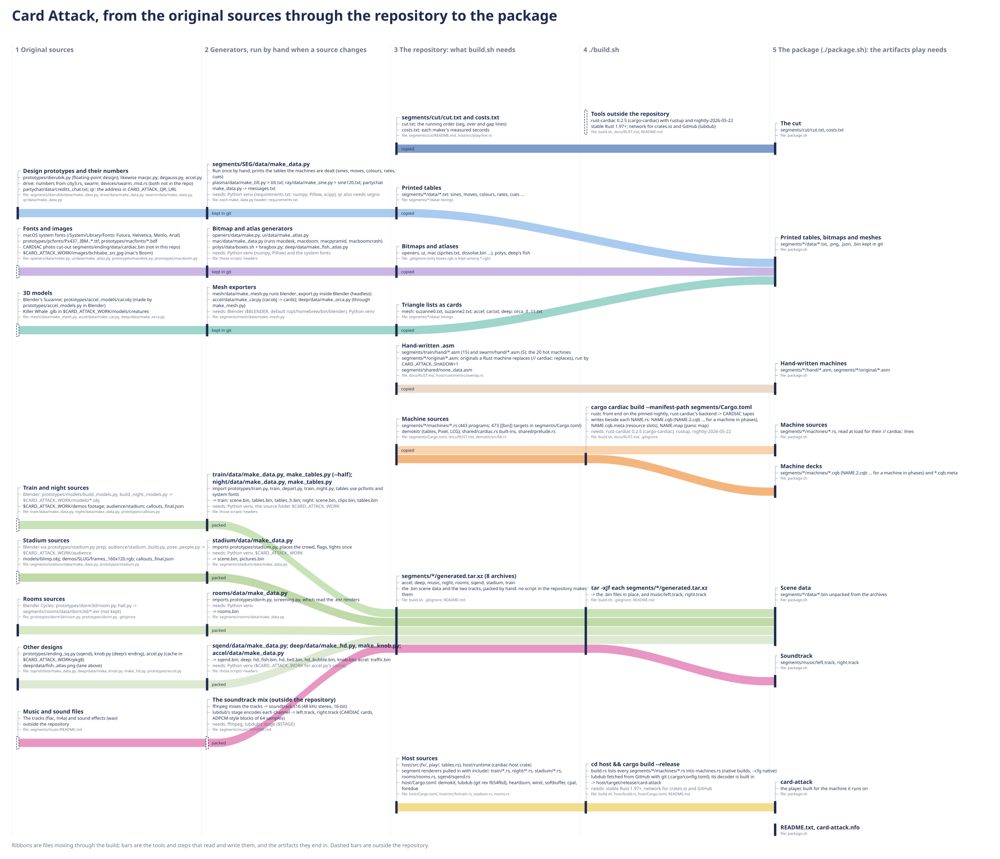

# Card Attack

A demo by Strange Query for Demosplash 2026 (21 November 2026, Carnegie Mellon), on CARDIAC. The film is computed
live on CARDIACs while it plays: machines work out the pictures' places, colours and light frame by frame, and two
more decode the soundtrack from its tapes. Pictures made ahead of time (photos, fonts, footage of other demos,
Blender and Python renders, printed tables) are assets that the machines place, light and mix; each segment's
README names its own. Every machine was written in Rust, compiled with
[rust-cardiac](https://github.com/StrangeQuery/rust-cardiac); twenty of the busiest were then written again by hand in
CARDIAC assembly, and those versions run in the film. `docs/RUST.md` says exactly what is compiled and what is
written by hand.

## System requirements

Card Attack has only ever been run on an M5 Ultra Mac Studio with 30 cores and 96 GB of RAM. Other machines and
platforms are untested.

- macOS on Apple Silicon.
- `play` uses all the cores but two (28 workers there; `--workers N` to change it). The schedule's costs
  (`segments/cut/costs.txt`) were measured there.
- Memory: a peak physical footprint of 26.8 GB, measured with `/usr/bin/time -l` on `play --dry-run --as-shown`
  (which lets each frame go on the film's clock, as the show does).
- Disk: about 1.6 GB once built.

To build it you need git, [rustup](https://rustup.rs) with stable Rust 1.97 or later,
[rust-cardiac](https://github.com/StrangeQuery/rust-cardiac) 0.2.5 or later (below; it fetches the nightly toolchain
its driver runs on with rustup, once), and a network connection (for crates.io and the lubdub decoder on GitHub). To
make a video of the film (below) you also need [ffmpeg](https://ffmpeg.org) on the PATH (`brew install ffmpeg`).

## Build

First install rust-cardiac 0.2.5 or later, the compiler the machines are built with, by following
[its README](https://github.com/StrangeQuery/rust-cardiac). Then check that it works by making and running its
countdown program in a scratch folder:

    cargo cardiac --version
    cargo cardiac new countdown
    cd countdown
    cargo cardiac run -q -- 3

The first command should print `cargo-cardiac 0.2.5` (or a later version), and the last should count down from 3
(the first time, it may also say what it downloads):

    3
    2
    1
    0
         halted after 58 instructions

If it does, build Card Attack:

    git clone https://github.com/StrangeQuery/card-attack
    cd card-attack
    ./build.sh

`build.sh` checks that `cargo cardiac` is 0.2.5 or later, unpacks the generated data (each segment's
`generated.tar.xz`), compiles every machine with `cargo cardiac build`, and builds the host.

The diagram follows every file from the original sources (designs, fonts, models, music) through the generators
run by hand and the archives they are packed in, to what the repository holds for `build.sh`, and on to the files
the package holds for `play`. Open it on its own to read it at full size.

## Package

After `./build.sh`:

    ./package.sh FOLDER

`package.sh` makes the copy that is submitted to the compo, about 935 MB: the host binary, `README.txt` and
`card-attack.nfo` and, beside them, what `play` reads from `segments/`. In it, `./card-attack play` runs the film on its own.
Zip the folder to submit it.

## Play

    host/target/release/card-attack play                 # the film, computed live, fullscreen with sound; Escape quits
    host/target/release/card-attack play --windowed      # in a window
    host/target/release/card-attack play --dry-run       # no window: computes the film as scheduled and says each segment's slack

`play` runs each segment the cut takes frames from on worker threads (one HEARTBURN each), the heavy ones split into
blocks of about half a second's work, into memory; a composer makes the cut's frames from them with the cut's own
machines; the window shows frame n at n/12 s. The soundtrack is decoded live by two more CARDIACs and goes to the
Mac's current output device. `--audio-offset MS` delays the sound for a projector that shows pictures late, `--mute`
plays without it, `--stop N` ends at frame N, `--lead SECONDS` waits longer before frame 0 (1 s by default).

## Making a video

After `./build.sh`:

    host/target/release/card-attack render OUT.mp4

`render` computes the film exactly as `play` does, on the same workers and the same machines, but writes each frame
to ffmpeg in order instead of showing it, as fast as the CARDIACs go rather than on the film's clock. The 192x96
frames are scaled up 8 x 8 with each pixel copied, so the video is 1536x768 and pixel-sharp. The sound is the one
`play` plays: the same two CARDIACs decode the soundtrack's tracks (`segments/music`) into a temporary file first,
padded with silence to the film's length (the soundtrack ends 83 ms before the last frame does), and the file is
deleted afterwards. ffmpeg encodes the result for YouTube and the like: H.264 (Main, yuv420p, CRF 17, a keyframe a
second) and AAC (320 kb/s, 48 kHz stereo), with the index at the front, the audio as long as the video. On the M5
Ultra it takes about two and a half minutes and the same memory as `play`; the file is about 195 MB. `--workers N`
changes how many workers compute the frames.

## Checking every frame

Each segment has an independent native renderer, `reference.rs`, and the host can check every frame CARDIAC computes
against it. This renders to disk (several GB of raw frames) and takes much longer than the show.

    ./refs.sh                                        # the references, into refs/
    host/target/release/card-attack all refs         # every segment, then the cut, each frame checked
    host/target/release/card-attack play --check     # the live film, compared frame by frame with that render

One segment: `host/target/release/card-attack SEGMENT refs/SEGMENT_ref`. `card-attack --native ...` also runs every
machine built natively, from the same Rust source, on the same cards, and stops if any card differs.
`CARD_ATTACK_SHADOW=1` runs each one-phase machine's hand-written original beside it. `PROFILE=file` counts
instructions per machine.

## Layout

`segments/` has a folder for each part of the film. In running order:

| Folder | What it is |
|---|---|
| [`openers`](segments/openers) | the five cards that open the film |
| [`mac`](segments/mac) | the cold open: a Mac Classic's one-bit screen, Boom running in a window |
| [`turn`](segments/turn) | the camera pulls back from the Mac and turns to the PC; the CGA |
| [`bbs`](segments/bbs) | a BBS's message reader in ANSI text, in front of the [`tumble`](segments/tumble), the [`dierubik`](segments/dierubik) and the [`roto`](segments/roto)zoomer |
| [`rotodg`](segments/rotodg) | the degauss at the rotozoom's end, into the VGA plasma |
| [`vga`](segments/vga) | the climb from the EGA to the VGA, over the [`plasma`](segments/plasma) |
| [`modex`](segments/modex) | the ray-traced mirror ball over the plasma floor in Mode X |
| [`rooms`](segments/rooms) | two pull-backs out of the picture: the dorm and the screening hall |
| [`polys`](segments/polys) | a nod to Complex's Dope: a morphing Phong-shaded blob |
| [`accel`](segments/accel) | the drive, first in software, then 3D accelerated |
| [`deep`](segments/deep) | underwater: a kelp forest, the drop-off, the canyon |
| [`train`](segments/train) | the bullet train's cab ride |
| [`night`](segments/night) | the train's night arrival |
| [`stadium`](segments/stadium) | the stadium party, with the [`partychat`](segments/partychat) carrying the credits |
| [`qr`](segments/qr) | one frame: a QR code |
| [`sqend`](segments/sqend) | the SQ in silver chrome |

Folders the segments above use:

| Folder | What it is |
|---|---|
| [`cut`](segments/cut) | the running order (`cut.txt`), the layers over segments, the measured costs |
| [`ui`](segments/ui) | the UI kit: full-resolution layers painted on CARDIAC, for the cut's `over` lines |
| [`shared`](segments/shared) | machines and data more than one segment uses, and the machine prelude |
| [`swarm`](segments/swarm), [`cube`](segments/cube), [`drive`](segments/drive), [`ray`](segments/ray), [`rubik`](segments/rubik), [`mesh`](segments/mesh), [`titles`](segments/titles) | machines and data from earlier parts, used by the segments above |
| [`music`](segments/music) | the soundtrack's two tracks, decoded live |

Each segment's folder holds a `README.md` (what it shows, why it is hard on CARDIAC, how it is done), `machines/`
(its Rust machines), `reference.rs` (the independent native renderer that checks it) and `data/` (with the `make_*.py`
that made it). A few hold `original/` (the hand-written CARDIAC machines some Rust ones replace, which
`CARD_ATTACK_SHADOW=1` runs beside them) or `hand/` (machines written by hand for speed, most of them run in a Rust
machine's place). The host code that runs it is `host/src/fx/`.

Outside `segments/`:

- `demokit/`: integer-only building blocks (`Pixel`, the lookup tables, the LCG) shared by the machines and the
  references; the host uses its tables only. `cargo test` in it checks every table against its definition.
- `host/`: the host, in Rust. It keeps the schedule (which frame of which segment comes next), deals cards in,
  carries punched cards from one machine to the next, fetches from tables at the places machines punch, and files
  the frames. `host/runtime/` (the `cardiac-host`
  crate) is the part any CARDIAC demo could use. `host/src/` is Card Attack's own: its segments (`fx/`), the
  player (`play/`), and every machine built natively (`machines.rs`, listed by `build.rs`).
- `prototypes/`: the designs some segments were made from; their data generators import most of them.
- `docs/`: `RUST.md` (what is compiled Rust and what is written by hand), `STYLE.md` (how a machine is written),
  and the performance notes.

The machines are one Cargo package, `segments/Cargo.toml`: each machine is a binary target there, and demokit a
dependency. `build.sh` compiles them all; one machine:

    cargo cardiac build --manifest-path segments/Cargo.toml --bin NAME

The data generators are Python (`python3 -m venv .venv && .venv/bin/pip install -r requirements.txt`); some need
Blender or source material that isn't in the repository, which is why their output is kept, packed, beside them.
