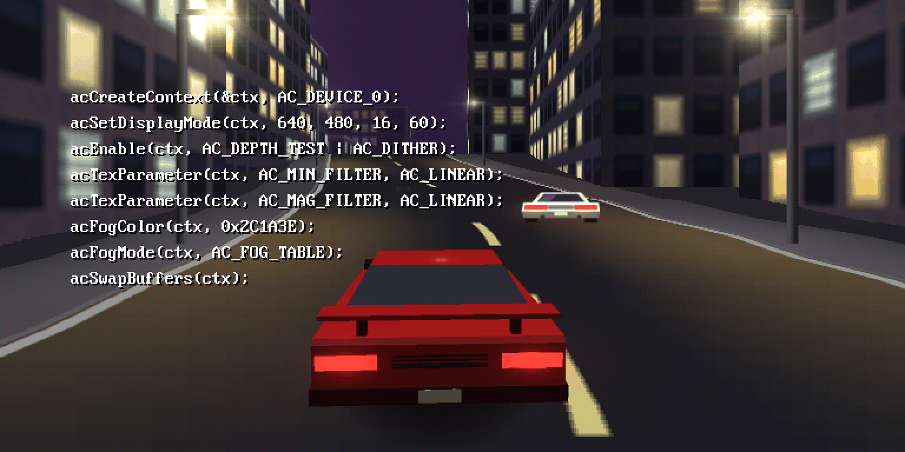

# Accel

## What it shows

A drive through a city at night, on a street that twists and climbs and dips the whole way, first as a software
renderer draws it (192x96, ten levels a channel, hard edges, the nearest texel). At 5.5 s the VIDEO OPTIONS menu
comes up over it (the UI kit's layer `ui/videoopts.rgba`, laid on by the cut) and the drive goes on under it,
dimmed, while the pointer sets **3D Accelerator** and Apply. Five black frames follow, and the same street comes back
accelerated: 768x384 shown 2 x 2, 16-bit through a 4 x 4 ordered dither, bilinear walls, anti-aliased edges, purple
haze, glows round every light, a bloom, lens flares, and ghosts down the strongest headlights. The calls
(`acCreateContext ... acSwapBuffers`, the text kit's ACCEL page) sit over the first 2 s and fade over one. Our car (a
mesh from Blender, drawn by the [mesh](../mesh) kit) climbs to a crest, takes it flat out and flies, the camera
rising after it and the view tilting down over the drop, and it lands with sparks at the accelerated half's frame 56.

The segment renders 113 frames at 192x96 (66 before the menu, 47 under it) and 118 at 1536x768. The film shows all
113 of the first, 5 black frames, and the first 59 of the accelerated half (4.9 s): there the [rooms](../rooms)
segment pulls back out of the picture into the screening hall, and the accelerated drive's frames from 59 on play on
the hall's screen, with the brag (`ui/accelbrag.rgba`: 640 x 480 / 16-BIT BILINEAR / 3D ACCELERATED) over them.

**In the cut:**

    seg accel accel/video.rgb 0 113 192x96
    over ui/videoopts.rgba 1197x628 339 140 66 47
    gap 5
    seg accel accel/video_hd.rgb 0 59 1536x768

## What runs on CARDIAC and what the host does

Almost every number in the picture is worked out on CARDIAC machines. That covers the camera's path, height and
turn, every ray, the march out along the street, the walls and their texels, where each lamp post, car and the jet
stands and how big it is drawn, every depth test and every blend, the haze, the glows, the bloom, the flares and the
ghosts, our car's jump, its shadow and its sparks, the 16-bit dither and the software half's ten levels. The jump's
sums (the swarm's calculator) and the mesh kit that draws our car are CARDIAC machines too. The host does some
arithmetic of its own, and the list below says where.

The host (`host/src/fx/accel.rs`, `accel_hd.rs` and `accel_jump.rs`) does this between the machines:

- It deals each machine its deck and carries the cards one machine punches to the next.
- It fetches table entries at the indexes the machines punch: the lane's wobble and swerve, the street's plan and
  grade, the cross-section, the pools' falloffs, the wall texture, the glow, falloff and ghost profiles, and the
  DAC's levels. Many of those indexes it finishes itself, by adding: the next entry after the one punched (`+ 1`),
  the entry a march step reaches (the camera's entry plus the step's), a block's row of faces (ten cards a block),
  a texel's place in its bay or roof (by the tone, the end wall and the kind, then 12 times the column across plus
  the row up), a traffic sprite's pixel (the sprite's start plus 8 times the sum of its row times its width and
  its column), and the dither's threshold by the pixel's place in the 4 x 4 matrix (its row and column, each mod 4). It holds the index
  of the landing's falloff table at 191, the table's last entry.
- It puts the lamp posts and the traffic in order far to near by the distance `dalong` punched, on the card sorter
  (`host/src/sorter.rs`). For the walls it gathers the
  candidates that land on each pixel, in the order they were drawn, and `anear` picks the nearest.
- It reuses output. The machines that work each item of a deck alone punch the same cards for the same input, so
  the host runs each distinct input once and copies the cards to its repeats. Where a blend's two inputs are the
  same colour (two texels, two texel rows, or all four of our car's samples: their differences on `asum`, each
  against 0) the host copies that colour, which is what the blend punches for it.
- It places pixels. It turns a machine's row and column into a place in the frame, adds the offsets to a light's
  or a picture's pixel to find where each glow, flare, ghost, shadow and sprite pixel lands, and drops the ones that
  fall off the screen. A glow, the shadow's ellipse and a ghost are worked out on one side of their middle and
  mirrored to the other by the host. The host works out how far out from a light's pixel a glow can still land on the
  screen (from the light's place and the screen's edges) and asks the machines for only those offsets; a flare's
  box is the places its ways out give (as far as the reach `afway` punched), held to the screen by the host, and a
  ghost's is its middle less and plus its radius on `asum`, held to the screen. The calls'
  shadow is the letters' pixels 3 down and 3 across.
- It makes a few signs and choices itself. `amoff` is dealt the sign of the ray's across part, which the host finds by comparing it with 0. A
  traffic sprite is the stored one whose width is the first at least as wide as `atwth` punched, found by the
  host's comparisons.
- It leaves some things out by comparing the machines' numbers itself. A light makes a glow only if its strength is
  over 10; lamps and headlights make flares only if it is over 60; the ghosts come only from the strongest light,
  when that is a headlight over 225. A spark is not drawn if a place of its head or tail on the screen reaches
  990 or -990 pixels. The ten brightest sparks light up, put in order on the card sorter by the
  brightness the sums punched.
- It picks by frame number what the frame calls for: which part of the jump the frame is in, which sparks are
  alight (the frame less each spark's first frame, from 0 to 7), and whether the calls show. The frames since the
  landing (`f - F_LAND`) are worked out by the sums, for the landing's wag and pitch and the car's height as it
  lands.

Assets made ahead of time are used as demos have always used them:

- **Our car** is a mesh modelled in Blender (`prototypes/accel_models/car.obj`), turned into cards by
  `data/make_car.py`. The mesh kit's machines place, light, depth-test and draw it.
- **The traffic's sprites** (`traffic.bin`): each body, from behind and from the front, drawn from the design and
  stored at every width the drive can ask for. `atwth` punches how wide a car is to be drawn; the host takes the
  stored sprite of that width (or the next wider one stored), `asamp` punches which of its pixels each screen pixel
  shows, and the machines haze it (`amix`) and lay it over the scene where it is nearer (`apaint`).
- **The jet's sprites** (`data/jet.txt`): one for each of the 36 frames it is in the sky, drawn from the design at
  the size the machines work out for that frame. The machines punch which frame's sprite to use and where it goes,
  and lay it on.
- **Tables** printed by `data/make_data.py` from the design: the street's plan and grade, the blocks and the
  traffic's starting places, the wall texture and the palette, the street's colours, the pools' falloffs, the
  march's steps, the cross-section, the quarter-wave sine and the swerve the lane is worked out from, the glow's
  profile, the flares' falloff and its logarithm, the ghosts' profiles, the 4 x 4 dither, the DAC, the software
  half's levels, and the sparks' launch numbers (the design's random numbers). The turn table (cosine and sine for
  each slope) is the [drive](../drive)'s.

## Why it's hard on CARDIAC

- **It's a 3D scene with a moving camera.** Every column of the street needs a ray, every block a ray-to-wall test,
  every pixel of the road the point where its ray meets the ground, and the street turns, climbs and dips under it.
  All of that is multiplying and dividing, done by adding and subtracting.
- **Screen places don't fit a card.** 768 columns in eighths of a pixel is 6,144; a card holds 999.
- **The accelerated look is blending everywhere.** Bilinear texels, anti-aliased edges, haze, glows, a bloom and
  lens flares are all mixes of colours, each a product a card can't hold.
- **96 cells a machine.** The work is cut into 106 machines of its own, with the [drive](../drive)'s 11, the mesh
  kit's and the swarm's arithmetic.
- **Random access is out.** A machine can't hold a frame, the street's plan or a texture; the machines punch
  indexes and the host fetches the entries.

## How it's done

`reference.rs` (with `hd.rs` and `jump.rs`) draws the beat in ordinary Rust, whole numbers only, every division
saying how it rounds and every number a machine holds within a card. It is the spec, and was compared frame by
frame with the design (`prototypes/accel.py`, look A). `host/src/fx/accel_hd.rs` and `accel_jump.rs` do the same
on CARDIAC, the numbers punched by machines except where the list above says the host works them out; `accel.rs`
files the two halves and lays the calls on.

- **The camera's path and our car's lane.** Where across the street the camera and our car are each frame, in
  eighths: 2.5 units, less 4 units times the swerve past the slow car ahead, plus a wobble of 0.4 sin(1.7 t). The
  camera follows the car 3 frames behind, so one run gives both. `aphase` steps the wobble's phase (22.547 steps of
  a 1000-step turn a frame) and punches its place in the quarter-wave table (`data/lanesine.txt`) and its sign;
  `aswerve` punches which entry of the swerve's table (`data/laneswerve.txt`) applies; the host fetches them, and
  `alane` adds them up and rounds. The three machines run once, on CARDIAC, at the start of the segment's render,
  for all 243 frames from the camera's first to the car's last, and every frame reads its place from that run. The
  camera's height on the grade is `acam`'s, and its rays across and along the street `aray`'s (the along rays from
  the negated sine, chosen by a third card).
- **What's nearer.** The walls are laid over the street where they are nearer, in both halves. The host gathers
  the wall pixels that land on each pixel of the frame, keeping their order, and deals them with the pixel's own
  distance to `anear`, which punches the winner; the host copies the winner's colour and distance in. Lamp posts,
  cars and the jet are laid on by `apaint`, which makes the same test for each pixel itself. Our car takes over a
  pixel's distance where it covers at least 3 of the pixel's 4 samples (`athree`).
- **The street.** At 25 sample columns the ray is marched out (`amz`, `amx`, `afine`, `amoff`, dealt the ray's
  sign by the host; `amul` and `amrow`
  the row of each step; `amlamp`, `ampool` the lamps' pools and the haze; `amrows`, `amnum`, `amlerp` each row's
  ground between steps). Between the columns each row's numbers are carried across (`asrow`, `asgap`, `asdash`,
  `around`). Each pixel's place in the cross-section is `asmat`'s (`data/cross.txt`); the partly covered ones are
  found by their covers (`aswide`, `aslong`, `asedge`, `ascov`, `ascut`, `akover`) and mixed (`amix`).
- **The walls.** Each column's ray is tested against the blocks' faces by the drive's `dface`, `dlat` and `dhit`;
  where along each it meets and how big a texel is there are `awprep`, `awq`, `awfar`, `awx`, `awtf`, `awte` and
  `awfoot`'s; the rows from the lowest open one up are `awclip`, `awalk` and `awup`'s; the texels (`awbay`,
  `awtex`) are blended across (`awblend`) and up (`awcol`).
- **What stands in it.** Lamp posts and the traffic, far to near: the drive's `dlamp`, `dcarx`, `dmul` and
  `dalong` place them, and `acarz`, `athvis`, `athx`, `afog`, `aweight`, `ay8`, `apost1` to `apost4`, `apcol`,
  `apshade`, `ashade`, `apaint`, `aarm`, `alamp` and `a810` draw them. The cars are sprites: `atwth` punches how
  wide each is drawn, `asamp` which of the sprite's pixels each screen pixel shows, and `acarxy` where its corner
  goes. Their lamps are `alin`, `apair`, `aadd2`, `asum` and `ahalf`'s. The jet's sprite crosses the sky
  (`data/jet.txt`): `ajflags` says whether it is in view and which of its lamps are lit, and `ajk`, with `asum`,
  `amul` and `aadd2`, works out where it is and how big.
- **The jump** (`jump.rs`, `accel_jump.rs`). The path, the camera's height and the view's tilt (a shear: the
  horizon moved) are worked out by the swarm's sums (exact sums of products, divisions rounded down, the sine
  table). Our car is drawn by the mesh kit, flat shaded, a material a face, at twice the size: four samples a
  pixel, averaged by `aavg4`. Its shadow is `ashu`, `ashk`, `aghs` and `amix`'s; the sparks where it lands
  (`data/sparks.txt`, the design's random numbers) are `asaxis`, `asfade`, `ageq` and `aflabs`'s.
- **The lights.** Each light's glow is its profile (`data/glowt.txt`) times its amount (`agparam`, `aamt`,
  `agtab`), by how far out each pixel is (`agaxis`, `agpt`: an octagon), summed (`agsum`). The bloom is `abthr`,
  `abox`, `abmix` and `abadd`'s; the flares' streaks and stars are `aflp`, `apart`, `aflv`, `aflax`, `afway`,
  `afsq` and `aflrow`'s, and the ghosts `aghc`, `aghg`, `aghu` and `aghs`'s.
- **The 16-bit frame** is `adither`'s, through the card's DAC (`data/dac.txt`).
- **The software half** is the same pipeline at the middle of each 4 x 4 block only (`asrow4`, `asrun`, `asg4` for
  the street's rows), marched coarser (`data/steps_soft.txt`), with hard edges, the nearest texel and the car drawn
  by the kit at 192x96. It is quantised to ten levels through the ordered dither (`asql`, `asqp`,
  `data/softq.txt`) and dimmed under the menu (`adim`: 11 v / 20).

`card-attack accel refs/accel_ref` says identical to native Rust 113/113 (192x96) and 118/118 (1536x768).

**Instructions:** 18,793M for the whole render, 1.71 million machine runs: the software half 3,406M for its 113
frames (30M a frame), the accelerated half about 15,387M for its 118 (130M a frame). The costliest machines are the
walls' `awcol` (2,382M), the street's `asrow` (1,802M) and the march's `amul` (1,710M). The mesh kit's machines take
1,109M, the swarm's sums 570M and the drive's machines 533M.

Switches, for building and checking (the reference takes the same): `ACCEL_STAGES` (1 the street and sky, 2 the
walls, 3 what stands in the street and the jump, 4 the glows, 5 the bloom, 6 the flares, the default),
`ACCEL_FRAMES` and `ACCEL_SOFT_FRAMES` (only the first N of each half; the render then files only those). `card-attack
accel_dump F` prints the march's rows at frame F as `refs/accel_ref segments dump F` does; with `ACCEL_RGB=1` it
writes the accelerated frame instead (as `refs/accel_ref segments hd F F+1`), with `ACCEL_SOFT=1` the software frame
(as `... soft F F+1`). Debug prints: `ACCEL_WALL=x`, `ACCEL_STEPS=x`, `ACCEL_THINGS`, `ACCEL_LIGHTS`, `ACCEL_CAM`,
`ACCEL_POSE`, `ACCEL_SHADOW`, `ACCEL_SPARKS`, `ACCEL_PIX=i`.

## Machines

Cells per machine (96 at most; a machine in two phases gives its data, then each phase's code).

| Part | Machines (cells) |
|---|---|
| The camera, the lane, what's nearer | `aphase` 84, `aswerve` 73, `alane` 57, `acam` 81, `aray` 95, `anear` 46, `athree` 39 |
| The march | `amz` 7 + 26 / 59, `amx` 4 + 37 / 48, `afine` 83, `amoff` 83, `amul` 93, `amrow` 92, `amlamp` 95, `ampool` 74, `amrows` 95, `amnum` 55, `amlerp` 93 |
| The street's rows and covers | `asrow` 81, `asgap` 74, `asdash` 64, `around` 18, `asmat` 58, `aswide` 46, `aslong` 71, `asedge` 37, `ascov` 92, `ascut` 75, `akover` 54, `amix` 86 |
| The walls | `awprep` 44, `awq` 85, `awfar` 71, `awx` 60, `awtf` 54, `awte` 55, `awfoot` 88, `awclip` 17, `awalk` 82, `awup` 88, `awbay` 42, `awtex` 66, `awblend` 73, `awcol` 87 |
| Lamp posts and traffic | `acarz` 87, `athvis` 83, `athx` 56, `afog` 50, `aweight` 39, `ay8` 52, `apost1` 93, `apost2` 86, `apost3` 44, `apost4` 84, `apcol` 65, `apshade` 88, `ashade` 66, `apaint` 82, `aarm` 84, `alamp` 91, `a810` 17, `atwth` 35, `asamp` 38, `acarxy` 79, `alin` 34, `apair` 36, `aadd2` 67, `asum` 24, `ahalf` 38 |
| The jet | `ajk` 70, `ajflags` 49 |
| The jump, its shadow and sparks | `aavg4` 90, `ashu` 52, `ashk` 46, `asaxis` 71, `asfade` 78, `ageq` 22, `aflabs` 29 |
| Glows, bloom, flares, ghosts | `agparam` 73, `aamt` 63, `agtab` 49, `agaxis` 66, `agpt` 27, `agsum` 31, `abthr` 25, `abox` 67, `abmix` 59, `abadd` 30, `aflp` 82, `apart` 36, `aflv` 43, `aflax` 40, `afway` 23, `afsq` 48, `aflrow` 49, `aghc` 77, `aghg` 80, `aghu` 56, `aghs` 24 |
| The frame and the software half | `adither` 28, `asrow4` 89, `asrun` 59, `asg4` 70, `asql` 85, `asqp` 21, `adim` 41 |
| From other folders | the [drive](../drive)'s 11, the [mesh](../mesh) kit's (`mesh_front`, `mesh_tone`, `mesh_mix`, `mesh_walk`, `mesh_depth`, `polydot`), the [swarm](../swarm)'s sums, the UI kit's `ui_page`, `ui_ease` and deep's `umix` |

## Where it differs from the design

The design (`prototypes/accel.py`) is written in floating point. The segment works in whole numbers that fit a
card, with machines of at most 96 cells, and these are the choices that follow from it.

- The design's formulas are taken in whole-number forms: the march's steps, the glow's octagon (max + 3 min / 8
  for a circle), the flares' streak and star terms (each a quotient, at most 192 along the falloff's table), and the
  ghosts' centres at whole pixels with their profile by 16ths of the radius on each axis.
- The camera's path and our car's lane are whole eighths, worked out by `aphase`, `aswerve` and `alane`. They
  differ from the design's floating-point path by one eighth on one frame each, at the bottom of the swerve.
- Our car turns by a yaw and a pitch, the two turns the mesh kit takes, so the design's roll in the air and its bob
  are not drawn. Headings and grades are taken as their tangents, as the angles are small. The landing falls on the
  drive's frame 174 (the design's 173.85). The camera follows the car's height at frames f - 1 and f - 2, halved
  (the design's f - 1.5). The highlight is the kit's table (power 32; the design's 24), with one half-way vector
  for the whole car. A pixel takes 2 x 2 samples (the design's 3 x 3). The shadow's ellipse lies along the street
  (the design's along the car). The tail lamps' glow is always full; the design dims it as they turn away, which
  they hardly do.
- Things more than 600 pixels off the screen's middle, and car lamps more than 990 across, are culled. The furthest
  slow car starts at 999 quarters, the most a card holds (the design's 1000).
- The software half is the accelerated half's pipeline sampled at the middles of its 4 x 4 blocks, an eighth of a
  192x96 pixel from the design's pixel middles, with a coarser march.

## Making it

    python segments/accel/data/make_data.py          # the tables and sprites (traffic.bin is not kept in git)
    python segments/accel/data/make_car.py           # car.txt, car_mats.txt from prototypes/accel_models/car.obj
    ./build.sh                                       # the machines, among the rest
    ./refs.sh                                        # refs/accel_ref, the reference
    host/target/release/card-attack accel refs/accel_ref

## Files

- `reference.rs`, `hd.rs`, `jump.rs`: the reference.
- `machines/`: the 106 machines.
- `data/make_data.py` prints the assets from the design, `prototypes/accel.py`: the street's plan and grade, the
  blocks, the traffic's starting places and its sprites, the palette, the cross-section, the march's steps, the
  tables (glow, falloff, ghosts, dither, DAC, the software levels), the jet's sprites, the sparks' launch numbers,
  and the tables the camera's path and our car's lane are worked out from. `data/make_car.py` makes our car's
  cards from the Blender mesh. `traffic.bin` is packed in `generated.tar.xz`.
- Host: [`host/src/fx/accel.rs`](../../host/src/fx/accel.rs), [`accel_hd.rs`](../../host/src/fx/accel_hd.rs) and
  [`accel_jump.rs`](../../host/src/fx/accel_jump.rs). It files `video.rgb` and `video_hd.rgb` (not kept).
