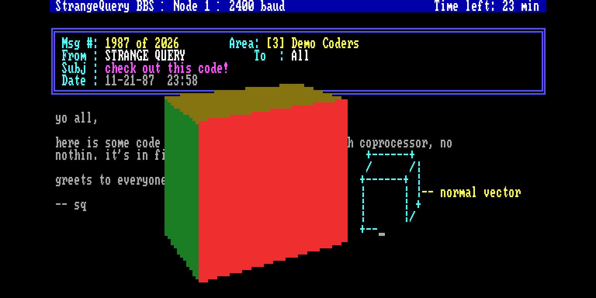

# The BBS

## What it shows

After the [turn](../turn) to the PC and its CGA tunnel, a BBS's message reader in 80-column ANSI text, the IBM CGA's 8x8 font in its sixteen colours,
each pixel 2 x 4 on the frame (1280x768, centred): the StrangeQuery BBS's bar, a post to the demo coders' area from
STRANGE QUERY, "check out this code!", arriving at 2400 baud (20 characters a frame), the cursor blinking. In front of
it, the [tumble](../tumble)'s cube (its frames 14..147), then [the die and the Rubik's cube](../dierubik): the cube
comes back a die, splits into a Rubik's cube that solves itself tumbling, pops. The page crossfades into the
[rotozoomer](../roto) behind the cube (eight frames), and the cube roams on in front of the rotozoomer. From the
rotozoomer's 37th frame the picture wobbles: each row pushed sideways by up to 5 pixels, a wave 40 rows long rolling
0.5 radians a frame, growing in over 15 frames. The prototypes were `bbs.py` and `fullcut.py`, which are not in
this repository.

It is two renders. `bbs` files `video_hd.rgb` (1536x768, 272 frames: 134 of the tumble, 130 of the die and the
Rubik's cube, 8 of the crossfade) and `bbsroto` files `video.rgb` (192x96, 72 frames over the rotozoomer, its frames
50..121; the wobble from the 37th). The cut shows all 272 of the first and the first 36 of the second; the
[degauss](../rotodg) shows the next 28 (the wobbling ones) under its blotch and jolt.

## Why it's hard on CARDIAC

- **Text is a font,** and the page is 1280x768 pixels on the frame.
- **Laying one picture over another** needs to know where the cube is: the tumble and the die were drawn on black.
- **A crossfade is a product a pixel,** at 1536x768.
- **The wobble is a sine a row,** times a growing amplitude, rounded to pixels.

## How it's done

- **The page** is the UI kit's (`ui/pages.rs`'s `BBS`, `fx/text.rs`): `ui_page` places each character that has
  arrived and the cursor after the last; the host fetches each glyph's cell from the atlas's IBM CGA face by its code
  (the box's double lines and the bar's divider appended to the atlas); deep's `umix` lays its ink and paper on. How
  many characters have arrived, 20 a frame from the seventh, is `ui_ease`'s (900 j / 45), held at the page's 891 by
  `rb_hold`. A page is drawn on CARDIAC the first frame it is needed, and the host copies it when a later frame shows
  the same number of characters and the same blink.
- **Where the cube is:** `dr_key`, per row of the cube's frame, punches 1 for each pixel that isn't black. The host
  copies the cube's pixel there (8 x 8 on the 1536x768 frame) and the picture's elsewhere.
- **The crossfade** into the rotozoomer (its frames 42..49) is the kit's: each pair of pixels that meets mixed once on
  `umix`, by `ui_ease`'s cover (32 j / 9).
- **The wobble:** `dr_clock` gives each row's angle in tenths of a degree (90 a row, 3313.521 a frame, -0.5 radians),
  `rb_sine` its sine (the rubik segment's table), `dr_wobble` the push: 5 g / 15 times the sine, g the frames into the
  wobble held at 15 (`rb_hold`), rounded half away from zero. The host works out each pixel's source column itself,
  the column less the push, wrapped round the row's 192 pixels, and copies that pixel.

The cube's frames are read from the [tumble](../tumble)'s render (`tumble/video.rgb`), the die's
(`dierubik/video.rgb`) and the rotozoomer's (`roto/video4.rgb`); none of them is changed.

**In the cut:**

    seg bbs bbs/video_hd.rgb 0 272 1536x768
    seg bbsroto bbs/video.rgb 0 36 192x96
    seg rotodg rotodg/video_hd.rgb 0 36 1536x768

The [turn](../turn) runs before it, and the degauss after it.

`card-attack bbs refs/bbs_ref` says identical 272/272; `card-attack bbsroto refs/bbs_ref` 72/72.

**Instructions:** `bbs` 800M for 272 frames (2.9M a frame: `umix` 621M, the pages' inks and the crossfade; `dr_key`
177M; `ui_ease` and `ui_page` 2.5M); `bbsroto` 63M for 72 (`dr_key` 46M, the wobble's `rb_sine` 9M, `dr_clock` 7M and
`dr_wobble` 0.7M).

## Against the prototype

The tumble's frames over the page are the prototype's to the pixel, the page and the cursor's blink included. The
die's and the Rubik's cube's are [theirs](../dierubik). The crossfade steps in 32nds, not 9ths, and rounds toward
zero. The wobble's pushes are the prototype's (its float sine rounded, ours from the table rounded half away from
zero; the same on every row of every frame). The bar's "³" is drawn as the prototype draws it: the font has no such
character, and shows two dots (perhaps "│", CP437's 179, was meant).

| Number | Largest | Margin |
|---|---|---|
| A place on the page (`ui_page`) | 632 | 367 |
| Characters arrived | 891 | 108 |
| `dr_wobble`: its rest, below 999 | 998 | 1 (by construction) |
| A row's angle (tenths, as quarter and rest) | 899 | 100 |

## Machines

None of the machines is in this folder: the BBS borrows them.

| Machine | Cells | What it does |
|---|---|---|
| `dr_key` (the [die's](../dierubik)) | 28 | Per row of the cube's frame: 1 for each pixel that isn't black |
| `dr_clock` (the die's) | 87 | Per row: the wobble's angle, in tenths of a degree |
| `rb_sine` (the [rubik](../rubik) folder's) | 93 | The angle's sine, from the printed table |
| `dr_wobble` (the die's) | 72 | Per row: the push, 5 g / 15 times the sine, rounded |
| `rb_hold` (the rubik folder's) | 36 | The characters arrived, held at the page's end; the wobble's growth, held at 15 |
| `ui_ease`, `ui_page` (the [UI kit](../ui)'s) | 90, 83 | How many characters have arrived and the crossfade's covers; each character's place on the page |
| `umix` (the [deep](../deep)'s) | 83 | The glyphs' ink and paper, and the crossfade |

## Files

- `reference.rs`: draws both videos in ordinary Rust (the page by `ui/text.rs`), from the cube's and the rotozoomer's
  renders. Args: the demo folder, then `hd` or `roto`.
- Host: [`host/src/fx/bbs.rs`](../../host/src/fx/bbs.rs). It files `video_hd.rgb` and `video.rgb` (not kept).
