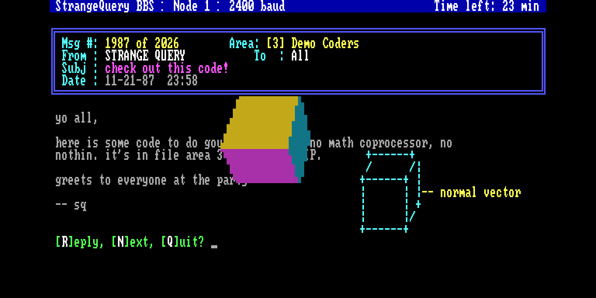

# Cube

This folder holds the machines that turn, light and draw the [tumble](../tumble)'s cube. The cube once had a segment
of its own, an opening where a square tipped, spun and turned out to be a cube; that segment is no longer in the
film, and only its machines are used now. The tumble runs every one of them, and the [BBS](../bbs) lays the tumble's
frames over its message page, which is where they appear in the film. The screenshot is the BBS's frame 74.

## The machines

| Machine | Cells | What it does |
|---|---|---|
| `tm_turn` | 58 | Per frame: the cube's angle, in 60ths of a turn, from the frame's number |
| `tm_axis` | 57 | Per frame: the axis it turns about, and the tilt |
| `tm_path` | 71 | Per frame: whether the cube travels, the path's three steps, and the lens |
| `tm_levels` | 84 | Per frame: the faces' fizzle level, the rotozoomer's dissolve level and frame, the cube's dissolve level |
| `vtx` | 4 data + 41 / 61 (two phases) | Per frame: the cube's eight corners turned by the angle about the axis |
| `project` | 46 | The corners shifted for the tilt, so the front, top and right side show |
| `esort` | 81 | The corners into the 12 edges, each from its top end to its bottom end |
| `gather` | 50 | Three corners of each face |
| `fshade` | 91 | Each face's signed area from a cross product: hidden or not, and its light |
| `palette` | 34 | Each face's colour times its light, by repeated adding |
| `comp` | 29 data + 58 / 56 (two phases) | Per row: the wireframe's codes, fizzled in by an ordered dither |
| `fspan` | 24 data + 49 / 59 (two phases) | Per row: each face's span, from its edges' spans |
| `solid` | 17 data + 29 / 50 (two phases) | Per row: the visible faces laid into the wireframe's codes, fizzled |

`tm_turn`, `tm_axis`, `tm_path` and `tm_levels` work out each frame's angle, axis, path and levels from its number.
The tumble's own machines (`path`, `persp`, `gather4`, `facing`, `project4`,
`raster4`, `cover`) do what this set can't at twice the size: see its [README](../tumble).

## How they work

- **Turning with additions only.** `vtx` reads an angle index A (0-59), an axis, and a 60-entry sine table, and
  keeps sin A and cos A = sin(A + 15). The cube's corners sit at ±1 before scaling, so every product is plus or minus
  the sine or cosine. The tumble deals it the table scaled to 24 for the cube it draws and scaled to 12 for the small
  cube it lights the faces from. [CUBE_ROTATION.md](CUBE_ROTATION.md) says why the table has 60 entries.
- **Lines with additions only.** The edges are stepped down a row at a time with an error term, Bresenham's way
  ([Bresenham, 1965](https://ibm1401.computerhistory.org/Pics3/bresenham1965.pdf)).
- **Hidden faces.** `fshade` takes the cross product of two of a face's edges: a negative area faces us, and its size
  is how squarely the face faces us, so it is also the face's brightness with the lamp at the eye
  ([back-face culling](https://en.wikipedia.org/wiki/Back-face_culling)).
- **Fizzle.** `comp` and `solid` show a pixel when the level passes its threshold, which steps by 7 mod 16 from pixel
  to pixel ([ordered dithering](https://en.wikipedia.org/wiki/Ordered_dithering)).

`vtx`, `comp`, `fspan` and `solid` are too big for memory in one piece. Each runs in two phases: it loads its second
half over its first, and keeps its data.

**Instructions** in the tumble's 201 frames: `comp` 734M, `solid` 281M, `fspan` 113M, the rest of this folder's
machines together about 2.3M.

## Files

- `machines/`: the thirteen machines above.
- `original/`: the hand-written CARDIAC versions of the one-phase machines `project`, `esort`, `gather`, `fshade` and
  `palette` (`CARD_ATTACK_SHADOW=1` runs each beside its Rust machine).
- `CUBE_ROTATION.md`: why the sine table went from 24 entries to 60.
- The cube's corners, edges, faces and colours are in [`host/src/tables.rs`](../../host/src/tables.rs), with its sine
  tables, which the host builds when it starts;
  the host code that runs these machines is [`host/src/fx/tumble.rs`](../../host/src/fx/tumble.rs).
