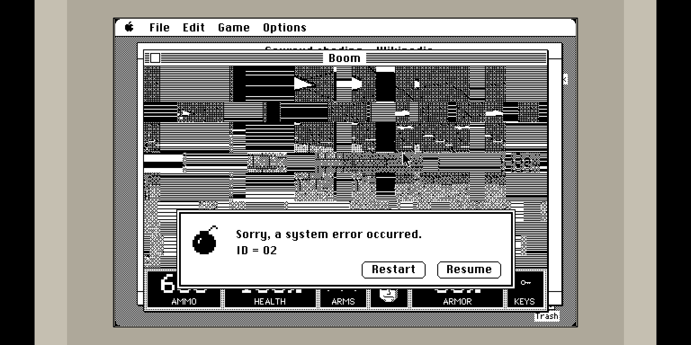

# The cut

The running order: every segment in sequence, and the layers laid over some of them. This isn't a segment of its
own: it is what the segments add up to, 3,419 frames, 4:44.9 at 12 frames a second.

## What it does

[`cut.txt`](cut.txt) lists the segments, one line each (`seg NAME VIDEO START COUNT SIZE`): the video to take frames
from, where to start, how many, and the size it was drawn at, `192x96` or `1536x768` (and `reverse` after it plays the
frames backwards). Between and under them it can say more:

| Line | Meaning |
|---|---|
| `stutter N1 N2 ...` | Cut back and forth into the next segment: beats of N1, N2, ... frames, this segment's last frame, then the next segment's own frames as it runs on underneath, and so on (the two overlap by the total) |
| `hold N` | Hold the segment's last frame N frames more |
| `gap N` | N black frames after it |
| `freeze AT N` | Hold the segment's frame AT for N frames more; it carries on after |
| `repeat AT F1 F2 ...` | After the segment's frame AT, show its frames F1, F2, ..., then carry on from AT + 1 |
| `unpixelate N8 N4 N2` | On a 1536x768 segment: its first N8 frames averaged over 8 x 8 blocks, the next N4 over 4 x 4, the next N2 over 2 x 2, then sharp |
| `over FILE WxH X Y AT LEN` | A full-resolution layer over the segment's own frames AT..AT+LEN, placed at X, Y of the 1536x768 frame |

The present cut uses only `seg`, `over` and one `gap`: the segments follow each other with hard cuts. It has four
layers: the Mac's bezel over the whole [cold open](../mac) (377 frames, `turn/bezel.rgba`), the VGA's brag over the
[plasma](../plasma) (42 frames), the [UI kit](../ui)'s video options dialog over the software [drive](../accel)
(47 frames), and the [party chat](../partychat) over the [stadium](../stadium) (495 frames).

**Two sizes.** The cut itself is 192x96. A segment drawn at 192x96 (`192x96` on its line) is taken as it is. A
segment drawn at 1536x768 is cut to and from: the cut files a black frame in its place at 192x96
and lists which video frame goes there in `hd.txt` (`frame video f`, a line each). A frame under a layer is made at
1536x768, filed in `video_hd.rgb` beside the cut file and listed in `hd.txt` too; at 192x96 the cut files it without
the layer. Of the film's 3,419 frames, 2,887 are shown at 1536x768 (`hd.txt`'s lines) and 532 at 192x96, each pixel
8 x 8.

**Layers.** A layer file (under `segments/`) is frames of W x H pixels, each red, green, blue and its cover (0-32,
in 32nds: 0 shows the segment, 32 the layer), one frame from AT, the last one held. It is a file on disk, or what a
segment files (the UI kit's, the brag, the bezel, the chat), read through the live runtime, so the player takes it
from memory. Under the layer, a 192x96 segment's frame is filed 64 times a pixel. Each pixel the layer covers is
mixed toward the layer's by its cover on CARDIAC, by deep's `umix` (a + (b - a) cover / 32, rounded toward zero), a
run of up to 256 pixels at a time; pixels alike (the same layer pixel over the same frame pixel) are mixed once and
the result copied to each. Pixels it doesn't cover are left as they are.

The live player (`card-attack play`, see the top README) makes the same frames from the same plan: `cut.rs` plans
how each frame is made (`Cut`) and its machines make any one frame (`Composer`), here for `video.rgb` and in the
player as the segments come in, and `card-attack render OUT.mp4` (see the top README's "Making a video") writes them to a
video file, the 192x96 frames scaled up 8 x 8 by copying each pixel, so every frame is the cut's exactly. `costs.txt` is what each segment's maker took in the last dry run (`card-attack play
--dry-run`): seconds, or for a maker the player splits into blocks of frames, the seconds a block takes to set up
and each frame's. The player cuts the blocks and schedules by them.

## Machines

| Machine | Cells | What it does |
|---|---|---|
| `blockmean` | 60 | Per row of blocks per channel: each block's mean, rounded half up (`unpixelate`) |
| `umix` | 83 (deep's) | A run of up to 256 covered pixels mixed toward the layer (`over`) |

In the present cut only `umix` runs, since no frame is un-pixelated; the test cut (below) runs both.

**Instructions:** 12,074M for the film's 961 frames under a layer, all of them `umix`'s, in 94,377 runs. The other
2,458 frames take nothing here: the cut only files them.

## Checking it

`reference.rs` builds the same cut in ordinary Rust from the same videos, and `card-attack cut refs/cut_ref`
checks every frame of `video.rgb` and `video_hd.rgb` against it: identical 3,419/3,419 and 961/961.

**The test cut.** The film uses few of the cut's lines, so [`test/cut.txt`](test/cut.txt) is a small cut that tries more of them: a `repeat`, a `freeze`, a `hold`, a switch from 1536x768 to 192x96, the
un-pixelate steps, and layers, two of them over one segment. It reads videos the segments make (the plasma's, the
swarm's, the ending's at both sizes), the UI kit's notification, and its own layer, `test/layer.rgba` (480x144, eight
frames). After `./build.sh`, `./refs.sh` and a render of those segments (`card-attack all refs`
renders them all), from the repository's root:

    python3 segments/cut/test/make_layer.py                                  # test/layer.rgba (not kept)
    host/target/release/card-attack cut refs/cut_ref cut/test/cut.txt        # the test cut, checked

It files `video.rgb`, `video_hd.rgb` and `hd.txt` in `test/` (not kept) and checks each frame against the reference; its
block means and layers run `blockmean` and `umix`.

## Files

- `cut.txt`: the running order.
- `hd.txt`: which video frame each 1536x768 frame of the film is, written by the cut.
- `costs.txt`: each maker's seconds in the last dry run, for the live player's blocks and schedule.
- `machines/`: `blockmean`, and `dissolve`, the [tumble](../tumble)'s.
- `original/mix.asm`: the hand-written `dissolve`.
- `reference.rs`: the cut in ordinary Rust.
- `test/`: the test cut and its layer's generator.
- Host: [`host/src/fx/cut.rs`](../../host/src/fx/cut.rs).
