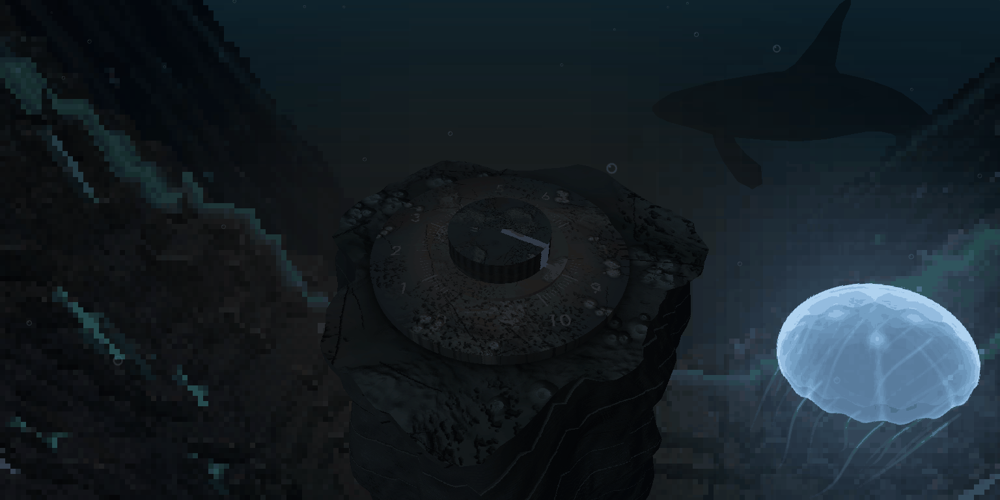

# Deep

## What it shows

Underwater, in the spirit of Subnautica: gliding level through a kelp forest over a seabed of rock blocks traced
per pixel (caustics, god rays, two schools of fish crossing in front), out over the first drop-off, then down a canyon of
terraces that drop further each time, the diver swimming a straight line from lip to lip and drifting side to side,
tipping only downwards. The water's light is fixed to the world (bright above, dark below) and dies with depth;
marine snow streams past; faint bands of glow mark each lip and glowing spots dot the seabed. 3D jellyfish glow up
out of the dark from the second drop. Near the bottom the diver turns toward a faint glow ahead and comes to a stop
over it: a big, chunky old amp's volume knob on a craggy rock pillar, rough, worn and fouled, set to 9. It sticks
twice, then one click turns it to 10; it powers up, crackling, for a second and a half; lightning; a flash; and the
film cuts to the train (the ending, below). 353 frames, 29.4 seconds, at
192x96. Story time runs twice as fast as the film (the journey); the life in the water runs at its own pace.

The film shows the 1536x768 video from its frame 48 to the end, 305 frames (25.4 s), after the [rooms](../rooms)
segment's screening hall, which plays the dive's first 48 frames on its screen while it zooms in.

It files two videos. `video.rgb` is the dive at 192x96 as above; nothing in the film reads it now, but the host
still files it and checks it.
`video_hd.rgb` is the same 353 frames at 1536x768 with the creatures drawn sharp: the dive's water, seabed,
kelp and seagrass at 192x96, each pixel 8 x 8, and over them, through the same camera, the fish from an atlas of
mackerel rendered ahead of time (13 yaws, 2 heights, 8 swim phases), the marine snow made tiny rising bubbles, and the
jellyfish: bells from an atlas of a ray-cast bell seen from seven heights, made ahead of time, the two nearest
mixed by CARDIAC, tentacles and frilled
oral arms as soft strands, each fading in over 3 seconds; then the ending (below). The 192x96 video has
no knob.

## Why it's hard on CARDIAC

- **The seabed is traced per pixel through a camera that pitches, yaws and rolls.** At 50 degrees nose down a
  screen column is not a vertical slice of the world, so the usual height-map trick for flight sims (Voxel Space)
  doesn't hold; each pixel's ray has to be followed.
- **There's nowhere to keep the map.** A machine has 96 cells; the height map is 442 rows of 201 heights.
- **No multiply, no divide, no square root, no trigonometry, and three digits.** A ray's direction, its steps
  through the map, the distances for the fog, the shading's mixes, the jellyfish's bells and the kelp's leaves all
  come down to sums kept under 1,000, digit by digit or a remainder at a time.
- **96 cells a machine.** The work is cut into 110 small machines (most of them general: a mix, a long division,
  a product by digits), each fitting in memory.
- **Colour.** Fog, light and glows blend continuously, and every blend is a product a card can't
  hold: a + (b - a) k / 32 with b - a up to 255.

## How it's usually done

- **Height-map ray casting.** Flight sims of the 1990s drew height maps a screen column at a time, near to far
  ([Voxel Space](https://github.com/s-macke/VoxelSpace), NovaLogic's Comanche, 1992): a column's rays are known to
  hit further the higher up the screen they go, so each starts where the one below stopped. With pitch, the same
  coherence is used per ray, marching each through the map a step at a time
  ([Iñigo Quilez, "terrain raymarching"](https://iquilezles.org/articles/terrainmarching/)); here the steps are the
  map's rows.
- **Sprites and points** (the kelp, fish, snow and jellyfish) are projected through the same camera and drawn over
  the seabed with a depth test, a [z-buffer](https://en.wikipedia.org/wiki/Z-buffering).
- **True colour.** Each pixel's red, green and blue are worked out as numbers 0..255 and filed as they are, as a
  24-bit frame buffer holds them: no palette, no [dithering](https://en.wikipedia.org/wiki/Ordered_dithering).

## How it's done

**The map is an asset.** `data/heightmap.rs` printed `data/map.txt` from a seabed formula, with
rock added (a roughness three units across and blocky outcrops: a few, low, in the sand up top; more, taller and
wider, down the canyon): per row of z (a unit apart), the terraces' base height there and its drop to the next row,
how far it is past a lip, the 201 heights over the base in tenths (x = -100..100), and the glowing spots on it. The
rows are dealt to the machines that need them, one at a time.

**Blocks near, a texture far.** The seabed is meant to read as solid rock, Subnautica's chunky voxel look. For
the first 30 map rows ahead of the camera the machines make the seabed out of blocks a unit square, each as high as
its column's height snapped down to an even number of units (two-unit ledges, cliffs of stacked risers, outcrops),
and shade each by the face the ray went in by. Further out, where blocks would shrink to a pixel's stair noise, the
seabed is the smooth map as before, textured with the same strata (Doom's flat textures for distant walls); the
switch sits in the fog.

**The camera and the script.** Each frame's numbers (where the camera is, its forward, right and up vectors in
300ths and hundredths, the light, the phases, where the jellyfish, kelp, seagrass and fish are, the torch's aim,
and the camera's place across, its place from the portal's middle and the portal's plane, each split into its
parts) are worked out on CARDIAC by `script.rs`, written once against the train's operations: the host runs it with
the train's machines, the reference natively. It flies the path (the straight lines from lip to lip, the
eased pitch, the drift, the turn to the point it swims at) in whole numbers: angles in billionths of a turn, places, sines and
fractions in millionths, sines and arctangents from printed tables (every 10,000th of a turn; every thousandth of a
ratio) read between their entries, longer products card by card and the arctangent's ratio by long division a digit
at a time. The path is stepped every 1/48 s of story time, 2,976 steps, each turning a 52.8th of the way toward the
next lip, twice over. `data/script.txt` holds the printed numbers it starts from: the lips the diver swims to and
the creatures' fixed numbers, printed by `data/make_script.py` from random numbers (a hash). The
host only fetches by an index, routes by a punched flag and keeps the creatures a machine found near enough. Whole numbers
moved the camera by a hundredth or a tenth on 10 of the 353 frames and three fish frames by a tenth, against
floating point. The player works the script out on CARDIAC as
the deep's first job during the film, and every block of the deep's frames uses it.

**Rays, per screen row.** `drays` steps the ray 300 (f + a r + b u) across the row (each component as a whole part
and two-hundredths); `dslope` divides it by its forward part (long division, the remainder kept as five hundreds and
the rest), giving the steps across and up per unit ahead; `dtenth` the first, part step; `dlimit` the last slice
before 110 along the view. Once for the whole dive, `dnorm` and `droot` find each pixel's ray length.

**The march, per screen column.** A slice is a map row. Each column starts at its bottom pixel; `dslice` (three
phases) is dealt the pixel's ray and the slice's map row, reads the row as far as the ray needs (the cards before it ten at a time), and punches hit,
too far, above everything, the ray one slice on, and the next slice's number. Near, a ray is under a block when the even number of units above
its own whole units is no higher than the column's height, so the snapping is a comparison, not a division. When a pixel settles, `dwalks` puts the next pixel up at the
same slice (a pixel above hits no nearer), adding its step ten at a time, every column's in one run. The host only carries each column's
cards from slice to slice and deals the next row: a card sorter.

**The near seabed's blocks, per hit.** `dwalks` steps back a slice (a screen row's hits in one run); `ublocks` reads the blocks about the columns
there and at the hit. Per screen row, `ucolumn` finds whether the ray went in through the block's front, stayed in
its column or crossed into the next (and the tenths to the edge it crossed), `udescend` the tenths it took to go
down to each column's top, `uside` the face it hit (a top, the front, a side) and where, `upick` that block and its
neighbours across; `ublocks` again the blocks in front and behind, `dadd` over the hit's row base. The light:
`utop` a top's 29 32nds, darker toward a wall rising behind it (a crevice) and its front edge catching the light
over a drop; `ucorner` the same across; `uriser` a front's 16 or a side's 12 or 22, darker at its foot; `ucrest`
a face's top edge catching the light. The rock: `uplace` the column's place in two tables of 16 (a shift of the
strata and a little lighter or darker), `ustrata` four tones in strata five units deep and a fine dark band every
half unit down a face, `ugrain` a 4 x 4 grain of chips and cracks across each face, `ucoral` rubble at the foot of
a wall and coral on one ledge in four, `urocky` how sandy a top is by its height.

**The far seabed, per hit.** `dwalks` and `dsample` step back a slice and read the smooth map there; `dcross` finds
where the ray crossed between the rows, `uface` the light on the slope ahead and how rocky it is; `uplace`, `ufar`
and `ustrata` the strata at its height as a texture.

**The seabed's colour, per hit.** `dfar` the distance and the fog; `ubeam` and `ulamp` the diver's lamp, a beam that leads the view
(full within 4 pixels of where the torch points, fading out by 20; near rock taken toward its colour in full light, its
own shading kept, laid on after the fog, up to 26 32nds, gone by 70 units, the more the darker the water); `dlook` the rock
tone's colour at the frame's light and in full light; `dphase`, `dphase2`, `dsine` and `dglint` the caustics; `dspot`, `dfall`, `dwave`
and `uglow` the glowing spots; `dlip` the band on a lip. `umix` does every blend: a + (b - a) k / 32 by adding the
difference's rest past its 32s k times, the 32s carried out (or, when 32 - k is fewer, from b back toward a that
many times, rounded up); k of 0 or 32, most of them, needs no sums.

**Open water.** `dslope` again gives how far up a ray looks; `dwater` the gradient; `dshaft`, `dwave`, `dpow` and
`uray` the god rays (two sine waves across the screen, sharpened to the 6th and 10th power).

**Over the seabed.** Points are put on the screen by `ddot` (a dot product by the place's
digits), `dcull`/`dfine` and `dslope`.
- *Kelp and seagrass:* `dbase` finds each root on the map; `dsway`, `dwave`, `dswing`, `dsum` and `dpart` the
  points up each stalk; `dtip` each blade's tip. A leaf is rasterized a row at a time: `dleafv`, `dbbox`, `ureach`,
  `dstrip` and `dspanrow` find the pixels near its middle line; `dpart`, `dadd`, `ucap`, the radius machines,
  `dwidth`, `dwide`, `ulit` and `ualong` decide each one (inside, lit across, rib and rim); `dput` keeps only what
  is nearer. Bladders are discs (`uspan`, `dinside`).
- *Fish:* lines of dots (`dsteps`, `ustep`, `dpix`), silver by their flash, fogged by `dindex` and `dlook`.
- *Marine snow:* `dseed` scatters 450 specks once from the random sequence; `dsnow` keeps them in a box that goes
  round with the camera; `dspeck` fades each.
- *Jellyfish, far ones first:* `djfade`; a halo (`dbox`, `dlin`, `dgauss`, `dlook`, `ushade`); a bell of 12 rings
  of 32 points (`dcos`, `dpart`, `dadd`, the radius machines `dorder`, `dratio`, `dlook`, `dscale` for lengths,
  `uedge` and `dbell` for the glow at the edge and inside, `uspan`/`dinside` for each point's disc); eight
  tentacles (`dwiggle`, `damp`, `dhang`, lines of dots).
- *The ending:* from frame 290 the camera slows to a stop over the knob: frame n is the path's frame
  290 + fl((36 k - k^2) / 36) and r 36ths on (k = n - 290, at most 18), its place between the two (the change times r,
  rounded, in `script.rs`), its vectors that frame's; past frame 308 the frames are 308's, the water's
  phases going on.

**Colour.** Every channel is worked out 0..255 by the machines above and filed exactly as they punch it: three
cards a pixel, no palette and no dithering, so the water's gradients, the fog and the glows are smooth. (An earlier version of the dive was dithered with the 4 x 4 Bayer map to a
colour cube of ten levels a channel, which showed as a speckle over the dark water.) The host checks every channel
is 0..255 before it files it.

| Machine | Cells | What it does |
|---|---|---|
| `drays` | 76 | Per row and component: the ray, stepped across |
| `dslope` | 96 | Long division, 100 n / d or 1000 n / d (rays, water, projection) |
| `dtenth` | 54 | s tenths of a step |
| `dlimit` | 75 | The last slice before 110 along the view |
| `dnorm`, `droot` | 82, 39 | Once: a pixel's ray length |
| `dslice` | 17 data + 78 / 59 / 69 | The march: one column, one slice (blocks near, smooth far) |
| `dwalks` | 90 | Rays k slices on, many a run |
| `ublocks`, `ucolumn`, `udescend`, `uside`, `upick` | 95, 89, 72, 96, 44 | Near: the blocks about a column; which face the ray went in by, and where |
| `utop`, `ucorner`, `uriser`, `ucrest` | 91, 60, 74, 54 | Near: the light on each face, crevices, edges catching the light |
| `uplace`, `ustrata`, `ugrain`, `ucoral`, `urocky` | 84, 81, 74, 76, 63 | The rock: strata, a column's tone and shade, grain, rubble, coral, sand |
| `dsample`, `dcross`, `uface`, `ufar` | 70, 65, 75, 33 | Far: the smooth seabed, where the ray crossed, slope light, height for the strata |
| `dfar`, `ubeam`, `ulamp` | 85, 76, 72 | Distance and fog; the diver's lamp, its beam |
| `dphase`, `dphase2`, `dsine`, `dglint` | 74, 53, 84, 86 | Caustics |
| `dspot`, `dfall`, `uglow`, `dlip` | 31, 89, 70, 62 | Glowing spots; lip bands |
| `umix` | 83 | Every colour blend |
| `dwater`, `dshaft`, `dwave`, `dpow`, `uray` | 29, 79, 66, 70, 73 | Water gradient; god rays |
| `ddot`, `dcull`, `dfine` | 93, 44, 45 | Points through the camera |
| `dseed`, `dsnow`, `dspeck` | 93, 96, 50 | Marine snow |
| `dorder`, `dratio`, `dlook`, `dscale` | 66, 55, 91, 59 | A length from its two parts (a radius table, 33 entries); table look-ups |
| `djfade`, `dbox`, `dlin`, `dgauss`, `ushade` | 89, 66, 30, 88, 64 | Jellyfish fade and halo |
| `dpart`, `dadd`, `dsum`, `dcos`, `uedge`, `dbell` | 78, 28, 20, 91, 64, 96 | Products by digits; sums; bells |
| `uspan`, `dinside`, `dwiggle`, `damp`, `dhang`, `dsteps`, `ustep`, `dpix` | 87, 92, 29, 32, 74, 50, 59, 37 | Discs; tentacles and fish as dotted lines |
| `dbase`, `dindex`, `dsway`, `dswing`, `dtip` | 22, 20, 62, 75, 77 | Kelp roots, fog, sway, blade tips |
| `dleafv`, `dbbox`, `ureach`, `dstrip`, `dspanrow` | 36, 74, 65, 84, 89 | A leaf's rows and strips |
| `ucap`, `dwidth`, `dwide`, `ulit`, `ualong`, `dput` | 32, 92, 30, 91, 21, 36 | A leaf's pixels; the depth test |
| `dneg`, `dtwice` | 15, 14 | Each card negated (the walks back); each card doubled (the kelp's blades) |

90 machines for the dive itself, every one at most 96 cells. The dive's own 192x96 frames take 74.9G
instructions over the 353 frames, about 42 million machine runs.

**The rock's numbers** against a card's 999 (the largest each reaches over the dive, and the margin): the march's
ray against a block, ten times the even units over its whole units, 450 (549; at most 909 by design, the ray under
90); `ublocks`' column 140 (859) and a block 46 units near (at most 98 for any height); `ucolumn`'s ten times
the gap to the edge, at most 990 (9, held under 100 hundredths by design); `udescend`'s heights in tenths 449 before, 439 after, a level's 460, ten times the tenths
over it at most 990 (9) and the sum it divides by 124 (875); `uplace`'s column plus 420, 510 far (489);
`ustrata`'s base and height plus 500, 566 (433); `ufar`'s seabed 940 tenths (59); a block in front or behind over
the hit's base 46 (953); `ulamp`'s sums under 60 (939); `ubeam`'s offsets 191 and 95 (808). The rest are small: faces, tenths, 32nds, tables.

Every channel filed is 0..255, which the reference and the host both check.

## The creatures at 1536x768

The reference is `reference_hd.rs` (part of `reference.rs`'s program: it writes the 192x96 frames, then these); the
host is [`host/src/fx/deep_hd.rs`](../../host/src/fx/deep_hd.rs), called by the dive's own frame.

**The water.** The dive's machines work out the picture up to the kelp and seagrass as always; the host keeps a copy
of it and of its depths before the fish, snow and jellyfish go on. The 1536x768 picture starts as that water, 4 x 4 tiles each one colour (a copy of the dive's
pixel) until a creature is drawn in one; a tile nothing touched is the water's pixel.

**Each creature's numbers are the swarm's sums** ([`fx/swarm_calc.rs`](../../host/src/fx/swarm_calc.rs)): exact
products from quarter squares, long division rounded down, square roots and angles from the swarm's printed tables,
worked out a level at a time on its `sw_` machines, the host choosing by their flags what to work out next. From the
script's places: where each fish's middle is on the screen (thousandths of a pixel) and how far ahead, which way it
heads across the line of sight (the atlas's yaw, by an atan), whether it is seen from above, how the screen rolls
it, its swim phase (its number in the school and the frame), the atlas's size and the walk's steps; each bubble's
place (rising 3 tenths a frame, wobbling by a sine) and size; each jellyfish's fade (eased, and rising over 3 s from
the first frame the dive showed it), the bell's pulse, the views either side of its height, the screen's up,
its stretch away from the middle of the screen (a perspective camera's), its 24 tentacles' 25 points and its four
arms' three strands of 21 (their sway by the dive's sine table, the arms' frill), each piece's width, strength and
walk, and the halo's box.

**The pixels.** `hd_rows` steps two places (whole and thousandths) down a box's first column, `hd_walk` across each
row, punching the texel (or, for a strand, its place across in eighths of its width and along in hundredths) under
every pixel; the host fetches the texel by the index punched. Fish: `hd_cover` (the texel's cover in 32nds, none where
the dive's seabed or kelp is nearer), `hd_fcol` (the flash's light, then each channel lit, flashed and fogged), `umix`
in. Bubbles: `hd_bub`, `umix` toward the bubble's light. Jellyfish: `umix` mixes the two views' bell texels, `hd_eadd`
adds each strand piece's glow (the strand table's share by its strength), `hd_jelly` turns the glow into a cover and
a paleness (from the cover and pale tables), `umix` in a colour from the jellyfish's 33 (`umix` again); the halo,
every 4 x 4: `hd_rows`, `hd_walk`, `hd_gauss` (half the squared distance in tenths of its width), `hd_hamt` (the
fall-off table by the fade, in 256ths), `hd_mix256`.

**Data.** Two atlases are pictures made ahead of time, and CARDIAC only picks, places, covers, mixes and fogs
their texels. `data/make_hd.py` makes the atlases from `fish_atlas.png` / `fish_flash.png` and a ray cast of the bell,
as built data packed in `generated.tar.xz`, which `build.sh` unpacks (`hd_fish.bin` 17 MB, `hd_bell.bin` 81 MB,
`hd_bubble.bin`),
and `data/hd.txt`, their index and the printed tables (cover, paleness, the strand's glow across and along, the halo's
fall-off, the fine tentacles' lengths and the tapers).

| Machine | Cells | What it does |
|---|---|---|
| `hd_rows`, `hd_walk` | 81, 82 | A box's rows' starts; each pixel's texel (two places stepped by thousandths) |
| `hd_cover`, `hd_fcol` | 48, 79 | A fish's cover, its colour (products by digits) |
| `hd_bub` | 59 | A bubble's cover |
| `hd_eadd`, `hd_jelly` | 80, 78 | A strand piece's glow added; a jellyfish's cover and paleness |
| `hd_gauss`, `hd_hamt`, `hd_mix256` | 81, 60, 55 | The halo: where in the table, how much, mixed in 256ths |

`card-attack deep refs/deep_ref` says identical 353/353 for both videos (`--native` too); the instructions are
under the ending, below. `DEEP_FRAMES=a,b,...` renders only those frames and checks them (`DEEP_DUMP=dir` writes their 1536x768
frames; `DEEP_REF_FRAMES=` the same list makes the reference draw only those), `DEEP_CARDS=1` stops at a sum's card past 999 (natively), `KNOB_COST=1` reports the ending's stages.

## The orcas (1536x768)

In the HD video only, frames 84..156: a pair of killer whales glide left to right far out and low in the canyon's
haze, silhouettes the walls and floor hide (`reference_orca.rs`). The model is the Killer Whale by Poly by Google (CC BY 3.0, see CREDITS.md), made the mesh
kit's cards by `data/make_orca.py` (through `segments/mesh/data/make_mesh.py`) at 12 phases of a gentle swim
(`data/orca_0.txt` .. `orca_11.txt`, 636 triangles each).

Each frame the swarm's sums work out, from the frame's number and the camera: each orca's place from the camera
(the leader 66 units ahead in the world's z and 19 below, crossing from 38 left to 32 right of the world's middle;
the second, 37 units long to the leader's 46, behind it along the heading, to its far side and lower, each by a slow
sine), its turn (the camera's vectors times the model's axes in the world), its place in model units, its swim phase
(the second's 7 phases on) and the depth test's zero. The mesh kit draws each flat and unlit (`Kit::pixels` with
`Shading::Depth`, added to the kit for this: each pixel's depth instead of a colour), the further first;
`orca_ahead` turns its depths into units ahead (down the 1000 depths, 860ths carried), `orca_keep` hides it where the
dive's seabed or kelp is nearer, and `umix` mixes the dark body (2, 4, 7) toward the frame's far colour by the dive's
fog at that distance (`hd.txt`'s `orca_haze`; the host holds the distance `orca_ahead` punched at 199, the table's
last entry, before it fetches). Drawn into the water before the fish, snow and jellyfish.

| Machine | Cells | What it does |
|---|---|---|
| `orca_ahead`, `orca_keep` | 26, 27 | How far ahead each depth is; whether a pixel shows |
| the mesh kit's | | `mesh_front`, `mesh_walk`, `mesh_depth`, the swarm's edges and sums, `polydot` |

1.2G instructions over the 73 frames (17M a frame). The kit's edges are not smoothed, and the haze is worked out at each pixel's whole units ahead.

## The ending with the knob (1536x768)

Frames 228..352, in the HD video only, on CARDIAC
(`reference_knob.rs`, part of `reference.rs`'s program). At the bottom, a volume knob on a rock pillar,
seen from above as the diver comes to a stop; it sticks twice (308..330), clicks to 10 (331), powers up for a second
and a half (332..349), and lightning (350, 351) and a flash (352) end the dive; the cut goes straight to the train.

**The models and their surfaces are assets.** The knob's surfaces are a lightmap made in Python ahead of time
(`data/make_knob.py`): each texel's colour under the water's light, its relief and crevices, and what the dial's glow
adds at full strength. Each frame CARDIAC works out where the knob is, how it is turned, how much the glow and the ink
add, and the haze. `data/make_knob.py` makes the rock (30 units to the dive's unit:
its craggy side, 96 round by 12 rows, its radius shaped by lobes, crags and ledges; its top round the plate in
5 rings out to the side's broken outline), the plate (100 to the unit: a disc in 9 rings, its rim chipped, and the
rim's side) and the knob with its skirt (100 to the unit, as it stands at 9), as the mesh kit's cards; where the kit
keeps a corner's normal, each corner carries its place in the atlas (across, down, the page). The atlas (`knob.bin`,
built data like the dive's other atlases; 8 pages, 53 MB) holds each texel's shading: its colour
before the dial powers up, the same without the scale's ink, what the dial's own glow adds there at full strength,
its ink (32nds) and whose (the numbers 0..10, the pointer's marks). The light falling from the water above and the
relief (bumps, pits, dents, scratches, crust, barnacle clusters and the crevices between them) are worked out in
Python ahead of time, onto the surfaces, as a lightmap is ([Quake](https://en.wikipedia.org/wiki/Lightmap), 1996): the light comes
from a fixed way onto things that don't move. `data/knob.txt` holds the pages, the sticky turn's values and
shudders (keyed by hand, frame by frame, not simulated), the printed tables (the haze looking into lit water, the water's light by rows, the glows'
fall-offs, the lightning's glow by distance along and across) and the random numbers (the silt's blobs, the flakes, the
tremble, the arcs; the silt's, the flakes', the shudder's and the arcs' printed already scaled).

**Each frame, on CARDIAC.** The frame's numbers are the swarm's sums: the dial's value and its glow (hundredths,
0.55 + 0.45 v / 10, times 1 + 1.6 p as it powers up), how far the scale has lit, the ink's colour for each number;
where the dial is from the camera and each model's turn (the camera's vectors in 300ths times the dial's frame; the
knob turned by its value too, 30 degrees a step, by the swarm's sines) and place (the plate and knob trembling as it
powers up, the knob shuddering as it sticks).
- *The water's light* from frame 263: `k_lift` adds a table's light (by rows of 4) times how far it has come up
  (smoothstep over 30 frames, 32nds) where the dive's water is open, every 4 x 4 pixels.
- *The larger orca back across* (frames 282..328, right to left 55 units beyond the dial): the orcas' model, length
  and swim, the kit's flat draw (`orca_ahead`, `orca_keep`), its dark body mixed toward the picture by the haze
  looking into the lit water (`umix`).
- *The knob:* the mesh kit draws each model carrying its corners' places across its triangles (`Kit::carry`, added
  for this: the kit's walks carry the three numbers and `mesh_near` keeps the nearest piece with its depth);
  `k_ahead` turns depths into units ahead, `orca_keep` hides what the dive's seabed is in front of; the host fetches
  each pixel's texel by the page and place the walks punched. From the click, `k_lit` adds the glow's gain (32nds)
  and `k_ink` works out how far the ink lights (the scale's numbers coming on one after another), `umix` mixes toward
  the ink's colour; then `umix` hazes it by the dive's fog at its distance (the host holds the distance at 199, the
table's last entry, before it fetches). The rock first, then the plate, then the
  knob, each over the last.
- *The dial's glow on the water*, every 4 x 4 pixels the knob doesn't wholly cover (`k_sum` counts the knob's
  pixels in each, at most 16): e across and down from the
  dial's middle (the swarm's sums, a column and a row at a time), `k_index` its place in the fall-off table, the
  amount (the table times the glow) mixed in 256ths (`k_mix256`).
- *Silt* (two puffs as the knob sticks): each blob's place and size by the sums, `k_index`, the fall-off by its
  age, `k_sum` the blobs' amounts per 4 x 4 pixels (at most 141), `k_mix256`.
- *Flakes* shaken loose (140 squares from the click): their places and sizes by the sums, `umix`.
- *Lightning:* each arc's start on the rim, its way out (the swarm's angle) and its ten steps and forks (the sines),
  from knob.txt's random numbers, which `data/make_knob.py` prints already turned into angles and lengths (for
  example a card less 500 times 159,155); how many arcs there are and how far they
  reach are worked out by the sums from how far the power-up has come, except on frames 331 and 350..352, which have
  fixed numbers of their own, as does every frame's line width; each line drawn
  along its longer way (`hd_walk` punches the first and last row it covers in each column, or column in each row; the
  host adds them to the line's first row and files the line's colour from one to the other, leaving out pixels off
  the screen), its glow every 4 x 4 pixels from how far past its ends and across it each is (`hd_rows`, `hd_walk`,
  `k_seg`, the table), summed (`k_sum`); mixed in toward white, the blue glow and the flash (`umix`).

| Machine | Cells | What it does |
|---|---|---|
| `k_lift` | 44 | The water's light, where it is open |
| `k_ahead` | 24 | Units ahead of each of a model's depths |
| `k_lit`, `k_ink` | 46, 80 | The glow's gain on a texel; how far its ink lights |
| `k_index`, `k_sum`, `k_mix256` | 24, 33, 66 | A fall-off's place in its table; amounts summed; mixed in 256ths |
| `k_seg` | 69 | Where 4 x 4 pixels lie along and across a line of the lightning |
| `mesh_near` (the kit's) | 50 | The nearest piece on a pixel, with its depth |

**Instructions:** the 1536x768 video takes 91.3G instructions over its 353 frames, about 1.9 million machine runs
(before the knob it took 27.4G): a frame of the ending before the
click about 0.6G (the knob's draw 0.36G, the dial's glow on the water 0.08G, the orca 0.04G; the silt adds up to
0.4G), from the click 1.1G to 2.1G (the knob lit 1.0G, the lightning 0.6G at its height). The dive's own (192x96) is
74.8G over its 353 frames.

**Simplifications:** the surfaces' light is worked out in Python ahead of time onto the atlas (a lightmap; the
knob's turns with it, by 30 degrees at most); each pixel takes the nearest texel, and the kit's places are carried
straight across a triangle on the screen; the models' outlines are 96 corners round, their rows a fraction of a unit to 5 units apart; the dial's glow,
the silt and the lightning's glow are worked out every 4 x 4 pixels; the lightning is drawn a column (or row) at a
time and its glow goes by each line's distance, summed over the lines (a joint counted once), not a blurred drawing;
its random choices are knob.txt's numbers; the dial's frame is the stopped camera's; the ink lit from the click is a
mix toward each number's colour that frame; the cosines are the sines a quarter turn on, and the
lightning's angle is taken in hundredths of a pixel (the swarm's angle takes sizes under 100000).

## What was given up

- **A smooth seabed, near.** The first 30 rows ahead are blocks a
  unit square and two units a step, after Subnautica, not smooth terrain; further out it is the
  map sampled at its rows, a unit apart, and between its columns along x (heights in tenths). Where the two meet
  the ground changes shape a little (up to two units); it sits in the fog, but a careful eye can see it sweep
  toward the camera as the dive goes on.
- **Blocks seen edge on.** A ray stepping more than a column a slice (looking far to the side) is taken to hit the
  last column's top or, under it, its side halfway; a ray is tested only at the rows, so a block's side between them
  can be missed by a ray passing its corner. Near, the blocks are a unit across: there is no finer detail than the
  4 x 4 grain painted on each face.
- **A screen column's rays are marched from where the one below stopped.** A thin ridge seen past the side of
  another can be missed by a pixel or two.
- **Rounded tables and fixed point** stand in for floating point: sines from a 60-step table, the caustics'
  wavelengths 5, 6 and 7.5 units, the fog as two straight pieces of
  0.85 (d / 70)^0.8, the god rays' up factor 0.94 for 0.9, the spots' and lips' glow in 32nds, the jellyfish's
  view direction from the bell's middle, their points no bigger than 3.1 pixels across.
- **The far slope's light is one-sided** (the row before against the row hit, at the hit's x), not a centred
  difference.
- **Colour** is no longer given up: every channel is the machines' own 0..255.
- **At 1536x768:** the fish are the atlas's nearest cell and size, each pixel its nearest texel; the swim phase goes
  by the fish's number, not by tracking it; the bells are the atlas's, their canals don't turn with the jellyfish;
  tentacles and arms are 24 and 20 straight pieces (the arms three strands), a piece shorter than its width is left
  out; the halo is worked out every 4 x 4 pixels; the fade-in counts from the first frame the dive shows a jellyfish,
  by its number.
- **Edges.** Points more than 100 pixels from the middle are not drawn, nor kelp blades whose tips fall more than
  100 pixels out; jellyfish further than 98 units are left out; a kelp clump's depth is kept in whole units, so
  two clumps within a unit of each other can overlap the wrong way.

## Development notes

- **The map is the seabed formula, printed.** The march, the shading and the sprites are worked out on CARDIAC
  every frame, and so are the camera's path and where the creatures swim (`script.rs`).
- **Long division past 500.** `dslope` first borrowed one five hundred at most, which is right for the rays (their
  forward part is at most 441) but not for the kelp's leaf lengths; it now borrows as needed and carries what is
  left as tens of five hundreds.
- **The rock.** The blocks' shading was first worked out as two or three machines and came to 192 to
  298 cells each; it is cut into thirteen small ones the host strings together, each a few comparisons.
- **Machines cut small.** Most of the work is in general machines (a mix, a long division, a product by digits, a
  table lookup) that the host strings together; the specific ones (a slice of the march, a leaf's strip, a bell's
  glow) are each a few lines.

## Files

- `machines/`: the Rust machines and their compiled tapes.
- `reference.rs`: the independent native Rust version, which every frame is checked against.
- `data/map.txt`: the height map; `data/heightmap.rs` printed it from the seabed's formula and the rock's.
- `script.rs`: each frame's numbers (camera, light, phases, creatures), against the train's operations.
- `data/script.txt`, `data/make_script.py`: the lips and the creatures' fixed numbers the script starts from.
- `reference_hd.rs`, `data/make_hd.py`, `data/hd.txt`: the creatures at 1536x768.
- `reference_orca.rs`, `data/make_orca.py`, `data/orca_*.txt`: the orcas.
- `reference_knob.rs`, `data/make_knob.py`, `data/knob_rock.txt`,
  `knob_plate.txt`, `knob_knob.txt`, `data/knob.txt`: the ending; `data/knob.bin` (the atlas) is built by
  make_knob.py and packed in `generated.tar.xz`.
- Host: [`host/src/fx/deep.rs`](../../host/src/fx/deep.rs), [`host/src/fx/deep_hd.rs`](../../host/src/fx/deep_hd.rs).
