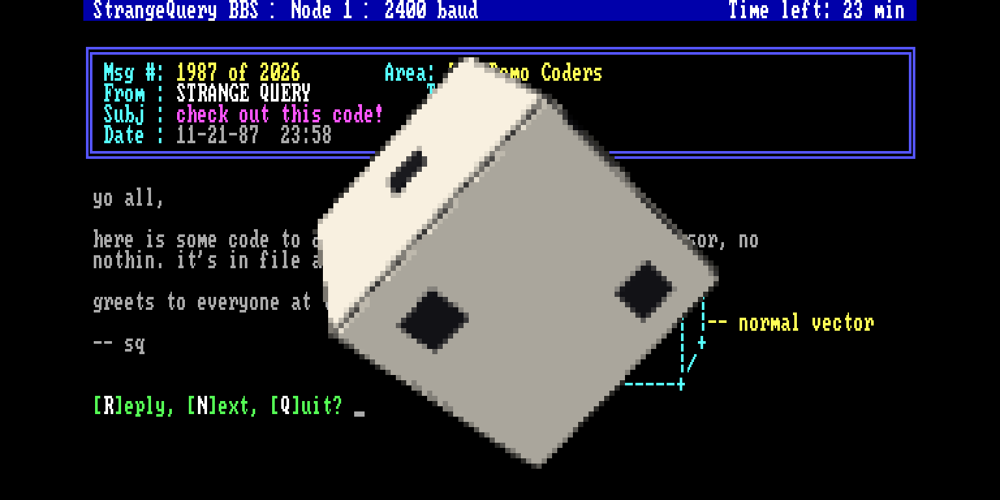

# The die and the Rubik's cube

## What it shows

The cube from the [tumble](../tumble), small and far where the tumble leaves it, comes toward us still tumbling. As it
comes, its faces go to ivory and the pips fizz in: a die, tumbling, for three seconds. It splits into a scrambled Rubik's cube (a crossfade over half
a second, the cube a little bigger and settling), which plays a real 16-move solve (the one the [rubik](../rubik) machines were written for) while
it tumbles (F R2 D' L2 D U2 F D' F D' F D F U' B2 R', each turn eased, the first taking six frames and the last
three), then pops (6% bigger and back, spinning faster for a moment), solved. Then it roams on, tumbling: out to about
twice the distance and back on two rhythms, across and up and down, wider the further it is. 192x96 on black, 210
frames.

It has no line of its own in the [cut](../cut). The [BBS](../bbs) lays its frames 0 to 137 over the message page and
138 to 209 over the rotozoomer; of those last 72, the cut shows the first 36 and the [degauss](../rotodg) the next 28,
so the film shows frames 0 to 201. The screenshot is the BBS's frame 172, the die's 38.

| Frames | What |
|---|---|
| 0-17 | The cube coming toward us, eased, from where the tumble left it; from 6, still coming, its faces to ivory (step j of 8), the pips growing in from the fifth (step j of 4) |
| 14-49 | The die, whole for 3 s: its last 4 frames coming in, then held |
| 50-55 | The die crossfading into the scrambled Rubik's cube (step j of 7), the cube 1.08 to 1.01 times its size |
| 56-115 | The solve: 16 moves of 5, 5, 5, 5, 4, ... 3 frames |
| 116-129 | The pop: 1 + 0.06 sin(30 min(k, 6) degrees) times the size, the tumble's time running 0.12 s a frame faster |
| 130-209 | Roaming (the BBS lays frames 130-137 over the rotozoomer arriving, 138-209 over the rotozoomer) |

## Why it's hard on CARDIAC

- **3D with no multiply and three digits,** as for the [rubik](../rubik) machines: up to two rotation matrices a frame
  (the tumble, Ry Rx Rz of three angles, and the turning layer's, the tumble times the layer's eased turn: two rotations
  composed), 26 cubies each a box with up to three stickers, up to about 160 faces shown a frame.
- **The cube moves in depth,** from 5.64 to 13 units away: a corner's place to a fraction of a subsample at 5.64 units
  and its distance at 13 can't both be a card in the same units.
- **The cube roams to the side,** so a corner's x on the screen in 8ths of a subsample runs past a card (pixel 160 is
  1028 8ths from the middle).
- **No depth buffer:** every face is drawn in painter's order.
- **The timeline's numbers are the machines':** the tumble's angles (rates in radians a second), the place eased toward
  us and the roam's cosines, the turns' easing, the pop's sine, the fades.

## How it's done

It uses the [rubik](../rubik) folder's machines where they fit, and four machines of its own. The host deals lists of
cards, carries what one machine punches to the next, and sorts by punched numbers (the cubies into drawing order, an edge's bounds into rows,
the pieces of polygons onto their pixels). The host also keeps the schedule (`scene.rs`: which shape a frame
shows, which move is turning and where each part starts, by counting frames; a step within a part is worked out by
`rb_sum` from the frame and the part's start) and the model's data (which boxes
make each shape, and which of the printed sizes each corner is made of), in the same file, shared with the reference,
as the UI kit shares its scenes.

**The view and the scale.** The eye looks along z, 40 degrees high: 264 subsamples a unit at unit distance. The
cube's place is x, y in 200ths of a unit and its distance in 70ths; everything is scaled so the cube's
middle is always 700 away: the place across and up is 245 x / distance (`dr_muldiv`), and each size the
corners are made of (the die's 1.0, 1.02, 0.98, 1.05, 0.55 and 0.17; the cubies' 0.68, 0.33, 0.35, 0.28 and 0.34) is
98 times its 500ths over the distance (`dr_muldiv`, after the scale for the split and the pop). So a corner is the
place plus the axes at those sizes, a sum of cards, and its depth stays 476..944.

**Per frame:**

1. `dr_clock` makes the tumble's three angles from the frame's number (and the pop's extra steps): counts times rates,
   in tenths of a degree with thousandths carried, as a quarter turn and the rest; `rb_sine` their sines; `rb_dot` the
   matrix Ry Rx Rz.
2. While a layer turns: `ui_ease` eases its turn (smoothstep, 900ths of a quarter turn), `dr_clock` adds the quarter
   turns, `rb_sine`, and `rb_dot` mixes two of the matrix's columns.
3. The place: `ui_ease` (smoothstep) from where the tumble left the cube to the near place; or the roam: `dr_clock`
   (k/7, k/4.3, k/11, k/6.5 radians), `rb_sine`, `rb_dot` (out 2.6 (1 - cos) + 1.2 (1 - cos), across (0.5 + 0.55 z)
   sin, up (0.3 + 0.3 z) sin). Then `dr_muldiv` scales it, and the sizes.
4. `rb_dot` puts each axis at each size, and finds the place's depth along each axis. A face of a box shows when the
   eye is beyond its plane: its side times that depth, plus its plane's sizes, below zero (`rb_sum`, `rb_hold`).
5. The order: on the die and on each cubie, what sits on a hidden face first (only its sides could show, past the
   body's edge), the body, then what sits on the faces shown. A plate, sticker or pip is drawn only as far as it stands
   out of what it sits on (the rest is hidden however it turns), so its sides cover the body's edge exactly where a
   depth buffer's would. The cubies go far to near by their distance squared from the eye (2 P.c + |c|^2, `rb_sum`,
   `rb_dot`), the turning layer's far side first (`rb_sum` and the rubik folder's `rb_order`).
6. The colours: per face direction its light, 0.62 + 0.38 n.l + 0.08 toward the eye, at half size
   since it reaches 1.08 (`rb_dot`, `rb_hold`); per material, twice the base times it, held at 255. The die's faces go
   from the tumble's colours to ivory on `ui_ease`.
7. Every corner (`rb_sum`), seen (`dr_persp`: 2112 v / depth, 33 additions carrying the depth, then six binary places;
   x less a middle column near the cube's, to the nearest 8 subsamples, so it stays within a card), y as the polygon
   machines take it (`rb_sum`).
8. Per polygon, the rubik folder's `rb_edge`, `rb_start`, `dr_column` (an edge's first column, about the frame's
   middle column), `rb_walk`, `rb_span`, `rb_piece`; per pixel row, `rb_pixel` (the mean of four subsamples, rounded; black
   where nothing falls).
9. In the split, the die and the Rubik's cube are each drawn, and the deep's `umix` crossfades them (32 j / 7 32nds).

**Before the first frame** the rubik folder's `rb_turn` and `rb_pocket` work out the cube after the scramble and after
each move of the solve, from `data/moves.txt`.

## Details

- **The near place is 5.64 units away:** at 5.5, with the die held three seconds there, it tumbles through turns
  where one of its long edges runs to 1007 eighths of a subsample, past a card; at 5.64 the longest is 975.
- **Painter's order** instead of the depth buffer; the same picture wherever the cubies' order by distance is the
  depth buffer's.
- **The light** is 310 / 999 + 190 / 999 n.l + 40 / 999 toward the eye, doubled: 0.6206, 0.3804 and 0.0801, each
  colour an even number before the mean.
- **The places and sizes** are whole numbers as above: a corner within about a third of a subsample. The roam's up
  and down is 0.5996 z.
- **The fades** round down toward where they go, and the mean of four subsamples is rounded.
- **The tumble's cube to the die:** the plain cube starts where the tumble's cube is (frame 147) but
  not in its turn: its turn jumps at the join.

## How big the numbers get

From the reference (`DR_STATS=1`), against a card's 999:

| Number | Largest | Margin |
|---|---|---|
| A matrix entry | 999 | 0 (a unit vector's part) |
| The distance (70ths) | 914 | 85 |
| The place across, up (200ths); scaled | 824, 467; 238 | 175 |
| The roam's how far out (100ths); its across's size | 756; 932 | 67 |
| A size (scaled) | 143 | 856 |
| A face's test | 834 | 165 |
| A corner, scaled (its depth) | 916 | 83 |
| A corner on the screen (8ths; x from the middle column) | 766 | 233 |
| An edge across or down | 994 | 5 |
| A cubie's key | 233 | 766 |
| A colour before it is held | 262 | 737 |

## Machines

| Machine | Cells | What it does |
|---|---|---|
| `dr_clock` | 87 | Angles: counts times rates, as a quarter turn and the rest |
| `dr_muldiv` | 74 | a b / c, rounded: the place and sizes scaled to the distance |
| `dr_persp` | 94 | A corner seen: 2112 v / depth, less a middle column's shift |
| `dr_column` | 95 | An edge's first column, about the frame's middle column |
| `rb_sine`, `rb_dot`, `rb_sum`, `rb_hold`, `rb_order`, `rb_turn`, `rb_pocket`, `rb_edge`, `rb_start`, `rb_walk`, `rb_span`, `rb_piece`, `rb_pixel` | (the [rubik](../rubik) folder's) | |
| `ui_ease`, `umix` | (the UI kit's, the deep's) | Easing and fades; the split's crossfade |

`dr_key` and `dr_wobble` are the [BBS](../bbs)'s.

**Instructions:** 2,416M for 210 frames (11.5M a frame): `rb_pixel` 977M, `rb_dot` 411M, `rb_piece` 263M, `rb_walk`
222M, `dr_persp` 157M, `rb_span` 117M, `rb_sum` 70M, `dr_column` 63M, `rb_start` 57M, `umix` 45M, the rest 35M.

`card-attack dierubik refs/dierubik_ref` says identical 210/210.

## Files

- `scene.rs`: the timeline and the boxes, shared by the host and the reference.
- `reference.rs`: draws every frame in ordinary Rust (`DR_STATS=1` prints the largest numbers).
- `data/`: assets made ahead of time in Python by `make_data.py` (colours, light, moves, turns, stickers, cubies,
  pips, sizes, rates).
- `machines/`: `dr_clock`, `dr_muldiv`, `dr_persp`, `dr_column`, and the BBS's `dr_key` and `dr_wobble`.
- Host: [`host/src/fx/dierubik.rs`](../../host/src/fx/dierubik.rs). It files `video.rgb` (not kept), which the BBS reads.
