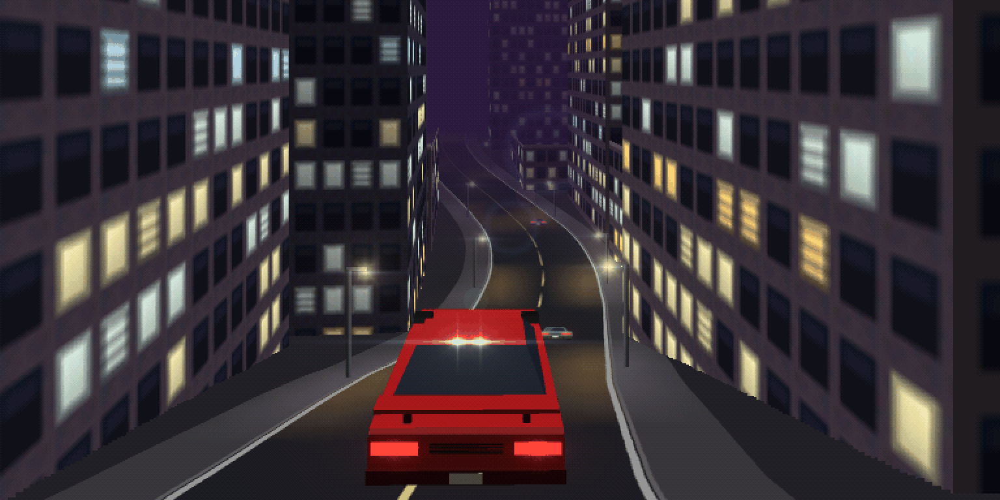

# Drive

The night drive through a city at 192x96 was an earlier segment and is no longer in the film. This folder keeps its
eleven machines that the [accel](../accel) segment still uses, in both its software half and its accelerated half:
the camera, its turn, the blocks' faces, the rays against the walls, and the street lamps and cars placed in the
camera's view. The picture above is the accelerated drive, whose walls and lamps are placed by them.

## What runs on CARDIAC and what the host does

These machines work out the camera's place, its turn, the blocks' faces, where each ray meets them, and where each
lamp and car is in the camera's view. The host deals them their decks and fetches table entries at the places the
machines punch: the nine entries of the street's plan under the camera from the entry `dz` punched, and the street's
middle under each car at the entry accel's `acarz` punched and the one after it. Where a machine needs a stretch of
a longer table (the plan, the blocks ahead, the grade), `dpick` is dealt the table with the place `dz` punched and
punches the stretch.

The host does a little index arithmetic around them: it adds 1 to a punched entry to fetch the next, finds the
cards of block k in `dface`'s output at 10 k plus the card's place, and takes the block a wall belongs to as the
face's index over 10 (`dhit` punches the index). The rays the columns are cast along are accel's `aray`'s, and the
along part of each comes from the turn's sine negated by the host (see the [accel](../accel)).

The tables are assets printed ahead of time: the street's plan and the blocks are [accel](../accel)'s, and the turn
table (`data/turn.txt`, the cosine and sine for each slope) is printed by `data/make_data.py`.

## Why it's hard on CARDIAC

- **The camera turns.** With the street bending, rays go off at every angle, and the street's middle has to be
  looked up wherever each ray lands.
- **Screen places don't fit a card.** Anything finer than a quarter pixel across the screen passes 999, so places
  are kept in quarters along the street and eighths across it.
- **Random access is out.** A machine can't hold the street's plan. `dpick` reads through it and punches the
  stretch another machine needs, from the place `dz` punched.

## How they're used

Units are the drive's: along the street quarters of a unit, across it eighths. Per frame of the drive
(`host/src/fx/accel_hd.rs`):

- `dz` says where the camera is (9 quarters a frame): the street plan's entry under it, how far into it, and how far
  into its block (a block every 30 units). `dcam` gives its place across and the street's slope ahead, and `dturn`
  its turn (cosine and sine times 400): it is dealt the whole slope table, `data/turn.txt`, and punches the entry
  for that slope.
- `dface` works out the faces of the nine blocks ahead. Per column, `dlat` steps the column's ray to each block's
  near and far end and says how far across it is there, and `dhit` decides, block by block, whether it meets an end
  wall or crosses a face. Accel's own wall machines draw the walls from there.
- `dlamp` places the street lamps (one every block, 6.6 units either side of the street's middle), `dcarx` each
  car across from the camera, `dmul` turns them to the camera's view (a b / per toward zero), and `dalong` says how
  far along the view each is.

## Machines

| Machine | Cells | What it does |
|---|---|---|
| `dz` | 67 | Per frame: the camera's place along the street, its plan entry and block |
| `dcam` | 96 | Per frame: the camera across, and the street's slope ahead |
| `dturn` | 51 | Per frame: the camera's turn from the slope, as cosine and sine times 400 |
| `dpick` | 33 | Picks a stretch of a table (the street's plan, the blocks ahead, a texture column) |
| `dface` | 94 | Per frame: the nine blocks' faces across from the camera, their heights, tones and textures |
| `dlat` | 13 + 71 / 35 / 52 | Per column, twice: how far across the ray is at each block's near or far end (three phases) |
| `dhit` | 94 | Per column: which wall the ray meets in each block |
| `dlamp` | 53 | Per frame: where the street lamps are from the camera |
| `dcarx` | 40 | Per car: how far across from the camera it is |
| `dmul` | 69 | Per lamp and car, four times: a b / per toward zero, to turn them to the camera's view |
| `dalong` | 35 | Per lamp and car: how far along the view it is |

In the accel segment's render they run 533M of its 18,793M instructions (`dlat` 284M of them).

## Files

- `machines/`: the eleven machines.
- `data/turn.txt`: the turn table, dealt to `dturn` by `accel_hd.rs` and read by accel's reference.
  `data/make_data.py` prints it, and with it the window texture (`windows.txt`, not kept), which accel's
  generators (its `make_data.py` and the design) read from here, so run this one first.
