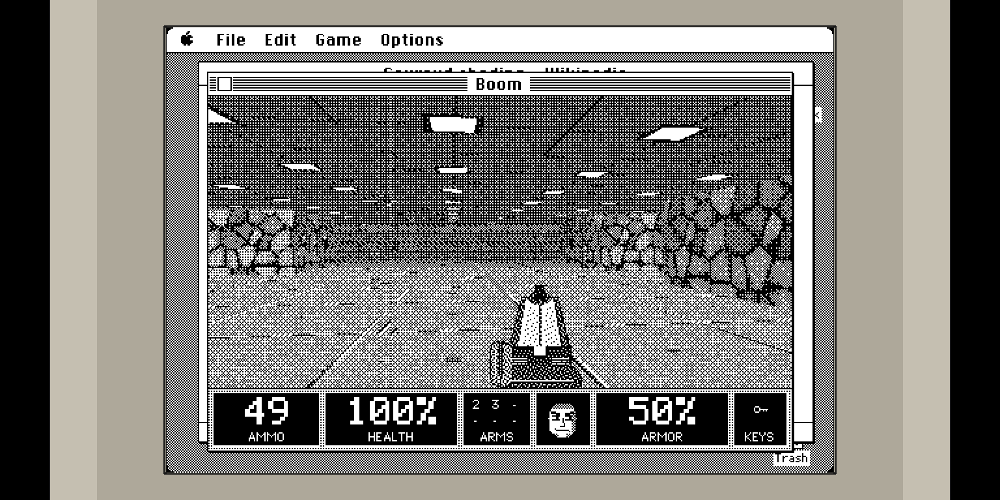

# Mac

The cold open: a Mac Classic running Boom, which crashes, then the desk and Card Attack's launch.

## What it shows

The cold open: a Mac Classic's 512x342 one-bit screen. Boom, a made-up shooter in a window, is running: down a
corridor of steel panels at a run, a shot, a door rises into the ceiling between its hazard-striped jambs, through
it into a room of stone pillars, turning, two more shots; the gun bobs and kicks, the status bar counts the ammo down
and its face looks round and grins. From frame 32 it goes haywire, worse and worse over three seconds (the hall of
mirrors): at first a band of the view now and then, the next frame clean again; then more and more bands left from
the picture before and smeared sideways as the player turns, streaked (one column across the band), or showing the
walls from behind the player; the ammo counter junk (999, 0, 512, 666) from a third of the way; strips of rows torn
sideways in the second half. At 68 the system error: the bomb box (Sorry, a system error occurred. ID = 02, Restart,
Resume), the broken picture frozen behind it; after a second the pointer goes to Resume (82): the game dies, and
behind it is THINK C's editor, nearly the whole screen, with the game's source, bsp_tree.c, in Monaco 9 at three
times the size (the plea, /* why doesn't this work??? */); the pointer goes to the scroll bar's down arrow and two
clicks scroll it two lines (106, 110), bringing the line with the sign the wrong way round into view. The Alarm Clock
flashes in the Apple menu's place, the reminder says Demos tonight in Derek's room. Did you check out that new one? (118), and the editor is closed in a
hurry; behind it Wikipedia's Gouraud shading page (the title, the tagline,
a paragraph and its contents, a picture box with a Gouraud-shaded sphere), half a second, closed; under it Learn to
Speak Finnish (LEARN TO SPEAK / FINNISH and the flag, its blue cross a dense dither, cropped to the window), eight
frames, closed. A floppy goes in (the watch), mounts as Card Attack, opens (Lightspeed C's project, the
sources, CARDIAC.h, blit.a), and the Card Attack application is double-clicked: the zoom rects grow to the whole
screen and the watch turns for two seconds. Then the application: a checkerboard tunnel in one bit, 128x86 blocks of
4x4 (a Mac Plus's honest effort), Atkinson-dithered, four pictures a second, with STRANGE QUERY PRESENTS, A CARDIAC
PRODUCTION and CARD ATTACK dissolving in and out over it (HyperCard's dissolve). 377 frames, 31.4 s, all of them in
the film after the [openers](../openers) (`seg mac mac/video_hd.rgb 0 377 1536x768` in the cut).

The prototype is `prototypes/macboomcrash.py` (Boom crashing: the hall of mirrors, the bomb box, the editor), built
on `prototypes/macdoom.py` (the game and the windows behind it), `macpyramid.py`'s bomb box and editor menus, and `macdesk.py`'s launch. From the reminder on it is
macdoom.py's script as before, 58 frames later. This segment makes the screen; the Mac's bezel round it is the
[turn](../turn)'s first frame, laid over the whole segment as a layer by the cut (`over turn/bezel.rgba 1536x768 0 0
0 377`). The sound cues, frame by frame, are in `data/cues.txt`, as notes for the soundtrack; nothing in the film
reads them.

## Why it's hard on CARDIAC

- **A Mac is a font and a pile of rectangles,** and CARDIAC has neither a font nor a screen, and 96 cells.
- **The hall of mirrors is a second view.** The walls from behind the player are the game's view from the same place
  half a turn round: every ray of those columns walked again, every wall's height and light again.
- **Every place is a sum.** A window's parts sit at its corners plus a distance; a title is centred on the middle of
  its window, (l + r) / 2, less half its width.
- **The pointer's glide is a cube.** 1 - (1 - j / n)^3 of the way, and the arc's 0.32 u (1 - u): the products pass
  a card.
- **Boom is a raycaster.** Every column's ray has to be walked across the map cell by cell, and the map doesn't fit
  in a machine: the walk is in texels (64 a cell) on lines a ray crosses at fractions of its own slope, and a ray's
  numbers (its part each way in 448ths, its way across in texels, 15 cells of map in texels) sit right at a card's
  edge. Every wall's height is a division, every floor pixel's texel a point on a line through the world, every dot
  a texel's grey against the dither under the light.
- **The tunnel needs an angle and a distance per block,** an arctangent and a square root, and its depth twists by
  2400 / R times a sine.
- **Atkinson's dither is sequential.** Each block's error goes to six neighbours, two of them in the rows below, so
  every row waits on the one above, and the numbers are eighths.

## How it's done

**The desk as data** ([`desk.rs`](desk.rs), shared by the host and the reference): every frame's layers (the desk's
icons, each window back to front, the alert, the menu bar), each a list of items (filled and framed rectangles,
sprites, lines of text, pictures worked out) whose places are a corner of the window (or of the screen) and a
distance, as the Mac's own resources gave a window's parts in its coordinates; the zoom rects as their two
rectangles and a step; the pointer as still or a glide's two points and a step; the tunnel's picture and title. The
script is the prototype's, frame for frame (its glides' lengths as it times them). **The game as data**
([`boom.rs`](boom.rs)): the window, the camera's keyframes, which shot is fired when, the gun's bob and kick, the
face, the counters' places, the map's and textures' files, the page's sphere, the flag's proportions.

**Assets** made ahead of time in Python ([`data/make_data.py`](data/make_data.py), which runs the prototypes' own
drawing code): the sprites
(`sprites.txt`: the icons plain, selected and the floppy opened; the arrow and the watch's eight hands; the Alarm
Clock's small clock; the close, zoom and grow boxes, the scroll arrows, the close box's starburst; the OK button and
pressed; the screen's rounded corners; the gun's four frames, the face's six, the status bar without its counters, the
counters' digits, the page's title and LEARN TO SPEAK / FINNISH in Chicago at twice the size); `boom.txt` (the map,
the seven textures' greys, the dither's thresholds for every light); the tunnel's printed tables (`tables.txt`: per
slope step, the angle within the octant and the secant; per distance, how far along, the depth's twist and the shades
with the fog in them; the sine); the title cards at 128x86 (`titles.txt`, Futura as the prototype sets them);
HyperCard's dissolve (`dissolve.bin`, the prototype's pixel order); the cues (`cues.txt`). Chicago 12, Geneva 9 and
Geneva 12 are the UI kit's atlas faces 17-19. The tunnel's arctangent, secant, twist (1440 / R) and fog curve (its
power 1.3) are worked out in Python and printed in these tables; CARDIAC fetches them, it does not compute them.

**Each frame of the desk** (the host: [`host/src/fx/mac.rs`](../../host/src/fx/mac.rs)):

1. `mac_place` adds up every place: the window's left, top, right, bottom or middle ((l + r) / 2) and the distance.
2. `ui_text` (the kit's) sets every line: Chicago and Geneva glyphs by their advances and offsets, centred lines by
   half their width, the right-set ones (the Finder's "available") by all of it; the boxes
   behind the icons' names and the active title are glyphs of no size at the ends.
3. `ui_ease` works out the zoom rects' edges (from + (to - from) j / n); `mac_glide` how much of the pointer's way is
   still to go at its step, (m / n)^3 of it by three multiply-and-divides by adding (and of that again), and
   `mac_arc` its place, the bow 8 / 25 of the difference to one side.
4. The host draws the desktop's 50% grey itself (a checker, every other pixel black), then lays each item in order:
   fills the rectangles (clipping them to the screen), lays each glyph's and sprite's pixels where they were placed,
   copies each picture's (the sphere's dots only).
5. The host clips each zoom rect to the screen and lists its outline's pixels; `mac_xor` turns them over, one rect
   after another.

**Each frame of Boom.** Its numbers are sums on [the swarm's](../swarm) arithmetic machines (`host/src/fx/swarm_calc.rs`: exact
sums of products, divisions rounded down, the sine table), as the turn's are. Units: texels, 64 a cell.

1. The camera on its path: smoothsteps fl(fl(x^2, 10)(3000 - 2x), 100000) of the frame's place in its leg, the
   places and the angle lerped between the keyframes; how far up the door is (a smoothstep over 10 frames).
2. The view's way: 448 cos and sin of the angle (the sine table); each column's ray, in 448ths, the way plus the
   screen's (0.8 each side) part: rdx = ux + fl(-uy k, 560), rdy = uy + fl(ux k, 560), k = 2c - 447.
3. For each ray and each way (the lines x = a cell's edge, and y = one): how far to the first line (the camera's
   texel, or 64 less it), the cell entered there, how far the ray has gone the other way by then, fl(first |b|, |a|)
   and its remainder, and how much further at each next line, fl(64 |b|, |a|) and its remainder (held to 999).
4. `mac_cross` walks each ray across the lines of each way, carrying the remainder like a line drawer, until 999
   texels either way or the map's edge; `mac_across` turns each crossing into the cell the other way and the texel
   crossed at (a texel less going back unless exactly on one). The host looks each cell up in the map.
5. `mac_first` finds each way's first wall and the door before it (the door shut is a wall, all the way up isn't
   there); `mac_pick` the nearer wall (the x line's when the way the ray had gone across there is less than how far
   along the y line's is) and whether the door is in front of it.
6. For each wall and the door: its column (the texel, 63 less it seen from behind), its scale s = fl(400 along, |a|)
   in 250ths of a texel a row, its light 155 - fl(7 s, 44) held to 10..100 (four fifths on a y line's wall, 27/20 in
   a muzzle flash), its first row (where 16000 + (2y - 223) s stops being below 0) and the texel there (that sum, with
   32 times the door's height for the door, over 500). `mac_wall` walks each down the rows: the texture's column of
   64 greys read in order as the texel comes to them, each row's dot black where the grey is at most the row's
   threshold, to the wall's foot or the view's. The host fetches the thresholds (`boom.txt`'s, for the light, at the
   place in the 4x4 ordered dither given by the wall's top row mod 4, worked out on the arithmetic, and the pixel's
   column mod 4) and the texture's column.
7. The floor and the ceiling (rows y and 223 - y see the same places), per row-pair m = 2y - 223: where the texels
   start across the row, n / 14m texels on from the camera (n = 560 ux + 447 uy, wrapped at 64: in thousandths) and
   how they step a column, -1000 uy / 7m (and the same down); the light 155 - fl(2545, m). `mac_fidx` steps each row's
   texels across, `mac_fdot` makes each pixel's dot from the fetched grey and its column's threshold.
8. The gun's bob, fl(12 bob sin, 9990) across and fl(7 bob |cos|, 9990) down (the phase 0.6 radian a frame), and the
   ammo's digits (50 less the shots). The host lays the gun's sprite (its kick and flash), the status bar, the digits
   and the face.

**Once:** the page's sphere (radius 70): for each row, on the arithmetic, its span (|x| up to the whole root of 70^2 -
y^2), the first pixel's height s (the whole root of what is left), what the square is over s^2, its light -50 x - 60 y
+ 62 s (7000ths: the prototype's -0.5 nx - 0.6 ny + 0.62 nz), and the dither's thresholds, ceil((70000 (2k + 1) -
179200) / 288) (the light held to 0..1, times 0.9, plus 0.08, under the step's middle). `mac_ball` keeps the root and
the light across the row (the square under the root changes by 2x + 1 a pixel: a step of the root when what it is
over the root's square passes either way; the light in hundreds and the rest), `mac_bdot` dithers it (the 4x4 ordered
dither at twice the size). The Finnish flag: its size (60 narrower than the window's inside, 18:11, cropped 8 above
its foot) and the cross's bands (ceil of 5 and 8 eighteenths across, 4 and 7 elevenths down) on the arithmetic;
`mac_flag` its pixels, the cross blue as three dots in four; the host frames it in black.

**The tunnel, set up once** (per block, row by row): `mac_offset` gives its offset from the middle in half pixels
(8 ix - 507, 8 iy - 337, odd, never 0), the longer and the shorter and the octant; `mac_slope` the slope step,
128 shorter / longer, a bit at a time without doubling past a card; the host fetches the slope table's angle and
secant at that step; `mac_angle` the angle round (800 a turn) from the octant; `mac_reach` the distance, longer
(1 + c / 200) (by100); the host fetches the ring table's cards at that distance.

**Each picture** (t = j / 4 s): `mac_turn` reads the sine table for the turn, 30 sin(0.225 j), the depth twist's
weight, 16 sin(0.15 j), and the travel, 11 j mod 40; `mac_twist` how far each depth twist (0-60) turns the wall this
picture; `mac_trow` each block's shade: around is its angle, the turn and its twist (the host fetches it by the
block's twist), a check every 50 (the tens digit 5 or more is an odd check); along its ring and the travel, a check
every 20; light where both are odd or both even, else dark. `mac_dither`, row after row, is Atkinson's: a block is
black under 128 (of 256); its error over 8, toward zero, goes to the next two (carried in the machine), and is
punched for the rows below: what the row under gets at each block (the three above it and the one two rows up, the
last carried in by the host from the row before) and the block's own eighth for the row after next. The host
deals each row what the rows above passed it.

**The titles:** `mac_thirds` gives how many thirds of a card's dissolve show at its frame (one more each frame in,
one fewer each frame out, at most three), `ui_ease` how far each third has come, 255 j / 3 (85, 170, 255); per screen row,
`mac_dissolve` says which of the card's pixels' turns have come; the host lays those, the rim black and the letters
white, over the tunnel (copied four by four from its blocks). Then the screen's corners, and the pointer.

**The crash** (the prototype's `haywire()`, `script()`). The hall of mirrors' schedule is worked out ahead of time
in Python, not on CARDIAC: `make_data.py` runs the prototype's generator and formulas in floating point and prints the
result to `data/haywire.txt`. From the frame's place in the haywire stretch, u = (f - 32) / 36, it works out which
frames come out clean (u < 0.4 and the frame's random number above 0.25 + 1.5 u), how many of the 48 bands show
(1 + int(48 u^2)), how far the smear moves (int(6 + 60 u) columns), how many strips tear (int(9 (u - 0.5)) from
halfway) and what the counter shows. The bands' places (the prototype's random numbers) and the four strips' rows
and moves (the prototype's constants) are printed in the same file. The pictures the schedule moves are worked out on
CARDIAC. Each frame from 32 to 67: the game's own frame, on CARDIAC as above (Boom plays on under the bug, its last two shots too); where
a band shows the walls behind, the game's view from the same place with the angle half a turn on (the arithmetic
adds 500000 millionths), only those columns' rays cast and walled (the flats in full), no muzzle flash. Then the host
moves the pixels, the bands in order, working out each source column itself: a band of the picture the frame before
showed, moved the schedule's columns across (the host's (c + 448 - shift) mod 448 on the view's 448 columns, the
player's turn smeared); the band's first column copied across it; the view behind's columns; then the torn strips
(22 rows each, moved across, the host wrapping each column round the row); and, where the counter is junk, the
status bar laid again with the junk digits (their places from the bar's corner) and the face calm. Each picture is the one before's,
moved: the frames from 32 to Resume are one block of the live player's (its cuts: 0-32, then 82 on).

The bomb box is a layer over the frozen picture: its double border (four fills), the bomb (a sprite at twice the
size), the two lines in Chicago and the buttons' labels centred on them (`ui_text`), the buttons' rounded outlines
(sprites), every place a corner and a distance (`mac_place`). The editor is a window like the others (its scroll bars,
arrows, grow and zoom boxes): each line of bsp_tree.c is a picture of it in Monaco 9 at three times the size (a sprite,
as the page's title in Chicago at twice is), its place the window's corner and a distance (33 rows a line, a line less
for each click), cut off at the foot of the rows that fit (a place too), all added on `mac_place`. The pointer's two
straight moves (to Resume, to the down arrow) are `ui_ease`'s: from + (to - from) j / 4 each way.

`card-attack mac refs/mac_ref` says identical 377/377 (512x342) and 377/377 (1536x768).

**Instructions:** 1,219M for 377 frames, in 39,631 machine runs. The game's 68 frames and the 26 views behind (the
frames whose bands show them, only those columns' walls) take about 1,140M: the arithmetic 546M (its long divisions
the most, `sw_divd` 239M and `sw_join` 118M; `sw_divd`, `sw_lsum`, `sw_qis`, `sw_qp` and `sw_mag` run as the
hand-written tapes in [`swarm/hand`](../swarm/hand)), `mac_fidx` 182M, `mac_fdot` 176M, `mac_wall` 152M,
`mac_across` 43M, `mac_cross` 29M, `mac_first` 11M. The tunnel's 36 pictures and the titles' 84 frames take about
73M (`mac_trow` 24M, `mac_dither` 22M, `mac_dissolve` 22M), the sphere and the flag about 2.4M besides their sums,
and the desk about 3M. The hall of mirrors' moves are the host's: its schedule is Python's, and the host's address
arithmetic moves the pixels by it. Live it splits into blocks, the frames from 32 to Resume one of them.

## Against the prototype

The desk is the prototype's to the pixel except where it rounds: the pointer's glides (within a pixel or two, a few
frames) and the zoom rects' edges (a pixel). The game is the prototype's picture in whole numbers: the camera's
keyframes to the texel, the rays in 448ths, the walls' rows and texels to a row or a texel at their edges, the floor's
texels to a thousandth of a texel a column (the prototype's float a texel off here and there at the tiles' edges);
the light and the ordered dither are the prototype's exactly (a texel black where its grey times the light is at most
the step's middle), so the dots differ only where a texel does. The gun's bob rounds down where the prototype rounds
to the nearest. About 1-7% of the game's pixels differ from the prototype's, along edges. The sphere's height is a
whole square root where the prototype's is exact: a few dots on the step's edges. The page and the flag are the
prototype's to the pixel. The
tunnel is the same picture in whole numbers (about 4% of blocks on the other side of a check's edge); Atkinson's
dither there too: the same greys, different dots. The titles' dissolve is the prototype's exactly.

The crash: the hall of mirrors' schedule is the prototype's exactly (printed by make_data.py), and its moves of
pixels are the prototype's numpy's; the pictures it moves are the game's, so they differ from the prototype's where the game's do
(about the same share of pixels, 4,000 to 9,000 a frame; the smear carries the frame before's differences along).
The walls behind are the game's view half a turn round, whole numbers as the game's. The bomb box, the editor and its
code, the menus and the scrolling are the prototype's to the pixel. The pointer's straight moves round down where the
prototype rounds to the nearest (halves to even): a pixel off at frames 77, 79, 101 and 102.

## Numbers

| Number | Largest | Margin |
|---|---|---|
| A window's left plus right (`mac_place`) | 666 | 333 |
| A glide's way across, and the sum by adding (`mac_glide`) | 453, 462 | 537 |
| The bow's part times 8 (`mac_arc`) | about 920 | 79 |
| A ray's part one way, 448ths (`mac_cross`, `mac_pick`) | 806 | 193 |
| How far along a line, texels (`mac_cross`: stops before 999; `mac_first`) | 998 | 1 |
| How far across, texels (`mac_cross`, held to 999) | 999 | 0 |
| A remainder and the next's, tested as rem >= a - r (`mac_cross`) | 805 | 194 |
| The other way's texel plus the way across's (`mac_across`) | 126 | 873 |
| A row's 500ths plus the step's (`mac_wall`) | 998 | 1 |
| A column's thousandths, tested as part > 999 - step (`mac_fidx`) | 999 | 0 |
| A texel's grey, a threshold (`mac_wall`, `mac_fdot`) | 256, 999 | 743, 0 |
| A row's root, and what its square is over the root's square (`mac_ball`) | 70, under 280 | 719 |
| The sphere's light's rest plus its change a pixel (`mac_ball`: the root steps by up to 12 at the rim) | about 840 | 159 |
| A slope step's remainder doubled, tested as rest >= longer - rest (`mac_slope`) | 506 | 493 |
| A distance in half pixels (`mac_reach`) | 610 | 389 |
| The angle round, turned and twisted (`mac_trow`) | 949 | 50 |
| Along and the travel (`mac_trow`) | 998 | 1 |
| A twist times the weight (`mac_twist`) | 960 | 39 |
| A block's value in the dither (`mac_dither`) | under 500 | 499 |

The arithmetic's numbers are its own (one card, or three); the largest, about 135M, is the turn's angle lerped (its
change times a thousandth of the way). The view behind's angle, half a turn on, is at most 659155 millionths.

## Machines

| Machine | Cells | What it does |
|---|---|---|
| `mac_place` | 63 | Per frame: every place, a window's corner and a distance added |
| `mac_glide` | 71 | Per glide frame, twice: what is left of the way, (m / n)^3 |
| `mac_arc` | 59 | Per glide frame: the pointer's place, the bow |
| `mac_xor` | 14 | Per zoom rect: its outline's pixels turned over |
| `mac_cross` | 90 | Per game frame: each ray across the lines one way, the cells and how far across |
| `mac_across` | 96 | Per game frame: each crossing's cell the other way and the texel crossed at |
| `mac_first` | 76 | Per game frame: each way's first wall and the door before it |
| `mac_pick` | 92 | Per game frame: each column's nearer wall, and the door in front of it |
| `mac_wall` | 90 | Per game frame: each wall's (and the door's) column of dots |
| `mac_fidx` | 83 | Per game frame: the floor's and ceiling's texels, a row-pair at a time |
| `mac_fdot` | 51 | Per game frame: the floor's and ceiling's dots, a row at a time |
| `mac_ball` | 94 | Once: the sphere, each row's root and light kept across it |
| `mac_bdot` | 86 | Once: the sphere's dots, the ordered dither at twice the size |
| `mac_flag` | 88 | Once: the Finnish flag's pixels, the cross a dense dither |
| `mac_offset` | 68 | Setup, per row: each block's offset, longer, shorter, octant |
| `mac_slope` | 41 | Setup, per row: each block's slope step |
| `mac_angle` | 64 | Setup, per row: each block's angle round |
| `mac_reach` | 70 | Setup, per row: each block's distance |
| `mac_turn` | 69 | Per picture: the turn, the depth twist's weight, the travel |
| `mac_twist` | 33 | Per picture: each depth twist's turn of the wall |
| `mac_trow` | 84 | Per picture, per row: each block's shade |
| `mac_dither` | 76 | Per picture, per row: Atkinson's dither (told the row's width) |
| `mac_thirds` | 28 | Per title frame: how many thirds of the card's dissolve show |
| `mac_dissolve` | 19 | Per title frame, per screen row: which pixels show |
| `ui_text`, `ui_ease` | (the UI kit's) | The lines of text; the zoom rects' edges, the pointer's straight moves, the dissolve's thresholds |
| the swarm's arithmetic | | `sw_qis`, `sw_qp`, `sw_lsum`, `sw_term`, `sw_mag`, `sw_shift`, `sw_divd`, `sw_join`, `sw_floor3`, `sw_sign`, `sw_ang`, `sw_sin`, `sw_short`, `sw_hund`, `sw_isqrt`, `sw_isqrt2` |

## Files

- `desk.rs`: the desk, its frames and the script, as data; `boom.rs`: the game's (both shared by the host and the
  reference).
- `machines/`: the machines.
- `data/make_data.py`: makes `sprites.txt`, `boom.txt`, `tables.txt`, `titles.txt`, `dissolve.bin`, `haywire.txt`,
  `cues.txt` (kept: assets made ahead of time).
- `reference.rs`, `reference_boom.rs`: every frame in ordinary Rust, from the formulas (the text by `ui/text.rs`).
  `card-attack mac refs/mac_ref` checks every frame against them.
- Host: [`host/src/fx/mac.rs`](../../host/src/fx/mac.rs). It files `video.rgb` (377 frames, 512x342) and
  `video_hd.rgb` (each pixel copied 2x2 by the host, a blit, 1024x684 at 256, 42 of 1536x768, black round it, for
  the turn's bezel to go round in the cut) (not kept).
