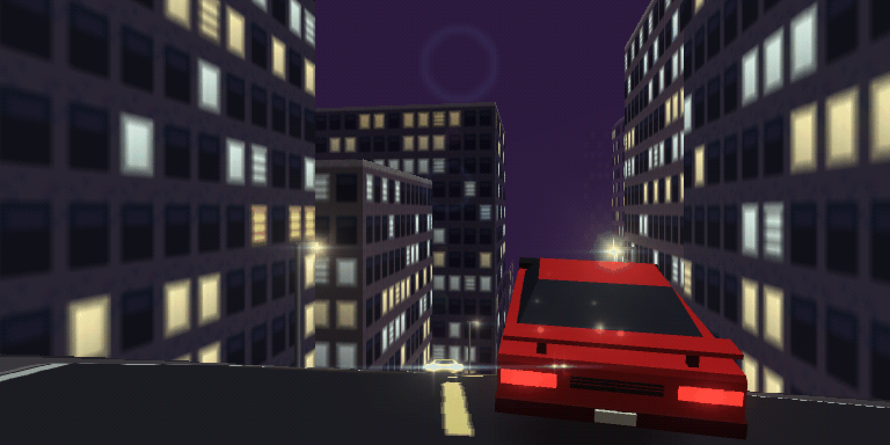

# Mesh



The mesh kit draws models from Blender on CARDIAC at up to 1536x768. It isn't a segment of its own. In the film it
draws our car in the [accel](../accel) segment (the car on the street and in the jump, flat shaded, in both halves),
and in the [deep](../deep) segment it draws the killer whales' silhouettes and the knob at the end of the dive (its
rock, its plate and the knob). A model is an asset, like a font or a photo, made ahead of time from Blender by a
Python script. Every number worked out from it each frame (the turn, the camera, the light, which faces show, every
pixel and the depth test) is CARDIAC's.

## Why it's hard on CARDIAC

- **Products and quotients of long numbers.** A corner turned exactly is a sum of products of three-digit numbers
  (millions of thousandths), and its place on the screen is a division by its depth, to a hundredth of a pixel:
  nothing of the geometry fits a card.
- **No depth buffer.** 1.2 million pixels' depths don't fit 96 cells. The pieces of the triangles are cards, sorted
  to their pixels by the host as a card sorter would, and a machine keeps the nearest on each.
- **Watertight at 1536x768.** Two triangles that share an edge must meet with no pixel between them and none drawn
  twice, so an edge is walked once and both take its crossings.
- **96 cells.** A dot product with three-digit factors is most of a machine (polys' `polydot`), so every step is its
  own small machine, run over a whole list at once.
- **Three digits for everything.** A normal's dot with the light is kept inside a card by taking the light at 98
  hundredths.

## How it's done

**The data** (`data/make_mesh.py`): Blender, headless (`blender -b`, through `data/blender_export.py`), exports the
model (a .glb, .gltf, .obj, or a .blend's meshes) at any subdivision level as triangles, and the script makes it whole
numbers. The model's space is x right, y up, z away (Blender's front, -y, toward the camera), centred on its box and
scaled so no corner is further than 499 units from the middle. Each corner's normal is in hundredths (99 long); each
triangle has its face normal and its plane's distance from the middle; the corners' UVs are printed in thousandths
when the model has them. `data/spec.txt` is the highlight's printed table, 99 (h / 969)^32 (`make_mesh.py --spec 32`).
The models in the film are `accel/data/car.txt` (`accel/data/make_car.py`), `deep/data/orca_*.txt` and
`deep/data/knob_*.txt`.

**The scene** (the swarm's arithmetic, `fx/swarm_calc.rs`): a turn from a yaw and a pitch (`Kit::turn`: their sines
from the swarm's table, R in thousandths, products rounded down); the light's way and the half-way vector turned into
the model's space (R's transpose) at 98 hundredths; the camera there, in tens of units. And, for a lit model, the
material's tables (`polydot`): its diffuse colour times each light 0..99, its highlight's times each highlight 0..99.

**The faces** (`polydot`, `mesh_front`): a triangle faces the camera when its normal's dot with the camera passes its
plane's distance less a margin of 6 (60 units). A face seen nearly edge on is kept and hidden by the depth test, so
no face that shows is ever dropped.

**The corners** (the swarm's arithmetic), of the triangles that face the camera: R v + 1000 P exactly in thousandths
of a unit; the depth rounded down to a unit; the place on the screen, f / 10 times across (or less up) over the
depth, in hundredths of a pixel from the middle; the depth less the scene's zero, a card (0..999).

**The light** at each face (flat): `polydot` gives its normal's dots with the light and the half-way vector.
`mesh_tone` gives the diffuse in hundredths and the highlight's index (each 0 where its dot is not above 0); the host
fetches the highlight from its table and the colour's two parts from the material's tables by the indices the
machines punched; `mesh_mix` adds them to the ambient, at most 255.

**The edges** (the swarm's edge machines, `sw_order`, then `sw_esub` to `sw_epix`): each edge of a triangle that
faces the camera is walked once, top end first (`sw_order` says which end is the top): the rows it meets and where it crosses each (two long divisions an edge, the remainders
carried), and the first pixel whose middle is at or right of it. Its ends' values (the depth, and the three numbers
the corners carry) are carried down its rows by `mesh_walk`: at the j-th of n rows, the top's plus the change times (j + 1) / (n
+ 1), cut toward 0.

**The spans** (`mesh_ends`, `mesh_walk`): each triangle's row runs from its two edges' pixels (`mesh_ends` punches
which is the left and how many pixels the span has, none where the two meet), and every value is carried across the
same way, the depth's walk punching each pixel's place.

**The depth test** (`mesh_depth`): the host sorts the pieces to their pixels, keeping the triangles' order. A pixel
with one piece takes it, and where there are more the machine keeps the nearest (the least depth, the first of
equals). `mesh_near` does the same for pieces that carry three numbers of their own.

The host deals, carries, sorts the pieces, fetches from the tables by the machines'
indices, and copies the computed pixels into the frame. When it reads a model it works out the model's radius with a
floating-point square root; that is used only as a bound on how big a corner's sums can get (to choose how many cards
they need), never as a value dealt to a machine.

## Using the kit

`host/src/fx/mesh.rs`:

```rust
let kit = mesh::Kit::new(demo);                                   // its machines and tables, once
let model = mesh::Model::read(demo, "accel/data/car.txt");        // a model from make_mesh.py
// each frame: a Calc with the frame's numbers, worked out on CARDIAC
let mut c = Calc::new();
let rot = mesh::Kit::turn(&mut c, yaw, pitch);                    // R from a yaw and a pitch (millionths of a turn)
let place = mesh::Place { rot, pos: [x, y, z] };                  // any numbers of the sums (units)
let view = mesh::View { focal10: 150, zref, light: [lx, ly, lz], half: [hx, hy, hz] };
let (drawn, pixels) = kit.pixels(&mut host, &mut c, &model, &place, &view, &material, mesh::Shading::Flat, w, h);
```

- **The place and the turn** are numbers of the sums (`swarm_calc`'s `N`), so they can be worked out on CARDIAC from
  the frame. R is in thousandths, rows across, up and away.
- **The view**: the camera at the origin looking along z, x right, y up; the frame's middle is the camera's axis.
  `zref` is the depth test's zero: every corner's depth less it must be 0..999 units (the host stops if not).
- **The frame**: any w x h up to 1536x768 (even). `pixels` gives back each pixel the model covers (its index in the
  frame) and its colour, for the caller to file. Each draw's depth test is its own.
- **Shading**: `Flat` (a colour a face), and two unlit ones. `Depth` with `Kit::pixels` gives back each covered pixel's depth instead of drawing, for a silhouette the caller
  colours (the orcas). `Carry` with `Kit::carry` carries three numbers each corner holds across
  the triangles and gives back each covered pixel's depth and the nearest piece's numbers (`mesh_near`): a place in a
  texture for the caller to fetch (the knob's rock, plate and knob). `Kit::draw_pixels` draws a model with a material a face and gives back
  each covered pixel's colour and depth (our car).

## Machines

| Machine | Cells | What it does |
|---|---|---|
| `mesh_front` | 16 | Which triangles face the camera |
| `mesh_tone` | 37 | The light's two dots made ready: the diffuse in hundredths, the highlight's index |
| `mesh_mix` | 56 | A colour: the ambient plus the material's two parts, at most 255 |
| `mesh_ends` | 27 | A span's two crossings in order, and its count of pixels |
| `mesh_walk` | 85 | A value down an edge's rows or across a span's pixels |
| `mesh_depth` | 49 | The nearest piece on each pixel |
| `mesh_near` | 50 | The nearest piece on each pixel, with the three numbers it carries |
| polys' | | `polydot` (every dot product, the material's tables) |
| the swarm's arithmetic | | `sw_qi`, `sw_qis`, `sw_qp`, `sw_lsum`, `sw_term`, `sw_mag`, `sw_shift`, `sw_abs`, `sw_divd`, `sw_join`, `sw_floor`, `sw_floor3`, `sw_add`, `sw_short`, `sw_card`, `sw_ang`, `sw_sin` |
| the swarm's edges | | `sw_order`, `sw_esub`, `sw_erows`, `sw_eclip`, `sw_eend`, `sw_ewalk`, `sw_ecross`, `sw_epix` |

In the accel segment's render, the kit's own machines and `polydot` run 1,109M of its 18,793M instructions.

## Against the design

- **Values across a triangle** are carried by rows and pixels, not by sub-pixel distances: at the k-th of n places
  the fraction is (k + 1) / (n + 1). Two triangles that share an edge take the same values from it, so colours and
  depths meet; inside a triangle a value is off by at most half a place's change.
- **The light's ways at 98 hundredths**: the diffuse reaches 96 hundredths, not 99, and the highlight's table is made
  for it (969 for a unit normal's dot).
- **No shadows.** A segment that wants one draws it itself (accel's car shadow is accel's own machines).

## Files

- `data/make_mesh.py`, `data/blender_export.py`: a model's cards from Blender, made ahead of time. `data/spec.txt`:
  the highlight's printed table.
- `machines/`: the kit's seven machines.
- Host: [`host/src/fx/mesh.rs`](../../host/src/fx/mesh.rs).
