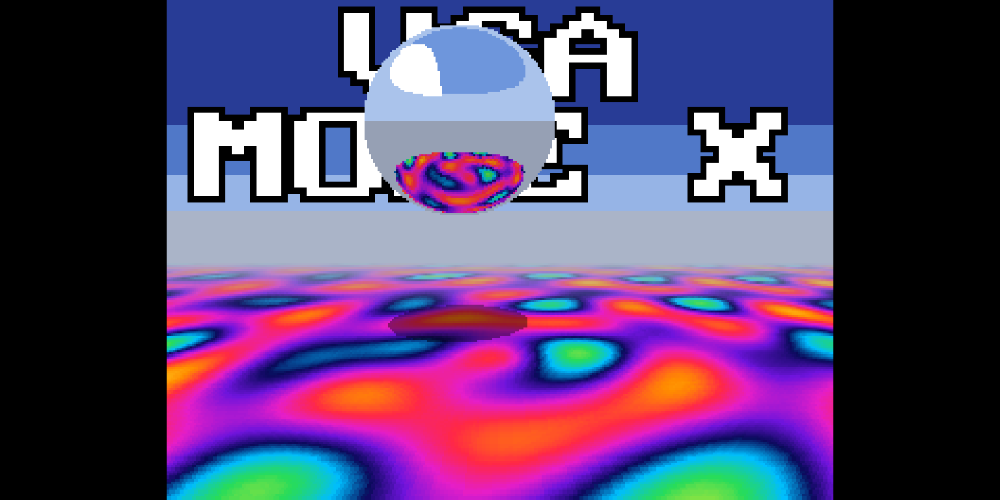

# Mode X

## What it shows

The ray tracer climbs to Mode X: the mirror ball over the plasma floor at 320x240, Mode X's square pixels, shown 4:3
in the middle of the 1536x768 frame. The ball is already falling at the first frame, its foot just inside the top,
lands at frame 14, bounces once and hops on, swaying over the plasma, which keeps turning from where the
[plasma](../plasma) left it. Behind it, filling the sky, **VGA over MODE X** in the VGA's 8x16 font (each page pixel
6 x 4), white with a thick black outline.

The segment renders 150 frames: the ray's 120-frame script, then 30 more that carry it on from its start (its sway
and bounces repeat every 120). The film shows its frames 0 to 65 (5.5 s) after the plasma; then the
[dorm](../rooms) pulls back from the monitor, which shows Mode X's frames 66 to 149 as it goes.

The degauss that once ended this segment now ends the rotozoomer ([`rotodg`](../rotodg)). Its machines (`dg_`), its
tables and its reference (`degauss.rs`) are in this folder, and `rotodg` uses them.

## Why it's hard on CARDIAC

Everything that makes a ray tracer hard on CARDIAC (no square root, no multiply or divide, no fractions, three digits),
at more than four times the pixels of the 192x96 scene it grew from, and:

- **The ball no longer fits a card.** Its radius is 46 pixels: 46^2 = 2116, past 999. Every square root on it
  (the span of a row, the depth of the surface) is taken on a number kept in two cards, hundreds and units, the
  squares taken away as odd numbers and the root counted as the odd numbers that still fit.
- **Neither does its bounce.** The bounced direction (C A, C B, 1058 - C^2) is out of 1058; it is halved, out of 529,
  each part made without the product (C A passes a card).
- **The floor comes nearer than the screen.** Below row 200 the floor is in front of where the plasma stood, so its
  distance is a division of a negative number, rounded down by adding back.

## How it's done

The scene is the 192x96 ball-over-plasma scene at 5 / 3 the size, its constants re-derived (see `reference.rs`): the
horizon at row 100, the camera 200 pixels from the screen, the ball's radius 46 (for 46 2/3), its centre 160 + 10 x / 3
across and 107 - 10 L / 3 down for its lift L. The plasma's units, its shadow and its colours don't change. A row is
four 96-pixel tiles, at 0, 96, 192 and 224 across: the plasma's machines paint 96 pixels a run, so the last tile's
first 64 pixels are the third's again, and only its last 32 are filed.

**Per frame:** the plasma's `pl_clock` (its clock running on from the plasma's last frame), the ray's `rt_path`
([ray](../ray): the ball on the entrance's arcs or the script, its shadow's size), and `mx_place`, which puts the ball
in pixels. The ball falls on two arcs given by `data/entrance.txt` (an asset: each arc's first frame, length and
height), then follows the ray's script from its 22nd frame.

**Per tile row:** `mx_row` gives the floor's points and fog (and the shadow); `mx_span` the ball's pixels; per ball
pixel `mx_norm` its surface and bounced ray, `mx_bounce` the light, sky, haze or the floor, and `mx_hit` the floor
point a ray reaches. `mx_compose` lays the ball's looks, u and v over the floor's (the host deals each background
card with the ball's after it where the ball covers it), and the plasma's machines paint the row: the plasma at the
reflected point, 4 32nds darker.

**The sign** is `data/sign.txt` (made by `data/make_data.py` from the atlas's VGA face and `ui/pages.rs`'s
`MODEX_SIGN`): a line per lettered pixel, x and y. The outline is every pixel within 3 of a letter, found once before
the first frame by the [titles](../titles)' role machine (`tt_role`, outlined, no shadow) run over the mask three
times, each pass's letters and outline the next pass's mask (two runs a row, 192 columns from 0 and from 128: 600
runs, 4.9M instructions). The host keeps each row's span of ball pixels, joining the spans `mx_span` punched in each
tile by taking the smallest start and the largest end, and where a letter's or the outline's pixel is outside that
span it files white on the letters and black on the outline.

The 1536x768 frame shows the 320x240 one 1024x768 in the middle, black at the sides. The host works out which
320x240 pixel each frame pixel shows, (5 x / 16, 5 y / 16), with its own multiplications and divisions (a
nearest-neighbour blit), and copies it.

`card-attack modex refs/modex_ref` says identical 150/150 at 320x240 and 150/150 at 1536x768.

**Instructions:** 21,556M for the 150 frames, about 144M a frame (1,260,858 reflected rays): `pl_paint` 8,164M,
`pl_tone` 4,019M, `mx_norm` 2,862M, `pl_ring` 1,447M, `pl_wave` 1,173M, `mx_bounce` 1,062M, `mx_row` 893M,
`pl_slant` 656M, `pl_rings` 540M, `mx_hit` 501M, `mx_span` 123M, `mx_compose` 112M, the sign's outline 4.9M.

## Against the prototype

The prototype is the 192x96 scene sampled at 320x240 in floating point; this is the scene re-built at 320x240 in
whole numbers, so it differs by rounding: within half a pixel in place (the prototype samples pixel centres), the
ball 46 pixels in radius for 46 2/3, the sky's bands on whole rows. The floor seen in the ball is finer than the
192x96 scene's: its distance in hundredths of the ray's length (tenths at this size would show the floor in five
bands, where the prototype's is smooth), the haze from the prototype's distance on. The mean difference from the
prototype's frames was about 4 of 255. The prototype is not in this repository.

## Machines

| Machine | Cells | What it does |
|---|---|---|
| `mx_place` | 66 | Per frame: the ball's centre and lift in pixels at this size |
| `mx_row` | 19 data + 68 / 33 / 42 / 37 / 54 / 44 | Per tile row: the floor's points, fog and the ball's shadow |
| `mx_span` | 5 data + 81 / 46 | Per tile row: the ball's pixels, its square roots on two cards |
| `mx_norm` | 5 data + 88 / 77 / 27 | Per ball pixel: its surface's depth and the bounced ray |
| `mx_bounce` | 82 | Per ball pixel: the light, the sky, the haze or the floor |
| `mx_hit` | 8 data + 68 / 61 | Per ray that reaches the floor: the floor point it shows |
| `mx_compose` | 26 | Per tile row: the ball's looks, u and v laid over the floor's |
| `rt_path` | (the [ray](../ray)'s) | Per frame: the ball's place on the arcs or the script, its shadow's size |
| `tt_role` | (the [titles](../titles)') | Once: the sign's outline, three passes |
| `pl_clock` and the plasma's row painters | (the [plasma](../plasma)'s) | The clock, the waves and the colours |

The degauss's machines, used by [`rotodg`](../rotodg) (the host's `fx/degauss.rs`):

| Machine | Cells | What it does |
|---|---|---|
| `dg_scale` | 80 | The blotch's and the jolt's strengths and amounts |
| `dg_lum` | 19 | A colour's light, red + green + blue |
| `dg_mix` | 90 | A colour's tints added and held to 0..255, brightened by the flash |
| `dg_push` | 46 | A row's or a column's push in whole pixels, per colour |
| `dg_anglew` | 72 | A pixel's quarter of the turn from the picture's middle (on the deck), and the sides whose ratio gives its angle |
| `dg_atan` | 74 | Each pixel's angle within its quarter, from the table of atan |
| `dg_turn` | 42 | An angle turned on by a colour's phase |

## Files

- `reference.rs`: draws every frame in ordinary Rust, the scene and the sign at 320x240, then the 1536x768 frames.
- `degauss.rs`: the degauss in ordinary Rust, which [`rotodg`](../rotodg)'s reference includes.
- `machines/`: the seven `mx_` machines and the seven `dg_` ones.
- `data/`: assets made ahead of time. Mode X's entrance (`entrance.txt`) and sign (`sign.txt`); the degauss's
  printed tables (`gauss_roto.txt`, `decay.txt`, `atan.txt`, `rates.txt`) and its warning sign (`warning.txt`, drawn
  by hand). `make_data.py` makes all but `entrance.txt` and `warning.txt`.
- Host: [`host/src/fx/modex.rs`](../../host/src/fx/modex.rs). It files `video.rgb` (320x240) and `video_hd.rgb`
  (1536x768), not kept.
