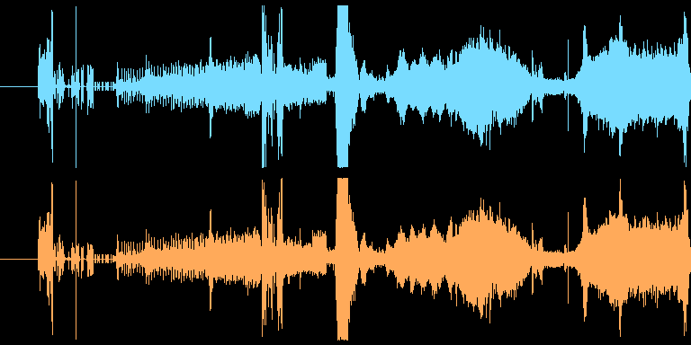

# Music

The soundtrack, decoded live by two CARDIACs while the film plays.

## What it is

The soundtrack is two tracks, `left.track` and `right.track`, one per channel. Each is a file of CARDIAC cards,
one card per line, made from the finished mix by [lubdub](https://github.com/StrangeQuery/lubdub)'s encoder,
`stage`. The mix itself is made outside this repository. The tracks are about 48 MB each, so they are kept packed
in `generated.tar.xz`, which `build.sh` unpacks.

Decoded, each track is 13,672,000 samples at 48 kHz: 4 minutes 44.8 seconds, the length of the film (3,419 frames
at 12 a second). The picture above is the decoded sound, each column the loudest and quietest samples of about 0.37
seconds.

## Why it's hard on CARDIAC

- **A card holds three digits and a sign.** A 16-bit sample runs from -32,768 to 32,767, so no card can hold one,
  and a value from -999 to 999 has too few levels to sound like anything.
- **There is no multiply.** Scaling a correction by the block's step size has to be done with additions.
- **96 cells.** The decoder, its sample history and its constants all have to fit in one machine's memory.
- **48,000 samples a second, per channel,** every one of them computed, and the film's pictures need the cores too.

## How it's done

The encoding is a form of ADPCM built around CARDIAC's decimal arithmetic. A track is split into blocks of 64
samples. Each block starts with two header cards, K and M, which set the block's step size to M x 10^K, and then has
one card per sample. The decoder predicts each sample from a straight line through the two before it, and the
sample's card says how far to correct that prediction, as a three-digit code times the step size. The header
rewrites three of the decoder's own instructions, so the step size costs nothing per sample. The decoder keeps each
sample in two cells, thousands and units, and punches each sample as two cards, which the host (in lubdub's
library) reads as one 16-bit number, thousands times 1000 plus units. `docs/AUDIO.md` in the [lubdub](https://github.com/StrangeQuery/lubdub) repository explains
the format and the decoder in full.

In the player (`host/src/play/sound.rs`), a decoder thread runs lubdub's `Stereo`: two CARDIACs running the
decoder, one per channel, taking turns a block of 64 samples at a time. Their cards are read from the track files
only as the CARDIACs ask for them, and the decoded samples go into a buffer about two seconds long, which the sound
card drains. The host only feeds cards in and passes samples on: every prediction, correction and carry is the
CARDIACs'. A sample is dropped as soon as it has been played, so the soundtrack is never all in memory, as cards or
as samples.

The sound card's clock keeps the time. Its first callback works out where the film's clock will be when its first
sample is heard, and from there it counts samples. If the decoder ever fell behind, the missing samples would be
played as silence and counted, and `play` says how many when it ends. `--audio-offset MS` delays the sound for a
projector that shows its pictures late, and `--mute` plays the film without it.

**Instructions:** decoding the whole soundtrack takes 1,107M CARDIAC instructions, 553.6M for the left channel and
553.2M for the right: about 40.5 an output sample. The decoder takes 38 + M instructions a sample, plus 16 for each
block's header.

## Checking it

The sound has no reference renderer here. lubdub's own tests check that the decoder on CARDIAC outputs exactly
the samples its encoder expects it to. To hear the tracks outside the film, decode them with lubdub's `dub` (built from its repository):

    dub segments/music/left.track segments/music/right.track | ffplay -nodisp -autoexit -f s16le -ar 48000 -ch_layout stereo -

## Files

- `generated.tar.xz`: the two tracks, packed. `build.sh` unpacks them into this folder.
- `left.track`, `right.track`: the tracks once unpacked (not kept unpacked in the repository).
- Host: [`host/src/play/sound.rs`](../../host/src/play/sound.rs). The decoder is lubdub's `audio/decode.cq`,
  fetched by Cargo at the revision `host/Cargo.toml` pins.
