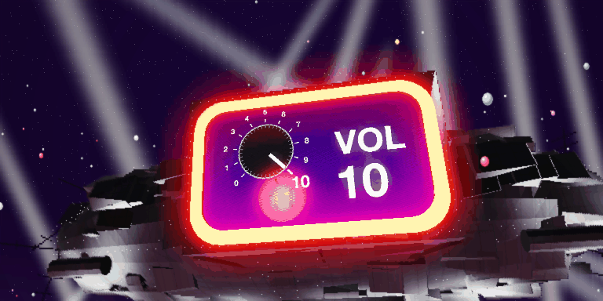

# Night



The night arrival, straight on from the train's last frame: the train brakes into the station at dusk, a drone
chases off over the town to the advertising airship, its volume knob clicks to 11, and the camera turns to dive onto
the stadium. The film shows its frames 0..328 (`seg night night/video_hd.rgb 0 329 1536x768`), 27.4 s; its last 44
frames, 329..372, are the night's layer of the dissolve, which the [stadium](../stadium) segment draws over.

## What it shows

The design is [`prototypes/train_night.py`](../../prototypes/train_night.py). The segment renders 373 frames at
12 fps (31.1 s) at 1536x768. The cab at full speed into the sunset, the sun going down and the sky through dusk to a dark
violet night with stars, the town's windows, signs and street lights coming on, our headlights on the rails; the
train braking into the station and stopping (frame 120) under the LED board, TONIGHT: DEMOSPLASH 0x10; the cab
dissolving (130-141) to the platform, the drone swooping in; the chase after it (from 152) out from the canopies, over
the town, to the advertising airship over the stadium (its hull, plates and masts, about 850 running lights, the
stadium's up-lights sweeping over it, its screen: DEMOSPLASH 0x10 over a laser grid, demos' footage, and the volume
knob at 10 that finds an 11 past the stop and clicks to it); as VOL 11 shows big and white, straight into the dive onto
the stadium down its avenue, its LED skin scrolling the
demos' names, its bands and beams, spots and lasers on the beat (137.14 BPM, beats 1 and 3), balloons, fireworks,
photo flashes; along its face, up and over the top. The last 44 frames are our layer of the dissolve into the
stadium's own render (the stadium segment lays its frames over ours at the same camera, given by the file described below).

## The world at half resolution

`night/video_hd.rgb` (what the live cut plays, and what the stadium's dissolve reads, frames 329..372) has the world
at half the resolution, 768x384 (the town, the fields, the street, the sky, the lamps' light, the beams and haze, the
motion blur and the bloom), made up to 1536x768; at full resolution what has to read across a room: the callouts'
screens and boards, the station's board, the airship's screen (VOL 10 to 11, DEMOSPLASH 0x10), our own train; and
the stars, a pixel each, drawn last. [`nparty.rs`](nparty.rs).

How it joins its two resolutions cleanly: the half-resolution render has the subjects in it too (their
glow, their blur, the beams in front of them), and its buffer keeps the world's own depth behind them (the nearest
of the pieces that aren't a subject). At full resolution the subjects' triangles are drawn again; a pixel of theirs is
kept where it is nearer than that depth at its half-resolution pixel. Kept pixels are shaded at full resolution and
take the light the post laid on their half-resolution pixel (the beams in front of the subject, never those behind
it) and its bloom, then the tone by their own vignette. Where a subject streaks (the blur over its block, half
-resolution pixels, from 1 to 5) its blurred half-resolution picture is mixed in, all of it by 5 and where balloons or
sparks were laid over it. The world is made up to full size (each pixel between its four nearest, a quarter and three
quarters of the way: the bloom's up4) from its own pixels only: those a subject covered first take their nearest world
pixel's colour, so no subject's colour bleeds round its edge and no beam behind a subject shows on it.

At half resolution the renderer is the same code (`set_res(2)`): the lens's twice f halved (on CARDIAC; its turn and
the projection's tables by the resolution), the screen's tables by the full screen's distances (the same vignette),
the blur along the half screen's lines (`blur_line_h`, the night's tables), the footprints a pixel twice as wide (4
quarter octaves more), the bloom's radii halved, the lamps a 2x2 block of its pixels (4x4 of the full screen's),
the airship's running lights and the fireworks' sparks one pixel (0.6 and 0.45 of the light), the photo flashes'
least size halved, a beam narrower than 0.6 of a pixel there laid on as if 0.3 to 0.6 wide (the light the same).

## The camera for the stadium's dissolve

[`data/camera_dissolve.txt`](data/camera_dissolve.txt) holds the camera for the stadium's dissolve. It has one line
a frame for frames F_HAND - 44 .. F_HAND (329 .. 373), each with eighteen whole numbers separated by spaces:

    frame  t12  ex ey ez  rx ry rz  ux uy uz  fx fy fz  focal

- `frame`: the night's frame (0 is the frame after the train's last); F_HAND = 373 is the hand-off, the stadium's
  camera at its show clock t = 3.0.
- `t12`: the stadium design's show clock in twelfths of a second, `frame - 373 + 36` (so t = t12 / 12).
- `ex ey ez`: the eye in the stadium design's frame (`to_aud`: X right, Y toward the stage, Z up), centimetres.
- `rx ry rz`, `ux uy uz`, `fx fy fz`: the camera's right, up and forward (the way it looks), unit vectors in the same
  frame, thousandths. The camera banks in the turns (the roll is in right and up), easing level by the hand-off.
- `focal`: the focal length in tenths of a pixel at 1536x768 (the lens widens from 78 to 75 degrees over the chase:
  10000 at the hand-off, the stadium design's F = 1000).

A point P (stadium frame) is at screen x = 768 + focal/10 (P - e).r / (P - e).f, y = 384 - focal/10 (P - e).u / (P - e).f.

The file holds the numbers the flight is worked out to on CARDIAC: a separate run of the host
(`NIGHT_CAMERA=1`, in [`host/src/fx/night.rs`](../../host/src/fx/night.rs)) works the flight and each frame's camera
out on CARDIAC, checks them against the native reference (`refs/night_ref segments --camera`) and writes the file.
That run is made before the show and the file is committed; during the film the stadium reads these numbers from the
file rather than working them out again (see the [stadium](../stadium)). They are within 30 cm and a few thousandths
of the prototype's camera.
The stadium's beat is the night's: their show clock less BEAT_T0 = 0.378 s, lights on beats 1 and 3.

## The callouts

The billboards, platform boards, screen towers, the airship's screen and the stadium's skin show the 63 entries of
the callouts list (`callouts_final.json`, kept with the source files) in its order (screens pick by index: Facts of Life's BASS is on the
tall billboard as the train comes in, frames 36..44). The 8 demos whose footage we may show play it
(`data/clips.bin`, an asset: frames captured from the demos ahead of time, whose pixels CARDIAC places and lights
on the screens); the 55 parodies show their parody title and group (captions, banners, the marquee; Future Glue with its
emblem, a bold horse's head drawn before its name, callouts.py's HORSE) over a stand-in
worked out on CARDIAC (callouts.py's `standin_cells`, nmat.rs's `standin`): an 80x60 picture a frame, combined on CARDIAC
from printed tables (`si_*`, which hold a sine table, palettes, each cell's radius and angle, the tunnel's depth and light by
the radius, the checks, the stars' places), 60 frames round, each cell 2x2 on the screen's 160x120: a plasma of four waves through a palette, a
tunnel of checks rushing at us, a rotozoomed check turning and breathing, stars flying at us, rings running out.

## Why it's hard on CARDIAC

The train's reasons (see [`../train/README.md`](../train/README.md): 1.18 million pixels, no multiplication or
division, 96 cells), and more of everything: the train's world and the night's (station, town, stadium, airship:
about 60,000 triangles in view at the busiest), lights that aren't the sun (four lines of tubes, street lights, our
headlights, the bowl's wash) summed over every shaded pixel, a hundred beams and lasers drawn through the haze, a
flight path that has to be worked out from keyframes in whole numbers so that the stadium's camera can pick it up to
the centimetre.

## How it's done

The train's renderer, with the night's parts beside it ([`night.rs`](night.rs), [`path.rs`](path.rs),
[`nframe.rs`](nframe.rs), [`nmat.rs`](nmat.rs), [`npost.rs`](npost.rs), [`nseg.rs`](nseg.rs)), written once against
the train's operations and run natively (`refs/night_ref`) and on CARDIAC (the host's `night` segment,
[`host/src/fx/night.rs`](../../host/src/fx/night.rs), on the train's machines, the hand-written ones included). It
has no machines of its own.

- **The start** (once, 11G on CARDIAC): the world (the train's plus the night's scene, `data/scene.bin` from the
  prototype's models), the shadow maps, the screens' tables, and **the flight**: the 38 keyframes through a
  Catmull-Rom curve at 8,001 places (cm), chords by whole square roots, resampled every metre, smoothed 300 times
  (tapered at the ends), resampled every 25 cm; the speed wanted along it, looked ahead for braking, smoothed by a
  4-frame Gaussian and scaled so the hand-off lands on the design's frame 520; the aims (a Gaussian over 25), the rolls (over 49)
  and the lens.
- **The design's timeline and the film's**: the flight, the light, the airship and the stadium's show clock run on
  the design's 520 frames (F_END), which circled the airship after reading its screen. The film skips that orbit:
  its frames up to the click to VOL 11 (VOL_OFF, the path's f_read + 20 = 327) are the design's
  as they were, the rest the design's 147 frames on (CUT_N: 7 bars at 137.14 BPM, so the beat, BEAT_T0 on the
  design's clock, runs on with the music cut by 7 bars at the same place). Over the 24 frames after the click
  (JOIN, to 351) the camera moves from the read onto the dive: the eye along a cubic (Hermite) from the read's place
  and speed to the dive's, its way, bank and lens eased from the read's to the dive's; from 351 on the dive is the
  design's as before.
- **Each frame**: the camera from the flight (or the cab's, or the platform's), the night's light (the sun's
  elevation, the night coming, the exposure, the beat), the frame's geometry through the train's raster (the night's
  movers: the airship, the drone), the sky going to night, shading by the train's materials and the night's
  (`NightShade`: the LED board, the tubes, the drone and its lights, the callouts' screens, the stadium's bands and
  LED skin, the airship's hull, frame and screen), the lamps (each 2x2 block's first pixel, every term by
  logarithms), then over the shaded frame the airship's running lights, the beams (each drawn along its longer axis on
  the screen, its Gaussian across by logarithms), balloons, fireworks, photo flashes, the stars; the train's blur,
  lens and tone. The first 24 frames mix the ride's world with the night's, 130-141 the cab's with the platform's.
- **Which triangles** (`night_visible`, [`nframe.rs`](nframe.rs)): as the train's, by bounds the machines work out at
  the start from the triangles' extents (each mode's spans of the camera's place along, a crown of the night's world
  in two spans, short of its tree's full model and past it; and the bounds for near: both of a triangle's ends within
  800 m along, its middle within 740 m across), compared on the machines each frame with the camera's place in metres. The frame's lists are worked
  out once and kept for the mirrors and the full-resolution pass. A mover (the airship, the drone, our own train) is
  far when the largest of its offsets from the eye is past 600 m, its offsets compared on the machines.
- **Printed tables** (`data/tables.bin`, `make_tables.py`): logarithms and back, the lamps' distance functions, the
  beams' Gaussian, the hull's seams and grime, and the airship's picture by its two coordinates (an asset made ahead
  of time, which CARDIAC samples and lights).

The host deals, fetches from printed tables and tables CARDIAC works out, and copies pixels. It also does arithmetic
of its own that decides what is in the picture, and the train's operations pick their machines by working sums out
on the host first (see the [train](../train)). The host's arithmetic here is this:

- **The lamps and lights.** [`npost.rs`](npost.rs) and [`nmat.rs`](nmat.rs) pick the pixels each tube, street light,
  headlight and up-light can reach, and the street lights near enough the camera to count, by comparing the places
  the machines punched with each light's on the host (within 100 m, 40 m along, 500 m of the camera, 25 m of a spot,
  and so on). The headlights' reach along (ahead of the cab's nose, within 150 m) is compared on the machines.
- **The balloons' and photo flashes' boxes.** The machines work out each balloon's box of pixels round it and the
  pixel of one too small to draw as a disc, and each flash's box; the host holds them on the screen.
- **The screen's table for the lens.** The screen's numbers are worked out on CARDIAC at the start for several focal
  lengths; each frame the host picks the one nearest the frame's focal length (CARDIAC's) by comparing the
  differences itself.

## Making it

```
python segments/night/data/make_data.py       # scene.bin, clips.bin (from the prototype, models, callouts)
python segments/night/data/make_tables.py     # tables.bin
rustc --edition 2021 -O -o refs/night_ref segments/night/reference.rs
card-attack night refs/night_ref              # on CARDIAC (night/video_hd.rgb), checked
refs/night_ref segments --camera              # data/camera_dissolve.txt
```

`NIGHT_FRAMES=a,b,..` renders only those frames; `NIGHT_SETUP_NATIVE=1` works the start out natively (quicker, for
measuring); `NIGHT_STAGES=1` reports the instructions by stage and machine; `NIGHT_BOTH=1 NIGHT_FRAMES=..` runs every
operation both ways and stops at the first that differs. The live player makes the start once (`night:setup`) and
the frames in blocks (`night/video_hd.rgb`). `NIGHT_OUT=path` saves a partial render there.

## Numbers

Instructions on CARDIAC (exact counts), all 373 frames (the orbit skipped), measured 2026-10-26 in 20 jobs
(`NIGHT_STAGES=1`). This was before some of the train's machines were written by hand
([docs/HOT_MACHINES.md](../../docs/HOT_MACHINES.md)), and the counts have not been measured again since.

| | `video_hd.rgb` |
|---|---|
| all of it | 1,466G |
| the start | 12.2G |
| the frames | 1,454.2G |
| identical to native Rust | 373/373 |

By stage (G): geometry 369.8, lamps 135.4, light 123.0, blur 48.6, tone 31.9, beams 53.4, places 64.6, lens (bloom)
29.4, laid-on light and stars 40.9, the stadium's skin 49.2, the hull 31.2, buildings 37.1, sky maps 80.3, the
airship's screen 97.2 (shaded at full resolution where it's still, and its half-resolution picture besides), camera
(rays) 35.6, mirrors 30.8, sky 9.4, balloons 15.7, the board 20.5, the callouts' screens 13.0, making the world up to
full size 52.8, the subjects' triangles and depth test 27.3.

With the orbit (520 frames): 2,067G.

## What the half resolution changes

- Long edges of the world (the platforms, the rails, the roofs) step every 2 pixels, softened by the making up; thin
  wires and lasers are fainter and softer; the town's windows and the stadium's skin are softer.
- The subjects are sharper where they're still (no full-resolution blur); a subject moving fast shows its
  half-resolution, blurred picture inside its full-resolution outline.
- A world thing in front of a subject cuts it on the half-resolution pixels (2x2 steps).
- Running lights, sparks and flashes are one pixel of the half screen (2x2), their light the same.

## Where it differs from the prototype

The train's differences (shading rate, motion blur, numbers by logarithms, the sky's grid, glow, shadows), and:

- **The lamps**: one pixel a 2x2 block; tubes and street lights farther than 100 m each way, our headlights 150 m,
  left out by the host's comparisons (what they would add is under half a step); the street lights within 40 m along, as the prototype's.
- **Shadows at night**: the dusk map (the sun's last), also for the ride's world in the join.
- **The stars**: each a pixel where it projects (the sky's showing), added after the motion blur (the prototype's
  are blurred with the sky).
- **The airship's picture**: what depends on its across or up alone printed at thousandths of the picture; its scan
  lines sampled at those thousandths (as the prototype's numbers at that size).
- **Beams**: the Gaussian across cut where it's under a millionth of the brightest; light under a tenth of R not laid
  on.
- **The beat**: offset by 0.378 s (the soundtrack's mix: the stadium's lights on its beats 1 and 3), so the pulses land a few
  frames later than the prototype's.
- **Glows** (the LED board, the airship's frame) come out a little redder than the prototype's (its bloom's green
  weaker), the street a little darker, the paddies' pattern the train's.
