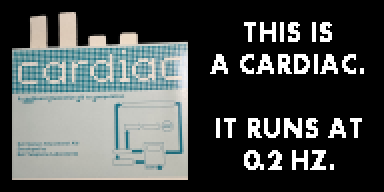

# Openers

The five cards that open the film.

## What it shows

The five cards that open the film, before anything else:

1. A photo of the author's CARDIAC on the left half, and THIS IS / A CARDIAC. / IT RUNS AT / 0.2 HZ. on the right;
2. STRANGE QUERY / WANTED TO SEE / WHAT IT COULD / REALLY DO;
3. SO WE GOT / A COUPLE OF THEM / AND OVERCLOCKED / THEM...;
4. ...TO 1 GHZ.;
5. ENJOY!

White Futura Medium (the demo's lettering) on black. Each card fades in over its first four frames and out over its
last four, by fifths (1/5 .. 4/5, full while held; the white at 51, 102, 153, 204, 255: exact levels, no dithering);
three frames of black follow each. The photo fades with its card, each colour at floor(colour x fifths / 5).

192x96, 191 frames (15.9 s) at 12 fps. The film shows all of them, first of all (`seg openers openers/video.rgb 0 191
192x96` in the cut).

| Card | Frames | Held at full |
|---|---|---|
| THIS IS A CARDIAC (the photo) | 0-47, black 48-50 | 40 |
| STRANGE QUERY ... REALLY DO | 51-88, black 89-91 | 30 |
| SO WE GOT ... THEM... | 92-129, black 130-132 | 30 |
| ...TO 1 GHZ. | 133-160, black 161-163 | 20 |
| ENJOY! | 164-187, black 188-190 | 16 |

## Why it's hard on CARDIAC

It isn't: it is the quietest piece of the film. The point of it is that even the black and the fades come off the
machines. The one wrinkle is the photo's fade: a colour times its fifths runs past a card (255 x 5), so the machine
splits the colour into fifths and what is left over.

## How it's done

The pictures are assets made ahead of time in Python. The word cards are bitmaps at the screen's size (`data/*.txt`,
1 a letter, set by `data/make.py`), and the photo card is a colour picture (`data/photo.bin`: the old ending's cut-out
of the CARDIAC laid on black and box-filtered to 88x84 at (6, 6), with the words in white).
The host keeps the schedule (each card's length and the three frames of black after it) and deals each frame's place
in its card. The machines work out only the fade, and colour every pixel by it.

1. `op_fade`, per frame: dealt the frame within its card and the card's length, takes the steps of the fade,
   min(5, frame + 1, frames - frame), none on the black after the card, and punches the steps and the white's level,
   51 a step.
2. `op_ink`, per screen row of a word card: dealt the level and the bitmap's row, punches each pixel's red, green and
   blue: the level on a letter, 0 off it.
3. `op_tint`, per screen row of the photo card: dealt the steps and the picture's row, punches each colour at
   floor(colour x steps / 5): the colour's fifths and what is left over, each added steps times. Held at full, the
   colours go straight through.

| Machine | Cells | What it does |
|---|---|---|
| `op_fade` | 44 | Per frame: the fade's steps and the white's level from the frame's place in its card |
| `op_ink` | 22 | Per row of a word card: the letters at the level, the rest black |
| `op_tint` | 67 | Per row of the photo card: every colour at the fade's fifths |

191 frames, 18,527 machine runs, 81M instructions: `op_ink` 35M (2,600 a row), `op_tint` 46M (9,400 a row on
average, most of it in the fades: held at full a row is a straight copy), `op_fade` 37K.

## How big the numbers get

| Number | Largest | Margin |
|---|---|---|
| `op_fade`: the frame within its card (on through the black after it), and frame + 1 | 50, 51 | 949, 948 |
| `op_fade`: the card's length; frames - frame (down to -2 on the black) | 48, -2 | 951, 997 |
| `op_fade`: the steps, and the level | 5, 255 | 994, 744 |
| `op_ink`: a colour, and the loop's count | 255, 192 | 744, 807 |
| `op_tint`: a colour, its fifths (51) added up to 4 times, what is left over (4) added up to 4 times | 255, 204, 16 | 744, 795, 983 |
| `op_tint`: the loop's count | 576 | 423 |

## Files

- `machines/`: the three machines in Rust, with their compiled tapes.
- `data/`: the word cards' bitmaps (192x96, 1 a letter), the photo card (192x96, red, green, blue a pixel), and
  `make.py`, which makes the bitmaps in Futura. The photo card was made from the old ending's cut-out of the
  CARDIAC, which is no longer in the repository, so `photo.bin` is kept as it was made.
- `reference.rs`: draws every frame independently in ordinary Rust, in whole numbers, from the pictures and the
  fade's formula. `card-attack openers refs/openers_ref` checks
  every frame against it and says identical 191/191.
- Host: [`host/src/fx/openers.rs`](../../host/src/fx/openers.rs), with the timeline.
