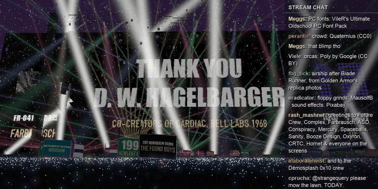

# Party chat

The stream chat over the stadium party, which carries the film's credits. Party chatter comes between the credit
lines, and the messages post one after another. Each one slides up into place and pushes the older ones up, and all
of them have posted by the time the giant screen shows the CARDIAC. The panel stays up until the cut to black.

The prototype is `prototypes/partychat.py` without its emoji: only
the scrolling text is kept. The words are in `data/credits_chat.txt`.

| Video | Frames | What it is |
|---|---|---|
| `chat.rgba` (`card-attack partychat`) | 495, 512x768 | The chat's layer, placed at 1024, 0 of the frame, over the stadium's frames 44 (the party) to 538 (the last frame before the QR code) |

**In the cut:**

    seg stadium stadium/video_hd.rgb 0 539 1536x768
    over partychat/chat.rgba 512x768 1024 0 44 495

## Why it's hard on CARDIAC

- **Text needs a layout.** A message wraps where a word would pass the panel's edge, the messages stack up from the
  bottom as they come, and each handle takes its colour from its letters.
- **The newest message slides in,** pushing every other message up by a quarter of its height each frame.
- **Laying a layer over a picture is a product for every pixel,** and the panel covers 291,840 pixels a frame of a
  party that moves under it, so no pairs of pixels repeat.

## How it's done

All of the drawing is the [UI kit](../ui)'s: the panel at 16 32nds of cover (partychat.py's 0.5), its head, and the
text in Arial 22 and its bold, each piece of text shadowed by three black copies at (2, 2), (1, 2) and (2, 1) under
it, as partychat.py's shadowed() does. [`layout.rs`](layout.rs) holds the layout's constants (the panel, the margins,
the line step, the colours, the shadow's offsets) and the order things are drawn in; every message line's place
and its shadow's are `pc_place`'s. The head, STREAM CHAT, stands at a fixed place, and the host adds the shadow's
offsets to it.

**Once for the layer,** `pc_wrap` lays out each message. It works out its handle's colour (the sum of its codes mod
8), where its text starts (6 past the colon), which line each word goes on (a word that would reach past 18 pixels
short of the frame's right edge starts a new line at the handle's start), and its height (29 a line, and 12 after).
The host joins each line's words.

**Every frame,** `pc_stack` works out how many messages have posted (each at its frame, from `data/messages.txt`),
where the newest goes (its bottom 22 pixels up from the frame's, sliding up over its first frames with 3, 2 and then
1 quarters of its height still to go) and where each one before it goes above it, until one would be wholly above
the head (nothing shows above row 62). Then `pc_place` works out where each line of each shown message is drawn:
the three places of its shadow first, then its own, 29 pixels further down for each line of the message.

`data/make_data.py` makes `data/messages.txt` from the credits in partychat.py's order: a chatter line first and one
after every two credits, with the last one closing the chat, and a `^` line being a reply posted straight after its
message. The emoji are left out, and a message with nothing else in it goes too. The 20 messages are posted evenly
over the layer's first 457 frames (up to the stadium's frame 501, the CARDIAC on the giant screen): the k-th at the
first frame f with int(f / every) >= k, as in partychat.py. That schedule is worked out in Python ahead of time and
printed into `data/messages.txt` by `make_data.py`. The last one posts at the layer's frame 435.

The cut lays the layer on the stadium with deep's `umix`, as it does every layer.

`card-attack partychat refs/partychat_ref` says identical 495/495.

| Machine | Cells | What it does |
|---|---|---|
| `pc_wrap` | 91 | A message's colour, where its text starts, each word's line, and its height |
| `pc_stack` | 78 | How many messages have posted, and the top of each one shown, the newest sliding in |
| `pc_place` | 48 | Each shown line's place and its shadow's three places |

**Instructions:** the layer takes 7,116M for 495 frames, measured on CARDIAC. Nearly all of it is the UI kit
laying the panel and the text: `ui_cover` 4,003M and `umix` 3,085M. The chat's own machines take 0.8M (`pc_place`
0.50M, `pc_stack` 0.24M, `pc_wrap` 0.03M).

## Against the prototype

- **There are no emoji,** neither in the messages nor floating beside the panel.
- **The slide** steps by whole frames from each message's posting frame. The prototype's posts fall between frames
  (one every 21.8 frames) and its slide moves by the fraction, so a message's place differs by at most a quarter of
  its height on the one frame it lands.
- **Posting** is even up to the CARDIAC. The prototype posted until 24 frames before the party's end.
- The text is the kit's (advances summed, glyphs from the atlas). The "·" of a credit line is appended to the
  atlas's Arial 22.

## Files

- `layout.rs`: the layout, shared by the host and the reference.
- `reference.rs`: the reference, in ordinary Rust.
- `machines/`: `pc_wrap`, `pc_stack` and `pc_place`.
- `data/credits_chat.txt`, `data/make_data.py`, `data/messages.txt`.
- Host: [`host/src/fx/partychat.rs`](../../host/src/fx/partychat.rs). It files `chat.rgba` (not kept).
