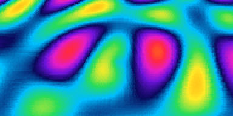

# Plasma

## What it shows

The classic demo plasma at 192x96 in exact colour: soft blobs that swell, drift and melt into each other while the
colours flow round a ring of eight. For its last four seconds the plasma tilts back, like a picture falling onto its
back, until it is a floor. The film cuts from there to [Mode X](../modex), where the mirror ball bounces on that
floor and reflects it, the plasma still moving.

It renders 204 frames. The film shows its frames 104 to 203 (100 frames, 8.3 s) straight after the [VGA](../vga)'s
wipe, with the VGA's brag laid over the first 42 by the cut. Its machines are used twice more: the VGA's 16-colour
plasma is the same plasma, worked out by these machines and painted in sixteen colours, and Mode X's floor and the
floor seen in its ball are painted by them too.

## Why it's hard on CARDIAC

- **It's built from sine waves.** CARDIAC has no sine, no multiply, no divide and no fractions.
- **Rings need each pixel's distance from the centre.** That's a square root of a sum of squares, and the sums
  run to 240,000. A card holds 999.
- **Exact colour.** A smooth plasma can't be 16 colours: every pixel is red, green and blue, worked out between
  the ring's colours.
- **The plane tilts.** Lying back, each row of the screen sees the plane at a different distance: a perspective
  division per row, and the plane's far edge runs off toward the horizon.
- **Every pixel, every frame.** 18,432 pixels a frame for 204 frames.
- **Program and data share 96 cells.**

## How it's usually done

- **Sum of sines.** A plasma adds up a few sine waves, each a function of something different about the pixel:
  - across the screen;
  - down it;
  - along a slant;
  - the pixel's distance from a point, which gives rings.

  The total is an index into a palette that loops smoothly. Lode Vandevenne's tutorial describes exactly this, and
  animates either by shifting the palette or by moving the waves
  ([Lode's Computer Graphics Tutorial: Plasma](https://www.lodev.org/cgtutor/plasma.html)).
- **Where it comes from.** Wikipedia traces the name to Bret Mulvey's 1988 VGA demo *Plasma* and its colour
  cycling. Demo coders took it up in the early 1990s, and it was a common first thing to write, usually done "by using
  sinus tables and pseudocolor palettes" ([Plasma effect](https://en.wikipedia.org/wiki/Plasma_effect)).
- **A textured floor** is drawn a row at a time: every row of a flat floor is at one depth, so one division per row
  gives its scale, and the texture steps across it (the racing-game floor).

## How it's done

The plasma is a function of a point (u, v) on its plane and the time, in units of a 192x96 pixel; the plane stands
on the floor at the bottom of the screen and tilts back about that line. Four waves, as the 96x48 plasma had, now
from quarter-turn sine tables fine enough that neighbouring pixels differ by a step or two:

- rings 64 units apart spreading from (0, 48), the middle of the screen;
- a wave across (96 units), one rolling along v (96), one slanting along u - v (96);
- each 32 + 32 sin, 0..64; the four added to the colours' start, mod 256, is a place on a ring of the eight colours
  of `data/ring.txt` (every sixth line), 32 steps apart, the colour exactly between them.

**Every frame:**
- `pl_clock`: where each wave and the colours start this frame (six, two and two units, and eight colour steps a
  frame), each made from the frame mod its own turn so that nothing passes three digits.
- `pl_tilt`: how far through the tilt the frame is, in thousandths, by long division. The host fetches that line
  of `data/tilt.txt`, a table printed ahead of time in Python by `data/make_tilt.py`: for each thousandth of the way,
  the eased angle's 600 cos and 100 sin. The ease, the cosine and the sine are in the table; CARDIAC works out only
  how far through the tilt the frame is. The
  references read the same tilts from `data/script.txt`, and a checked render stops if the machines' differ from it.

**Every tile row (four 96x48 tiles a frame):**
- `pl_row`: the row's slope against the plane, k5 = 600 cos - 5 (36 - y) sin / 100 (the tilt is the script's
  card pair). At or below 0 the row sees the sky (three bands of blue), under 60 haze; otherwise the row is
  v = 600 (96 - y) / k5 along the plane at depth z = 120 + v sin / 100, with fog from depth 240, all haze at 464.
  Across it u = (x - 96) z / 120, stepped by adding z to a remainder. Upright (cos 600, sin 0) that is just
  u = x - 96, v = 96 - y. It also marks the ball's shadow when Mode X asks for it (a disc, its half width per row
  by counting odd numbers); the plasma's own frames have no ball. Six phases; the 600-step division is the slowest
  part.
- `pl_ring`: the distance from the rings' centre to each of the 96 points, **walked**: it keeps r and the error
  e = u^2 + w^2 - r^2 (in -r..r), and moves one unit at a time from point to point. A step from c to c + 1
  changes the sum of squares by c + (c + 1), added in two halves so e stays inside a card; whenever e leaves its
  range r moves by one. No square, no square root, nothing past 833. The rounding: the r with
  r^2 - r <= n < r^2 + r.
- `pl_rings`, `pl_wave` (twice: across at u, rolling at v), `pl_slant`: the four waves, each looked up in a
  quarter of a printed sine table (`PL_WAVE64`, `PL_WAVE96` in demokit) by folding the step into the first quarter.
- `pl_paint`, once each for red, green and blue (the ring's channel punched into it): the place mod 256, its two
  ring colours, and a + (b - a) j / 32 rounded down, a bit of j at a time from the lowest: b - a added if the bit
  is set, then halved (five times it, shifted a digit), five times. The part is kept 250 up so that each number
  halved is 0..999.
- `pl_tone`, once per channel: the sky or haze colour where the row machine said so; else the plasma taken toward
  black (in the ball's shadow, or seen in the ball) and then toward the haze by the fog, each in 32nds.

The printed table eases the tilt in and out over the last 48 frames (3 s^2 - 2 s^3 of a quarter turn), so it stops
dead flat on the last frame, with the horizon at row 36 and the floor's foot at the bottom. Mode X carries the floor
on from there with the clock running on, its scene re-built at 320x240.

| Machine | Cells | What it does |
|---|---|---|
| `pl_clock` | 55 | Per frame: where each wave and the colours start |
| `pl_tilt` | 52 | Per frame: how far through the tilt it is, in thousandths |
| `pl_row` | 22 data + 71 / 62 / 67 / 67 / 54 / 44 | Per tile row: each pixel's point on the plane, or sky or haze; fog; the ball's shadow |
| `pl_ring` | 93 | Per tile row: each point's distance from the rings' centre, walked |
| `pl_rings` | 75 | Per tile row: the rings' wave and the colours' start |
| `pl_wave` | 89 | Twice per tile row: the wave across, the rolling wave |
| `pl_slant` | 93 | Per tile row: the slanting wave |
| `pl_paint` | 91 | Three times per tile row: red, green, blue between the ring's colours |
| `pl_tone` | 92 | Three times per tile row: sky and haze, shadow, mirror, fog |

**Instructions:** 4,528M for the 204 frames, about 22M a frame: `pl_paint` 2,226M, `pl_tone` 735M, `pl_row` 470M,
`pl_ring` 451M, `pl_wave` 320M, `pl_slant` 177M, `pl_rings` 149M, `pl_clock` 0.1M. `card-attack plasma
refs/plasma_ref` says identical 204/204.

## What it gives up

- The waves aren't the 96x48 plasma's exactly: the slant runs along u - v (it was u - 2v), the rolling wave runs
  the other way, and every table step is finer. Scales, speeds and the colour flow are the same.
- The fog at the horizon is there to hide what the far rows can't show: there a row jumps a whole ring.

## Development notes

- **This plasma isn't the first.** A 96x48 plasma came before it, blocky in the 192x96 cut. This one is
  finer, and it lies down to become the texture reflected in the silver ball.
- **Fitting.** One wave with its table is about 90 cells, so the four waves are four runs of three machines; the
  paint's eight colours as 27 cards didn't fit, a channel's nine do. The walk fitted once the rounding took
  -r <= e < r (no test for r = 0).

## Files

- `machines/`: the Rust machines and their compiled tapes.
- `formula.rs`: the plasma, the plane and the colours in ordinary Rust, for the two references.
- `reference.rs`: the independent native renderer every frame is checked against.
- `data/ring.txt`: the colour ring, an asset. `data/tilt.txt`: the eased tilt's table, an asset made ahead of time
  by `data/make_tilt.py`.
  `data/script.txt`: the tilt per frame, as the machines make it, for the references.
- Host: [`host/src/fx/plasma.rs`](../../host/src/fx/plasma.rs). It files `video.rgb` (not kept).
