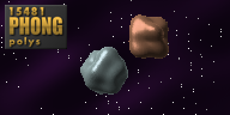

# Polys

## What it shows

A nod to Complex's Dope (1995) and its "7800 PHONG polys": a morphing, Phong-shaded blob tumbling and drifting toward
us over a dark purple nebula, with the brag box in Dope's style. It starts at 20 triangles for five and a half
seconds; the mesh grows to 7680; triangles split one at a time, fast to 7790, then slower and slower to 7800; a beat,
one more split, and the box hops and turns gold at 7801. Then the blob shrinks and moves aside, and a second blob,
copper, comes in from the right at a distance; its own mesh grows from 20 triangles to 7680 and splits to 7800, and
the gold count races with it to 15601: two Dopes and one. The box hops again, brighter, and stays. The two blobs
orbit each other, a whole turn in depth as well as across, each casting its shadow on the other: the copper one's
shadow sweeps over the grey, then the grey's over the copper. 192x96, 374 frames, of which the film shows the last
174 (see the timeline).

**The number is true.** Every triangle counted is filled on CARDIAC that frame, and the count in the box is the one
the mix machine punches: it counts the triangles as it takes them in, both blobs' (in thousands and the rest, as a
card holds three digits), and the host reads the number from those two cards and picks the box with that number on
it, and stops if it isn't the timeline's.

**The final count is one number,** in `data/final.txt` (15601). For 15600, write 15600 there and run
`data/boxes.sh` to redraw the boxes; the host and the reference read it, the second blob splits one triangle fewer.

## Why it's hard on CARDIAC

- **7,801 triangles a frame, then 15,601,** each with three corners turned in 3D, its edges walked row by row, its
  rows walked pixel by pixel, a depth test on every piece and Phong shading on every pixel that's left; and with
  two blobs all 15,601 filled a second time, on the shadow map. Over 374 frames it is 26.2 billion instructions, 70
  million a frame on average, 126 million with two blobs and 138 million at most (frame 362). Most of it is
  `polydot` (12.4 billion), `polywalk` (4.9), `polyunitize` (2.1), `polyrows` (1.9) and `polycross` (1.3).
  `card-attack polys refs/polys_ref` says identical 374/374.
- **No multiply, and three digits.** Every product of the 3D maths would pass 999 at once (a unit vector in
  hundredths times a radius of 280 quarter pixels). A product here is always c v / 100 with c two digits: c times v's
  digits, units first, the sum cut to a tenth before each, so nothing on the way passes 989 (`polydot`;
  `demokit::mul::by100` in `polylift`). In `polydot` c times a digit is 4 c while it fits, then 2 c, then c: a few
  adds, not one for each unit of the digit.
- **96 cells.** That multiplication is most of `polydot`'s 95 cells, so nothing that multiplies can do much else.
  The work is split into 26 small machines, most of them run over a whole list at once, and the generic `polydot`
  does most of the arithmetic: sums of products, with an addend and a bias.
- **Phong needs a unit normal at every pixel,** and its highlight is the 24th power of a dot product: a normal 3%
  short of a unit (as one carried across a triangle is) loses half the highlight.
- **A depth buffer doesn't fit:** a row of 192 pixels is twice the memory. Nor does a shadow map, for the same
  reason: it is a list of cards like the screen's pieces, sorted to their places by the host.

## How it's done

Everything is lists of cards through small machines; the host deals the lists, carries what one machine punches to the
next, and sorts pieces of triangles to their pixels by the row and column a machine punched on them, as a card sorter
would. Angles are in 960ths of a turn; a sine is read from every other card of the printed trig table
([shared](../shared)), ten to a step, between its steps by a straight line (`polyangle` brings the angle into the
first quarter turn, `polysine` reads it).

**Per size of the mesh** (worked out the first time it's needed, then carried): `polygrid` gives the bands' and the
columns' angles; their sines give each corner's point on the sphere, u (`polydot`, in hundredths); `polyphase` gives
the three waves' phases there (5x + 3y, 6z and 9y).

**Per frame:**

1. The turns' sines and the centre (`polyangle`, `polysine`, `polydot`); each corner's waves, sin and cos of the
   frame's phase plus its own (six lists).
2. The bulge: p = sin A cos B, then `polybulge` makes the push, 0.22 sin A cos B + 0.08 sin C in thousandths, and
   `polydot` the radius pushed: R + R push / 1000, the push taken a tenth and a unit at a time.
3. The corner: u times the radius, turned about x then y, and placed (`polydot`, four passes): screen x and y in
   quarter pixels, and depth.
4. The normal, from the waves' slope g: (1 + push + g . u) u - g (`polydot`), made a unit (`polysquare` its size
   squared in hundreds and the rest, `polyroot` the square root by odd numbers, `polyunitize` each part by long
   division) and turned (`polydot`).
5. The splits: the k-th split cuts triangle 7919 k (mod 7680) at the middle of an edge. Which triangle that is, the
   train's operations work out (a product and a remainder); `polydot` works out the middle corner.
6. Each triangle's normals to carry: half each corner's own and half the triangle's mean (`polydot` the mean,
   `polymix` five times the sum, in thousandths), and `polymix` counts the triangles.
7. Each edge: the rows it meets (`polyrows`, whose middles are from its upper end to short of its lower), and x,
   depth and the normal down it (`polywalk`, start + change k / height at each row, kept as a whole and a
   remainder). Each row of a triangle meets two edges; `polycross` finds its pixels (whose middles are from the
   left crossing to short of the right) and `polywalk` carries depth and the normal across. A split leaves a
   T: the triangle beside the split edge has it whole, and the middle corner, cut to a whole quarter pixel, is a
   little off it, so the halves' edges would cross some rows a quarter pixel from where the whole edge does, and a
   pixel could fall between, showing the blob's far side through it (a dark speck). So the halves cross their rows
   where the whole edge does: the whole edge goes through `polyrows` and `polywalk` too, and the host takes its x
   for the halves' rows (on the shadow map the same).
8. The host sorts the pieces to their pixels, in drawing order; `polydepth` keeps the nearest on each.
9. Each covered pixel's light: `polyface` turns it to face us (a normal carried across a triangle at the blob's
   edge can tip a little past it: its depth part is turned round, the rest kept, so it keeps its side's light; turned
   round whole it took the other side's, a dark speck on the lit edge and a bright one on the dark); `polydot` its size squared and the lift, half the
   shortfall; `polydot` its dots with the light and the half-way vector; `polylift` brings each up by the lift, one
   step toward a unit; `polyspec` the highlight from a table of h^24, `polyrim` the rim from a table of
   (1 - |depth|)^3; `polydot` adds them up, in tenths of a step.
10. The colours, exact (no bands, no palette, no dithering): `py_tone` gives each covered pixel its level, 40 plus
    the light, at most 250 (two-hundredths: the light as it comes, not cut to the prototype's twentieths), and the
    highlight to add; `polydot` makes each channel, a part of the level plus the highlight: the first blob's
    grey-blue 0.75, 0.86, 0.86, the second's copper 0.86, 0.60, 0.45. The sky is where there's no blob. `polylay`
    lays the brag box over.

**The orbit** (from frame 270). The orbit's centre is the first blob's drifting centre, moving 16 pixels right as
the first blob shrinks to 20 pixels (its radius before the waves; `polydot` from the timeline's shrink, the way still
to go, eased). The orbit's plane holds the way toward the light and a way across it (to the right, a little up and
toward us, chosen so that seen from the light it is all across): the way from the centre to the second blob is
cos a across + sin a toward the light (`polysine`, `polydot`), the orbit's angle a from the timeline. The first blob
is on the near side of the centre, 28 pixels out (growing from none as it shrinks); the second on the far side,
closing in from 60 pixels to 28. So a quarter turn on, the second blob is between the first and the light, and three
quarters on, the first is between the second and the light.

**The second blob** is the same blob made the same way (the same sphere at each size of its mesh, its waves a third
of a turn and more on, its own turns), placed there; its triangles go after the first's through the same mix
(which counts them all), fill and depth machines, each piece carrying which blob it is.

**The shadows** are a **shadow map**, a real one, seen from the light: the light's ray through a point keeps x -
0.80 z and y - 0.97 z (the light's x and y over its depth, 49/61 and 59/61), so that is where a point lands on the
map, moved so the orbit's centre is the map's middle (`polydot`); its depth along the ray is its depth.

11. Both blobs' corners on the map (`polydot`, two passes); their triangles filled again there, carrying only their
    depth (`polyrows`, `polywalk`, `polycross`, the same machines as on the screen), the pieces sorted to their places
    by the host; `py_near` keeps the nearest to the light on each place and which blob it is, or 999.
12. Each pixel either blob shows: its move less 0.80 and 0.97 of its depth (`polydot`); `py_cell` adds its middle and
    finds its place on the map, or punches a place below 0 when it is off the map; the host deals the cards on that
    place, or 999 and 0 for a place below 0; `py_test` takes away its diffuse light and highlight if the other blob
    is there nearer the light. A blob never shadows itself this way (its own far side is dark already from the
    light's dot), so no depth bias is needed. What's left is the ambient and the
    rim: a shadow is as dark as a blob's own dark side.

**Once:** the nebula, three waves crossing (`polynebula` the angles across each row, `polyangle` and `polysine` the
sines, `polydot` the mix squared and the purple), and 140 stars (`polystars` the random numbers, `polydot` the place
and brightness, `polystar` each on its row). Each row's bend angle, 14 y brought within half a turn either way, is
worked out on the host; `polyangle` and `polysine` give its sine, which `polynebula` is dealt.

| Machine | Cells | What it does |
|---|---|---|
| `polyangle` | 48 | An angle into the first quarter turn |
| `polysine` | 93 | 99 sin, from the trig table it carries |
| `polygrid` | 86 | Per size: the bands' and columns' angles |
| `polyphase` | 60 | Per size: the waves' phases at each corner |
| `polydot` | 95 | Sums of products, with an addend and a bias: most of the arithmetic |
| `polybulge` | 32 | The push of each corner |
| `polysquare` | 91 | A normal's size squared, in hundreds and the rest |
| `polyroot` | 58 | Its square root |
| `polyunitize` | 93 | A part made a unit's, by long division |
| `polymix` | 53 | The normals each triangle carries; the count |
| `polyrows` | 88 | The rows an edge meets |
| `polywalk` | 76 | A value along an edge or across a row |
| `polycross` | 93 | The pixels a triangle covers in a row |
| `polydepth` | 66 | The nearest piece on each pixel: which blob's, its depth and normal |
| `polyface` | 36 | A pixel's normal turned to face us |
| `polylift` | 93 | A light brought up toward a unit normal's |
| `polyspec` | 85 | The highlight, from a table |
| `polyrim` | 50 | The rim, from a table |
| `polylay` | 35 | The box over a row |
| `polynebula` | 85 | The nebula's angles across a row |
| `polystars` | 44 | The stars' random numbers |
| `polystar` | 31 | A star on its row |
| `py_tone` | 38 | Each covered pixel's level and highlight |
| `py_near` | 39 | The nearest to the light on each place of the shadow map, and its blob |
| `py_cell` | 91 | A pixel's place on the shadow map |
| `py_test` | 36 | A pixel's light in the other blob's shadow or out of it |

## The timeline

| Frames | What happens |
|---|---|
| 0-66 | 20 triangles (5 around, 3 bands); the box from frame 6 |
| 66-138 | the grid grows (smoothstep) to 60 x 65: 7680 |
| 138-168 | splits, to 7790 |
| 168-238 | one more every 2, 2, 4, 4, 6, 6, 8, 10, 12, 16 frames, to 7800 |
| 256 | a beat (18 frames), and 7801: the box hops (4 rows up for three frames, then 2 up, level, 1 down, level, from a table of offsets the host adds to the box's row) and turns gold |
| 270-290 | the blob shrinks (smoothstep) to 20 pixels and moves to its side of the orbit |
| 282-306 | the second blob comes in from the right (smoothstep), its grid growing (smoothstep) from 5 x 3 to 60 x 65; 7821 to 15481, in gold; the orbit speeds up |
| 306-312 | its splits, 20 a frame, to 15601: the box hops again and turns bright, and stays |
| 306-374 | the orbit at a turn in 80 frames: the copper blob's shadow on the grey (about 316-330), the grey's on the copper (about 352-366), until a whole turn is done |

The blob turns 0.7 and 1.1 radians a second about x and y, drifts 10 pixels across and 3 up and down, and grows
from 26 pixels to 54 (its radius before the waves), until it shrinks to 20 for the orbit. The second turns 1.0
radians a second the other way about x and 0.6 about y, and is 19 pixels.

The film shows the segment in two places. The [dorm](../rooms)'s monitor shows frames 200 to 233 as the camera pulls
back, and the cut then shows frames 234 to 373 (140 frames, 11.7 s) full screen: the last splits to 7800, the beat,
the gold 7801, the second blob, 15601 and the orbit.

## How big the numbers get

Over the first 340 frames as they were (frames 0-269 are unchanged), against a card's 999 (from the reference's
formulas, which the machines follow card for card):

| Number | Largest | Margin |
|---|---|---|
| A product's running sum in `polydot` (proved) | 989 | 10 |
| An angle, base and offset together (`polyangle`) | -960..956 | 39 |
| A wave's phase before it's brought within half a turn | 891 | 108 |
| The push, in thousandths | 294 | 705 |
| The radius pushed, in quarter pixels | 279 | 720 |
| A corner, turned (x, y, z) | 259 | 740 |
| Screen x, y in quarter pixels | 112..634, -52..455 | 365, 544 |
| Depth | 253 | 746 |
| The slope g | 88 | 911 |
| 1 + push + g . u, in hundredths | 210 | 789 |
| A normal's part before it's a unit | 148 | 851 |
| Its size squared, in hundreds | 223 | 776 |
| Long division's remainder, times five | 740 | 259 |
| A carried normal, 5 (n + mean), in thousandths | 985 | 14 |
| Its change down an edge | 885 | 114 |
| Its change across a row | 808 | 191 |
| A pixel's size squared | 976 | 23 |
| A lifted light, before it's held to 999 (tested, never formed) | 1001 | held |
| A dot with the light or half-way vector | 969 | 30 |
| The light, in tenths of a step | 301 | 698 |
| The level, 40 + the light, before it's held to 250 | 340 | 659 |
| The count, in thousands and the rest | 15, 601 | |

With the orbit (frames 270-373), measured from the reference:

| Number | Largest | Margin |
|---|---|---|
| The orbit's centre, x and y (`polydot`) | 401..443, 181..203 | 556, 796 |
| The way to the second blob, in hundredths (a `polydot` c, at most 99) | -98..98 | 1 |
| The blobs' distances from the centre | 2..112, 112..240 | 759 |
| The blobs' centres (`polydot`) | -77..665 | 334 |
| The first blob's radius, before and pushed | 80..192, 54..247 | 752 |
| A corner, turned, before its centre (z) | -198..182 | 801 |
| A corner on the screen: x, y, depth | 184..738, -17..401, -198..182 | 261, 598, 801 |
| The map's move, x and y (`polydot`) | -59..-17, -11..11 | 940, 988 |
| The move less 0.80 or 0.97 of a depth | -164..152 | 835 |
| A corner on the map, x and y | 136..705, 14..366 | 294, 633 |
| A pixel's middle on the map (`py_cell`, before it's tested) | 151..701, 42..366 | 298, 633 |
| A depth kept on a pixel, on the map | -198..173, -159..149 | 801 |
| A value carried down an edge or across a row; its change | 975; 840 | 24; 159 |
| The light, in tenths of a step | 299 | 700 |
| The grey-blue's red, green, blue (at most) | 225, 244, 253 | |
| The copper's red, green, blue (at most) | 253, 179, 150 | |

The blobs' corners on the map stay inside it (136..705 of 0..767 across, 14..366 of 0..383 down), so nothing of a
shadow is cut off; and on the screen inside 0..767 across, which the cross machine needs (the host stops if not).

`polylift` never forms a sum past a card: it tests the value against 999 less the step first.

## Against the prototype

- **Shading.** Per-pixel Phong, smooth: the prototype cut the level to twentieths (its 8-bit palette's bands); here
  it keeps the light's tenths of a step, so the
  blobs shade without contour lines. Half the smooth normal and half the triangle's own. The
  smooth normals are the blob's own (worked out from the waves' slope) rather than the mesh's (its faces' normals
  summed), and the triangle's own is the mean of its corners' rather than its plane's: planes from whole-number
  corners came out noisy on the fine mesh. At 20 to a few hundred triangles the facets are softer than the
  prototype's (its brightest facet catches less light); from about a thousand they look the same.
- **Unit normals** are one step toward a unit, (3 - |n|^2) / 2, not an exact square root: close for the fine mesh,
  a little dim on the first big triangles. The highlight's power comes from a table every 0.01, between its steps by
  a straight line.
- **No caps:** the mesh has none, as the prototype's hasn't, so a pixel or two can see through a pole into the
  inside (about one a frame, lit as the inside; on the coarse first meshes a bigger opening). The dark specks that
  sparkled over the blobs in an earlier version are gone: a split's half-edges cracking from the whole edge beside them,
  about one a frame, and a normal tipped past the blob's edge turned round whole and lit from the other side, a few
  a frame on the outline (see 7 and 9).
- **The waves** are 5x + 3y, 6z and 9y 960ths of a turn (3.2x + 1.9y, 3.9z and 5.8y radians, where the prototype had
  3x + 2y, 4z and 6y), and the amplitudes come out of 99-scale sines: the same kind of blob, not the same bumps.
- **The nebula** is the same three waves, mixed and squared in whole numbers; the stars come from demokit's random
  numbers, so they're in other places.
- **No palette:** every colour is worked out (the blob's grey-blue from its level and highlight, the nebula's
  purple), so nothing was given up to one. The brag boxes are assets, RGB pictures made ahead of time by `data/bragbox.py`.
- **The box shows the true count every frame.** The prototype showed 7800 for two frames after the 7801st triangle;
  here the box hops and turns gold on the frame the count turns.
- **The second blob, the orbit and the shadows** have no prototype: they were built on CARDIAC directly. The
  shadow map is a pixel a place, so a shadow's edge steps a pixel at a time, and it is hard (no soft edge). The
  second blob's copper is worked out like the first's grey-blue. The two never touch (28 + 28 pixels apart, at most
  26 + 25 pushed out). At the top and bottom of the orbit a blob's bulges can touch the screen's edge.
- **"On cardboard"** is gone: the cut never showed it, and the count now runs on where it came.

## Files

- `machines/`: the 26 machines in Rust, with their compiled tapes.
- `reference.rs`: draws every frame independently in ordinary Rust, from the formulas and the data.
- `data/boxes.rgb`, `data/boxes.txt`: the brag box for each count shown (52 x 37, raw RGB), the gold 7801 and the
  bright final count, drawn by `data/bragbox.py` (`data/boxes.sh` draws them all), and their names (numbers, `gold`
  and `bright`). `data/final.txt`: the final count.
- Host: [`host/src/fx/polys.rs`](../../host/src/fx/polys.rs), with the timeline.
