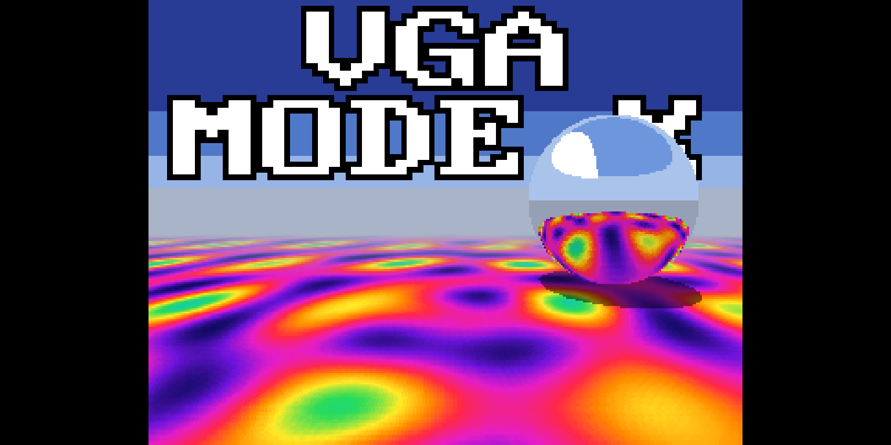

# Ray-traced ball

This folder no longer holds a segment of its own. The 192x96 ray tracer it once held (a mirror ball over a
checkerboard, then over the plasma) is not in the film. What is left are the three machines that move the ball, and
the data they read. [Mode X](../modex) uses all three: its ball is this ball, re-built at 320x240.

## What the machines do

The ball sways from side to side and bounces every two seconds while the floor scrolls under it. That motion is the
ray's script: 120 frames, per frame the ball's x and height and the floor's scroll in x and z. The host's
`fx/ray.rs` (`script`) makes it on CARDIAC once. The references read the same script from `data/script.txt`, and
a checked render stops if the machines' differs from it.

- `rt_sway` makes the ball's x, 28 t / 999 rounded, where t is 999 sin of the frame's 120ths of a turn, read from the
  printed table `data/sine120.txt`. It divides without a divide: with |t| = 36 a + b, 28 |t| = 999 a + 9 a + 28 b,
  so the answer is a, and one more when 9 a + 28 b reaches 500.
- `rt_hop` makes the height, 14 + 5 (144 - m^2) / 72 for m = f mod 24 - 12 (a parabola, a bounce every 24 frames),
  and the floor's scroll, 3 f mod 20 and 2 f mod 20.
- `rt_path` runs once per frame of Mode X. Its deck is the frame, the script's x and height for it, and Mode X's
  entrance (two arcs, each its first frame, length L and height H, from `modex/data/entrance.txt`). Inside an arc the
  ball is H j (L - j) / (L / 2)^2 over the floor, j frames into it, worked out by adding: H is added j (L - j) times
  and (L / 2)^2 taken away whenever it fits. So the ball drops in from above the frame, bounces, and lands where the
  script's own bounce starts; after the arcs it follows the script. It punches the ball's x and height, and its
  shadow's radius (44 less half the lift) and darkness (16 less a quarter of it, in 32nds): the higher the ball, the
  smaller and fainter its shadow. It runs in three phases, each loading over the last.

Mode X carries the script on from its 22nd frame and repeats it every 120 frames.

**Instructions:** in Mode X's render of 156 frames `rt_path` takes 0.2M. The script is made once, 120 runs each of
`rt_sway` and `rt_hop`.

## Machines

| Machine | Cells | What it does |
|---|---|---|
| `rt_sway` | 52 | Once per script frame: the ball's x from the sine table |
| `rt_hop` | 91 | Once per script frame: the ball's height and the floor's scroll |
| `rt_path` | 9 data + 36 / 61 / 40 | Once per Mode X frame: the ball on the entrance's arcs or the script, and its shadow |

## Files

- `machines/`: `rt_sway`, `rt_hop` and `rt_path`.
- `data/sine120.txt`: 999 sin of k 120ths of a turn, k = 0..119, made by `data/make_sine.py`.
- `data/script.txt`: the script as the machines make it, for the references.
- Host: [`host/src/fx/ray.rs`](../../host/src/fx/ray.rs) (`script`), and
  [`host/src/fx/modex.rs`](../../host/src/fx/modex.rs), which runs `rt_path`.
