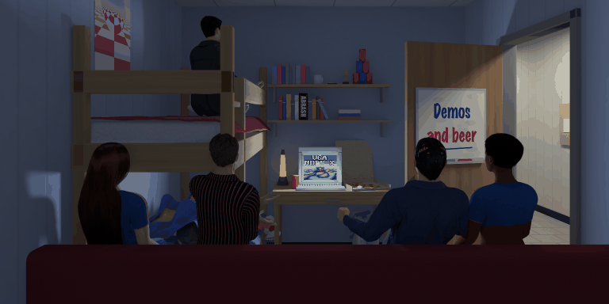

# Rooms

## What it shows

Two pull-backs out of the picture, so the audience sees the demo being watched, at 1536x768. The segment renders 349
frames; the cut shows them in two pieces.

- **The dorm** (frames 0-117, after Mode X's frame 65): the camera pulls back out of a 17-inch CRT into a cramped dorm
  room (a bunk bed along the left wall, the desk with the monitor, the tower, a lava lamp, four people on a couch in
  front of us, seen from behind). Mode X's frames 66 to 149 play on the monitor; then Dope's (the polys' frames 200
  to 233) start on it, letterboxed, while we're still out, and we dive back in onto Dope's own frame: the cut's polys
  go on from their 234th.
- **The screening room** (frames 118-348, after the accelerated drive's frame 58): we pull back out of the
  projected picture into a hall with a loose crowd of 130 standing and the projector on its cart. The drive runs on
  (its frames 59 to 117, with the brag over it from its 82nd), fades to black over its last second, and THE END
  holds for 2 s. Then comes the Windows 95-style desktop with the command prompt the drive ran from: two seconds of
  cursor, `seaplusplus` typed, "Unseen Planets presents", SEA++ in DOS blocks, and LOADING and its bar over five
  seconds while we zoom slowly in, the full bar held a quarter second. The dive starts on the screen while we're
  still in the room (its frames 0 to 47), and we zoom in over the people's heads onto the dive, which the cut
  carries on from its frame 48.

The designs are `prototypes/dorm.py` and `prototypes/screening.py`. Both rooms are built in 3D in Blender and rendered
ahead of time in Cycles through the designs' cameras (`prototypes/dorm3d/`: `room.py` the dorm, `hall.py` the hall,
`kit.py` their shared helpers; MakeHuman people, see [CREDITS.md](../../CREDITS.md)), into the layers the designs'
`draw_art` reads (albedo, the screen's light, the constant light, and for the hall the beam too). The renders are not
in the repository. The palettes are capped by k-means in `data/make_data.py` (the dorm 3,876 entries, its monitor's
surroundings 1,401, the hall 2,137), so CARDIAC's work per frame stays what it was with the flat drawings.

## Why it's hard on CARDIAC

- **The rooms are lit by the screen.** Every pixel's colour changes with the picture on the screen, so every
  palette entry has to be lit again each frame: a product per channel, and a sum over the screen's pixels for its
  mean colour.
- **The zoom is a power.** The pull-back's scale is s0^(1 - u), which CARDIAC can't compute directly.
- **1.2 million pixels a frame.** A pixel can't be worked out one at a time; each is fetched by index.

## How it's done

The rooms are assets, Blender renders made ahead of time and printed by `data/make_data.py` into `data/rooms.bin`
(packed in `generated.tar.xz`). For each room picture (the dorm whole at 2 art pixels a frame pixel, its monitor's
surroundings at 8, the hall at 2) there is a palette index per art pixel, and per palette entry its own light (A) and
how much of the screen's light reaches it (B): a pixel's light is A + B m per channel, m the screen's mean colour (A
its own colour under the ambient light and its glow, B what the screen's light brings through the wall's glow, the
people's rim, the beam and the haze). The screens' masks are printed too, and so are the tables the frames read: the
eases (smoothstep, and smoothstep to the power 1.5), each zoom's scale s0^(1 - u), the sRGB curve and its inverse.
Each frame CARDIAC works out the screen's mean colour, relights every palette entry, and works out the zoom and the
walks.

Each frame, on CARDIAC (`rooms.rs`, written against the [train](../train)'s operations; the host's `fx/rooms.rs` does
each operation with the train's machines, and `reference.rs` does them natively):

- the schedule's ramps, each eased by the printed ease table; the zoom's scale (s0^(1 - u) from a printed table) and
  its centre;
- the screen's mean colour: 512 of its picture's pixels, through the bytes-to-linear table, summed and divided (the
  32 x 16 grid of places it samples is worked out on the host, x0 + (x1 - x0) (2 i + 1) / 64 and the same down);
- each palette entry's light, (A + B m) times the room's light, and its sRGB byte;
- the walks from the frame's columns and rows to the picture's pixels and to each room picture's art;
- the fades' and THE END's byte tables; the desktop's typed count, the cursor's blink, how many of LOADING's dots
  and how much of its bar show;
- the brag's mix where it lies on the projected drive (by its cover in 32nds, as the cut's over line).

The desktop's text is laid out by the host, not by the UI kit's `ui_page` as the film's other text pages are: from
those counts the host builds the lines (padding the bar with spaces to 30), places each glyph of the VGA face at
8 pixels a column and 16 a row from the text area's corner, and draws the cursor in grey on two rows after the last
character.

The host fetches each pixel: the palette index from the printed table by the walks' indices, the lit byte by it, and
the picture's pixel by its walks, and picks the screen's where its mask says. The pictures on the screens are read
from the other segments' renders: `modex/video_hd.rgb`, `polys/video.rgb`, `accel/video_hd.rgb`,
`deep/video_hd.rgb` and the UI kit's `ui/accelbrag.rgba`.

`card-attack rooms refs/rooms_ref` says identical to native Rust 349/349.

**Instructions:** 5,245M for the 349 frames (15M a frame), 216,634 machine runs.

There are no machines of the segment's own: it runs the train's.

## Files

- `rooms.rs`: the renderer, written against the train's operations; the host and the reference both include it.
- `reference.rs`: the same renderer done natively, which checks every frame.
- `data/make_data.py`: makes the asset `data/rooms.bin` from the 3D renders and the designs.
- Host: [`host/src/fx/rooms.rs`](../../host/src/fx/rooms.rs). It files `video_hd.rgb` (not kept).
