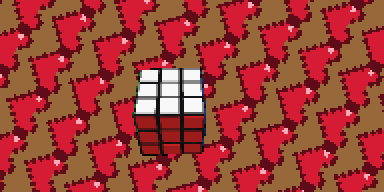

# Rotozoomer

## What it shows

A tiled picture, a 9×9 heart on cardboard, spinning and zooming in and out to fill the screen. 192 frames at 192x96
(144 frames is the view's period; the rest give the BBS room to run on).

The rotozoomer has no line of its own in the [cut](../cut). Its frames reach the film through the
[BBS](../bbs): its frames 42 to 49 under the page's crossfade, then 50 to 121 behind the roaming cube in the BBS's
192x96 video, of which the cut shows the first 36 and the [degauss](../rotodg) the next 28. The screenshot is that
192x96 video's frame 30, shown at twice its size.

## Why it's hard on CARDIAC

- **Rotation needs sine and cosine.** CARDIAC has no trigonometry, no multiply and no fractions.
- **The picture has to be somewhere.** A 9×9 texture is 81 colour codes, and a machine has only 96 cells for its
  program and its data together.
- **Every pixel needs its texture point.** That's 18,432 pixels a frame.

## How it's usually done

A rotozoomer never rotates the picture. For each screen pixel it works out where on the picture to look:

- **Across a row,** one step right moves the look-up point by a fixed (du, dv) that depends only on the frame's
  angle and zoom.
- **Down the screen,** one row moves it by the same step turned a quarter turn, (−dv, du).

So each frame costs one sine and one cosine, and each pixel costs two additions. The picture repeats in every
direction, so the look-up point just wraps round. It was a staple of software-rendered PC and Falcon demos in the
mid-to-late 1990s ([Demo effect](https://en.wikipedia.org/wiki/Demo_effect)).

## How it's done

Exactly that, in whole numbers. Texture positions are kept in hundredths of a texel, so the 9×9 tile is 900 by
900, and every position wraps modulo 900. The frame is four 96x48 tiles, each worked out on its own, and the host
stitches them together; the [tumble](../tumble) lays its cube over the same tiles.

- **Once per tile per frame, the clock and the rotor.** `r4_clock` is dealt the frame's number and punches the two
  angles, in 48ths of a turn: f mod 48, and 2 f / 3 mod 48. `rotor4` is dealt the two angles, the view centre, the
  tile's place in the frame and a 48-step sine table (built by the host when it starts). From the table it gets sin and cos of the angle, and a zoom
  Z = 21 + 8 sin b / 10 that breathes between 2 and 40. A half-pixel step right moves the texture point by
  (du, dv) = (Z cos a, Z sin a) / 20. It punches the steps, then the starting point (u, v) of each of the tile's 48
  rows.
- **Once per row, the row machine.** `rzrow` carries the heart in its own program, punched in by the host at the
  label `resource_tex`. For each of the 96 pixels it punches the texel at (u, v), then steps (u, v) by (du, dv).
- **The shared paint machine** `paint9` turns the codes into colour: cardboard, red, highlight and dark outline.

The texture is stored three texels to a card, as three decimal digits, column by column (cell 9j + r holds row r's
texels 3j to 3j+2), so a texel's cell is 9 × (column ÷ 3) + row with no multiply by 3 per pixel. Picking one digit
out of a card is a shift, and CARDIAC's shift instruction takes its shift amount as part of the instruction, so the
compiler's `digit()` builds the right shift instruction and runs it.

| Machine | Cells | What it does |
|---|---|---|
| `r4_clock` | 34 | Per tile per frame: the frame's two angles |
| `rotor4` | 8 data + 80 / 80 (two phases) | Per tile per frame: the steps, and each row's starting point |
| `rzrow` | 93 | Per row: 96 colour codes from the heart it carries |
| `paint9` (in [`shared`](../shared)) | 82 | Codes to red, green and blue |

**Instructions:** 257M for 192 frames (1.3M a frame): `rzrow` 169M, `paint9` 85M, `rotor4` 3M, `r4_clock` 0.5M.
`card-attack roto4 refs/roto4_ref` says identical 192/192.

## Development notes

- **The row machine was the last to leave assembly.** As Rust, with the texture carried in the program, it came to
  105 cells: picking a texel's digit took a shift loop plus a divide (about 12 cells, where the hand version built a
  shift instruction in 4), and the two modulo-900 wraps about 22. It stayed hand-written until rust-cardiac gained
  `digit()`, which compiles to the built shift instruction.

## Files

- `machines/`: `r4_clock`, `rotor4` and `rzrow`.
- `reference4.rs`: the independent native renderer every frame is checked against (with `roto_data.rs`, the heart,
  the palette and the sine table).
- Host: [`host/src/fx/roto4.rs`](../../host/src/fx/roto4.rs). It files `video4.rgb` (not kept), which the BBS reads.
