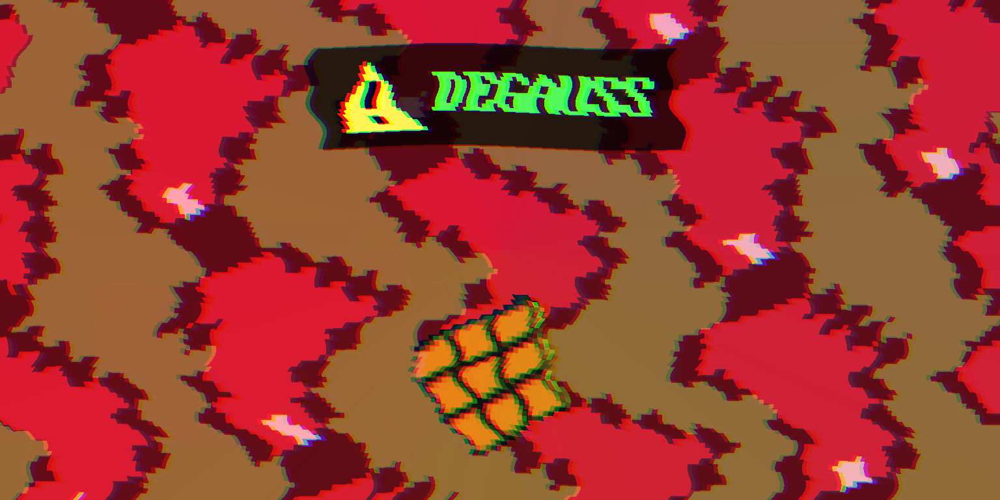

# The degauss

## What it shows

The end of the rotozoomer, as a monitor being degaussed. The [BBS](../bbs)'s wobbling rotozoomer, the Rubik's cube
still roaming in front of it, picks up purple and green blotches of colour impurity that creep into its lit parts.
A monitor's DEGAUSS sign comes up (a yellow warning sign and the word in the VGA's 8x16 face, bright green on a dark
box), blinking. Then the degauss itself: the picture jolts and wobbles (rows pushed across, columns down, decaying),
its three colours land apart, a rainbow swirl washes round, and there is a brief brightening, the sign shaking with
everything else. Half way through the jolt the picture under it cuts to the 16-colour plasma that the [VGA](../vga)
climbs from, and over the last frames the picture settles and the sign goes.

36 frames at 1536x768, 3 seconds, each 192x96 pixel shown 8 x 8. The first 28 are the BBS's 192x96 frames 36 to 63
(the rotozoomer's 86 to 113, the die's 174 to 201), and the last 8 are the VGA's 16-colour frames 0 to 7. The cut
shows all of them, between the BBS and the VGA:

    seg bbsroto bbs/video.rgb 0 36 192x96
    seg rotodg rotodg/video_hd.rgb 0 36 1536x768
    seg vga vga/video.rgb 8 22 192x96

The degauss is the one [Mode X](../modex) was designed with. It moved here when the
dorm's pull-back came to show Mode X's monitor small, and it runs as if these were Mode X's frames 114 to 149: the
blotch from the first frame (creeping in over 20), the sign from the 15th (blinking three frames on and three off),
the jolt from the 21st (16 frames, the sign steady until it goes at the 33rd), the cut to the plasma at the 29th.

## Why it's hard on CARDIAC

- **The degauss's curves are floating point:** sines of every row and column, an atan2 of every
  pixel, exponentials, products of three fractions.
- **A card can't hold the products.** 70 x 30 or 460 x 999 passes 999, so every product is taken by adding, as many
  times as the smaller number says, with the divisor carried out as the sum fills.
- **Every pixel is fetched from somewhere else.** The jolt pushes each colour of each row and column its own way, so
  each pixel on the frame comes from a different place in the picture.

## How it's done

The machines and the host's driver for them are Mode X's degauss (machines in [modex](../modex), the driver
`host/src/fx/degauss.rs`). The blotch is worked at the picture's own size, 192x96; the host then copies each picture
pixel 8 x 8 onto the 1536x768 frame, and the sign and the jolt are worked on that frame. Three of its inputs are
tables printed ahead of time in Python by `modex/data/make_data.py`: the blotches' falloffs over 192x96
(`gauss_roto.txt`), the jolt's and the flash's decays (`decay.txt`, 999 exp(-j / 4) and 999 exp(-j / 2)) and the atan
table (`atan.txt`, 257 entries). The angles are the clock machine's counts times rates (tenths of a degree), the sines
the [rubik](../rubik) folder's table, the atan read from its table at a ratio found by halving steps. Every machine
computes each distinct item once; the host sorts them out and files the answers back. To keep a column's place within
a card, a column past 767 is dealt to the clock machine as two counts, 768 and its count on from there.

- **The blotch, per frame:** its strength on `dg_scale` (dealt the frame, counted from the blotch's start, with the
  creep's and the decay's constants); on `dg_scale` too, each row's two blotch strengths, each
  pixel's two amounts (the row's strength by the falloff across, by the pixel's light from `dg_lum`), and each
  colour's tints added; held to 0..255 on `dg_mix`.
- **The sign:** the UI kit's page DEGAUSS (`ui_page` places its letters, `umix` lays them on), the warning sign's
  pixels (an asset, `modex/data/warning.txt`), and the box under them, each pixel under it taken toward black once on
  `umix`.
- **The jolt, per frame:** its sizes on `dg_scale` from the decay table; the waves' angles on `dr_clock` (the
  frame's phase dealt as the frame and a constant count of the same rate), their sines
  on `rb_sine`, each row's push across and each column's down on `dg_scale` and `dg_push` (a push per colour, in whole
  pixels). The swirl: each pixel's angle from the middle once (`dg_anglew`, `dg_atan`), turned on by each colour's
  phase (`dg_turn`), each distinct angle's sine (`rb_sine`), each pixel's light (`dg_lum`), the swirl's strength and
  tint (`dg_scale`). Then `dg_mix` mixes each colour the jolt brings to a pixel with the tint there, brightened by
  the flash. The host works out where each pixel's colour comes from itself: it adds the row's push across to the
  pixel's column and the column's push down to its row, holds each at the frame's edge, and fetches the colour
  there.

## Machines

All of them are other folders' machines.

| Machine | Cells | What it does |
|---|---|---|
| `dg_scale` ([modex](../modex)) | 80 | base + a b / c on a few numbers at a time: the sizes, the waves, the tints, the swirl |
| `dg_lum` (modex) | 19 | A colour's light: red + green + blue |
| `dg_mix` (modex) | 90 | A colour plus its tint, brightened by the flash, held to 0..255 |
| `dg_push` (modex) | 46 | Each row's or column's push, for each colour |
| `dg_anglew` (modex) | 72 | Each pixel's quarter and side of the half quarter, about the picture's middle |
| `dg_atan` (modex) | 74 | Each pixel's angle within its quarter, from the atan table |
| `dg_turn` (modex) | 42 | An angle turned on by a colour's phase |
| `dr_clock` ([dierubik](../dierubik)) | 87 | The waves' angles: counts times rates |
| `rb_sine` ([rubik](../rubik)) | 93 | Their sines |
| `ui_page` ([ui](../ui)), `umix` ([deep](../deep)) | 83, 83 | The sign's letters and box |

**Instructions:** 439M for 36 frames (12.2M a frame): `rb_sine` 216M, `dg_scale` 114M, `dr_clock` 55M, `dg_turn`
21M, `dg_atan` 14M, `umix` 10M, `dg_mix` 6M, `dg_push` 2M, the rest 1M.
`card-attack rotodg refs/rotodg_ref` says identical 36/36.

## In whole numbers

The degauss is worked in whole numbers: the amounts in 32nds, each tint
rounded down, the creep over 20 frames, the jolt's size in tenths of a pixel, the sines from the
table of whole degrees read between. Here the blotch is worked at 192x96, the picture's own pixels.

## Files

- `reference.rs`: draws every frame in ordinary Rust, with Mode X's `modex/degauss.rs`, from the BBS's and the VGA's
  renders. Args: the demo folder.
- The data is Mode X's, in [`modex/data`](../modex/data): `gauss_roto.txt`, `decay.txt`, `atan.txt`, `rates.txt`,
  `warning.txt`.
- Host: [`host/src/fx/rotodg.rs`](../../host/src/fx/rotodg.rs) and
  [`host/src/fx/degauss.rs`](../../host/src/fx/degauss.rs). It files `video_hd.rgb` (not kept).
