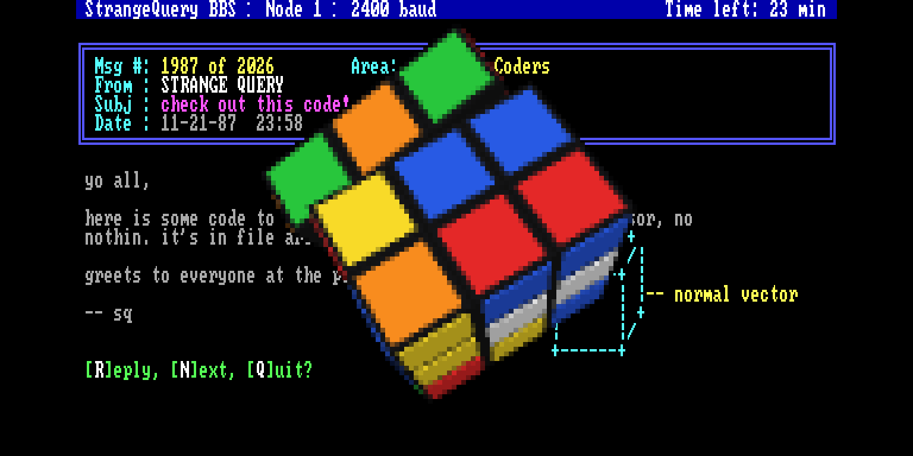

# Rubik's cube

This folder holds the machines that draw a Rubik's cube in 3D, and the sine table they read. They were written for a
segment of their own, a scrambled cube tumbling over a dark blue glow while it played a 16-move solve; that segment is
no longer in the film. Its machines draw [the die and the Rubik's cube](../dierubik), which the [BBS](../bbs) lays
over its message page and the rotozoomer, and two of them work for the BBS's wobble and the
[degauss](../rotodg). The screenshot is the BBS's frame 222, the cube part way through its solve.

## The machines

| Machine | Cells | What it does | Used by |
|---|---|---|---|
| `rb_turn` | 76 | Per move: the stickers turned a quarter turn about the move's axis, as often as the move says | dierubik, before the first frame |
| `rb_pocket` | 78 | Per move: each sticker's pocket (its cubie and face), so the host can file it there | dierubik, before the first frame |
| `rb_sine` | 93 | Sine and cosine of an angle in tenths of a degree, read from `data/sine.txt` between whole degrees | dierubik, the BBS's wobble, the degauss |
| `rb_dot` | 89 | Sums of products x y / 999, rounded: matrices, axes, the light, distances | dierubik |
| `rb_sum` | 36 | Signed sums: corners, distance keys, the faces' tests | dierubik |
| `rb_hold` | 36 | Values held between two bounds | dierubik, the BBS |
| `rb_order` | 65 | Which cubies turn with the moving layer, and which half is drawn first | dierubik |
| `rb_edge` | 92 | A polygon's corners into edges, top to bottom | dierubik |
| `rb_start` | 68 | An edge's first subsample row and its slope | dierubik |
| `rb_walk` | 69 | An edge's bound in each row | dierubik |
| `rb_span` | 90 | A polygon's span in each row | dierubik |
| `rb_piece` | 89 | Spans cut into pieces of pixels with the polygon's colour | dierubik |
| `rb_pixel` | 78 | Per row and channel: each pixel's four subsamples painted in order, and their mean, rounded | dierubik |

How they fit together is in the [dierubik](../dierubik) README. The host deals lists of cards, carries what one
machine punches to the next, and sorts cards by numbers the machines punched, as a card sorter would: the cubies into
drawing order, an edge's bounds into rows, the pieces of polygons onto their pixels. There is no depth buffer: every
face is drawn in painter's order, and each pixel is the mean of 2 x 2 subsamples, exact red, green and blue with no
dither.

## Instructions

In the die and the Rubik's cube's 210 frames these machines take 2,142M of the 2,416M: `rb_pixel` 977M, `rb_dot`
411M, `rb_piece` 263M, `rb_walk` 222M, `rb_span` 117M, `rb_sum` 70M, `rb_start` 57M, `rb_edge` 19M, and the rest
about 5M. In the BBS's rotozoomer part `rb_sine` takes 9M, and in the degauss 216M.

## Files

- `machines/`: the thirteen machines above.
- `data/sine.txt`: 999 sin(k degrees) for k = 0..91 (the last only to read past 90), printed by `data/make_data.py`.
