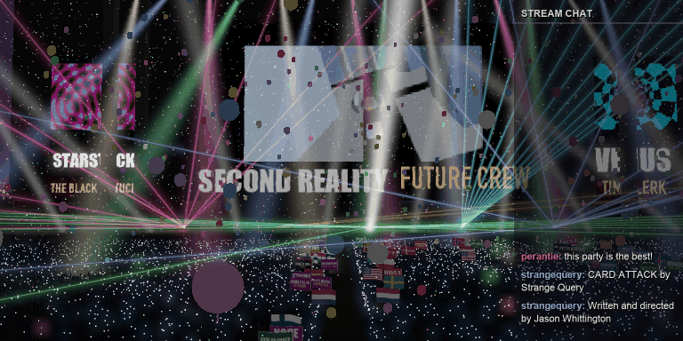

# Stadium



The stadium party: 65,536 people dancing in a stadium at night, the lights hitting on the beat, the airship overhead,
the thank-yous, and the CARDIAC last on the giant screen. It is drawn at 1536x768, every pixel on CARDIAC. The
[party chat](../partychat) is laid over it from its frame 44, carrying the credits. After it come the
[QR code](../qr) and the [SQ](../sqend).

Several things in it are assets made ahead of time in Blender and Python (`data/make_data.py`). They are the
stadium's triangles and the airship's, the dancers' posed meshes (each move and phase posed in Blender), the impostors' atlas
(those poses rendered from behind and above, with their normals), where the people, flags, balloons, confetti, city
lights, stars and lights stand (and the lights' colours), which people are drawn (`cparty`) and Dope's star directions, and the pictures in
`pictures.bin` (the demos' footage, their captions and title screens set in the prototype's fonts, the thanks, the
national flags and the CARDIAC photo). Each frame CARDIAC works out the camera, the beat and every light, turns,
places and lights the dancers and impostors, picks each dancer's pose and what each screen shows, works out the
parodies' stand-in pictures, the beams, lasers, pyro and glow, and mixes it all through the tone curve. The camera
for the first 44 frames is the exception: it is read from a file worked out on CARDIAC before the show (below).

## What it shows

The segment renders 575 frames at 12 fps (47.9 s). The film shows the first 539 of them, 44.9 s
(`seg stadium stadium/video_hd.rgb 0 539 1536x768`). The design is [`prototypes/stadium.py`](../../prototypes/stadium.py)
(design notes in [`docs/design/audience.md`](../../docs/design/audience.md)),
with the weave through the crowd added (the 7 bars cut from the night's airship orbit, 147 frames).

- **Frames 0-43: the dissolve from the night arrival.** The night segment's last 44 frames before its hand-off
  (its video's frames F_HAND - 44 .. F_HAND - 1) with this party drawn from the night's camera laid over them, more
  and more (its share smooth(k / 44)^0.6, the night's `render()`), the show's clock running from -0.67 s.
- **Frames 44-538: the party** from the crest over the south rim (the show's clock t = 3 s) to t = 44.25 s
  (`clock.rs` KEYS): everything firing at once; a glide at the airship's height,
  looking ahead, slowing to above the end of the left aisle (two 4 m aisles up the pitch, x -6 m, almost under the
  airship, and 30 m: `make_data.py` AISLES; the flags and placards held along them); a graceful descent into it and
  the run up it at 2 m toward the giant screen, the hands in the air against it; up to 5 m and across to the right
  aisle, turning a full circle over the crowd, the crowd flashed bright at its middle (FLARE_T: spiked, decaying
  over 2 s as the crest, the strobes with it and a white wash on everyone); down into the right aisle and pulled back
  down it facing the stage; up at the airship (THANK YOU / SAUL FINGERMAN on its screen); down again, low
  (THANK YOU / D. W. HAGELBARGER on the giant screen); the final rise toward the screen and the CARDIAC on it.
  The crowd's clothes are dark solid colours, no prints.
- **Frames 539-574: black.** The design ends with 3 s of black; the film doesn't show these frames, and cuts to the
  QR code instead.

Everything in it: 65,536 people (40,246 on the pitch, 25,290 on the tiers; 32,768 of them drawn), each in one of five Quaternius models,
dancing one of eight moves on the beat, the wave rolling back over the pitch every phrase, a Mexican wave round the
tiers; the giant screen (a montage of the 8 demos we may show, with their captions, a different one every 2 beats),
the two LED walls, the banners round the bowl (all 63 callouts: the 8 and 55 parodies over stand-in pictures); 14 moving heads, 26 searchlights (8 of them sweeping the airship's hull), 5 laser sources of 12
beams, 8 pyro columns, 9,000 pieces of confetti, 600 balloons, 80 flags (demos' and nations'), phones held up,
coloured photo flashes, the city's lights, the stars (faint tinted ones and Dope's crisp white ones), the dark violet sky, the airship (its running lights, beacons,
the searchlights' pools on its hull, its screen), the outer wall's LED skin; the glow (bloom) and the tone curve. The
airship's envelope is the night's dark grey while it carries on from the night, and white for its second appearance
(the colour changes at frame 308, while the airship is out of shot: `things.rs` WHITE_T12); the glow
holds each lit block to 180,000 so the white under the searchlights sums on a card.

## Why it's hard on CARDIAC

- **Size.** 1.18 million pixels, 25,000 triangles of stadium, 7,500 of airship, 40 posed dancers of 2,000 triangles
  each, up to 32,768 impostors, 35 beams in the haze, 60 laser beams, about 40 lights. The prototype lights every pixel by
  every light and works out every beam for every ray: 15G instructions a frame on CARDIAC if done its way.
- **No multiplication, no division.** Products and quotients by logarithms (the printed tables of ln and e, as the
  train's), one sum on CARDIAC for a product of any number of factors.
- **96 cells.** Every step is one of the train's small machines run over a list.
- **Cards.** A number is -999..999; places in centimetres, depths as K / z, light in ten-thousandths: longs.

## How it's done

The renderer is written once ([`frame.rs`](frame.rs) and the files it includes) against the train's operations
([`segments/train/ops.rs`](../train/ops.rs)), and run two ways: natively (`reference.rs`, `refs/stadium_ref`) and on
CARDIAC ([`host/src/fx/stadium.rs`](../../host/src/fx/stadium.rs), the train's `Cardiac`: its machines, the host
dealing, carrying, fetching from printed tables by the indices they punch, picking by the flags they punch, sorting).
It has no machines of its own: everything is the train's (the hand-written ones included) and the swarm's
arithmetic that it uses.

- **The clock** ([`clock.rs`](clock.rs)): the show's clock in twelfths of a second; the camera through the
  prototype's keys (Catmull-Rom, the Hermite weights from a printed table, the turn to the right at 5 s); the beat
  (cycles in millionths), the lights' levels (the decays from printed tables), the strobe, the pyro, every moving
  head's, searchlight's and laser's way (the swarm's sines), the airship's drift and bob, the sweep of the
  searchlights over its hull (its shape `blimp_hull` as the night arrival's model builds it).
- **The beat's phase** (`BEAT_T0` = 0.378 s, from the soundtrack's mix): the lights' hits, the strobe, the LED
  walls' pulse, the pyro, the dancers' phase and the moving heads' and lasers' patterns run from it, and so does the
  giant screen's montage (a demo every 2 beats); the other screens' slots and all the footage keep the show's own
  clock, as the prototype has them (the demos land where they did).
- **Triangles** ([`raster.rs`](raster.rs)): corners into the camera's space (B (p - eye), by logarithms), clipped to
  the near plane (15 cm) and a guard band (corners made at a plane put on it), projected by logarithms (hundredths
  of a pixel, K / z), each edge's crossings of the rows (the `crossings` operation), the values down each edge and
  across each span by slopes (logarithms) and `walka`, only on the screen. Backs left out 20 m away or more.
- **The crowd** ([`crowd.rs`](crowd.rs)): each person's move (the band of arms up rolling over the pitch, the
  Mexican wave round the tiers, by comparisons) and phase; who is in view; the 40 nearest within 26 m drawn as their
  posed meshes ([`things.rs`](things.rs): the pose's corners turned to the facing and placed, M v + o by logarithms,
  backs left out); everyone else an impostor: its feet's corners and its top on the screen, the rows between walked
  for the left edge, the picture's rows and columns walked, every covered texel of the atlas a piece (the finer
  atlas, three times the prototype's, for those over 96 rows); the impostors' pieces sorted nearest first by the
  depths the machines punched, and the first piece on each pixel kept. While it lays the pieces down, the host leaves
  out the rows and columns off the screen by its own comparisons.
- **What each pixel sees** (`resolve`): every piece sorted to its pixel by the host, CARDIAC's `nearest` where a
  pixel has more than one.
- **The light** ([`light.rs`](light.rs)): the prototype's `light_at` (the giant screen as 18 area lights by its
  picture's means, the LED walls, the moving heads' cones, the strobes, the pyro; on the airship its searchlights'
  pools) worked out at probes as an ambient cube (the light on six faces: the face along a normal is its parts
  squared times the faces'): a 4 m grid over the pitch, rings round every fourth row of the tiers every 6 m, the
  stadium's places in 12 m cells; the airship's in 8 m cells riding with it; each near dancer, flag and balloon its
  own. Only the probes
  something in view uses.
- **Shading** ([`shade.rs`](shade.rs), [`things.rs`](things.rs)): the stadium's surfaces lit at their corners
  (walked across), the lit windows and edges, the LED skin (the marquee scrolling, its dots, its colour turning,
  pulsing); the screens' pictures fetched by the place walked across their quads (a blit: the demo's frame, the
  caption, the thanks, the CARDIAC), times their level; the impostors per pixel (the atlas's normal into
  the probe's faces turned to the eye, the rim from the normal and the eye's elevation), the near dancers at their
  corners (the rim from the normal along the place), the printed backs (the shirt's place walked); the flags (their
  picture times the light on both faces), the balloons (the disc, the sphere's normal, the light through the rubber,
  the rim and highlight), the airship (its probes, the glow from below, its screen's picture).
- **The sky and the stars** ([`frame.rs`](frame.rs)): each pixel's ray's height part (its row's, times the screen's
  1 / |ray| worked out once on CARDIAC), the sky's colour from a printed table; the stars projected. Dope's stars
  (added after the design): 13,319 fixed directions, about one per 650 pixels of open sky, bright 140-255 (as
  bytes, their light the tone curve undone), a quarter 2 x 2; each turned into the camera's space by logarithms and
  projected, its light added on open sky only, after the glow (crisp; light adds, so the beams lie over them).
- **Dots** ([`air.rs`](air.rs), [`glow.rs`](glow.rs)): the city's lights, the airship's lights and beacons, the
  phones (the pose's hand), the photo flashes (CARDIAC's own LCG picks who and what colour), the confetti; each dot
  on its pixel and the eight round it by its cover, behind nothing nearer.
- **Beams** ([`beams.rs`](beams.rs)): each beam's axis clipped (on CARDIAC) and sampled every 8 half-size pixels
  along its line
  on the screen (the place on the axis, its width, the haze's glow there: the prototype's terms), its band (3.5
  widths either side) walked at half size, each pixel the sample's light times the Gaussian of its distance from the
  line (from the end's point past the ends), hidden behind a nearer surface; added at half size (below). The band's
  rows come from the crossings CARDIAC works out; the host sorts each row's crossings and holds the span's ends to
  the screen's edges itself (`max` and `min`). The beams' logarithm tables (the Gaussian, the haze, the fall-offs,
  the widths, the lasers' core) are tables built when the host starts.
- **Lasers, pyro**: each laser beam's band (20 px either side, inside the prototype's box) walked for the distance
  along and across, the core and glow by a printed table, its depth and fading by samples along it; a source's
  beams gathered and coloured once. The pyro's columns row by row.
- **The strobe's haze, the glow, the tone curve, the dissolve**: as the prototype (the glow only where there is
  any), the tone curve a printed table, the dissolve the night's bytes and ours mixed by the share.

## The callouts

A licence audit (kept with the source files, not in this repository) left 8 demos we may show; the list is
`callouts_final.json` among those files (63 entries in the callouts' order). The 8 clips keep their footage;
the giant screen's montage cycles only them (2-beat chunks on the beat's clock). The other 55 are parodies: their
made-up titles and groups on the captions, flags, banners, LED walls, the skin's marquee and the shirts, over a
stand-in picture worked out on CARDIAC ([`pictures.rs`](pictures.rs) `standins`; the prototype's `standin_values`):
plasma (four sines from a printed table at the texel's places, moved), tunnel (rings and spokes, half on and half
off, crossed), stars (300 flying at the viewer, each place over its depth), a rotozoomer (the place turned and zoomed:
two products each way, a checkerboard's parity) or rings (two moving centres' squared distances, their sines'
product), at 80 x 60, coloured by a printed palette by the parody's hue. Only the texels some screen shows are worked
out (the LED walls' all: their light is their picture's mean). Every screen keeps its index formula, worked out on
CARDIAC (`on_screen: callouts[(slot 3 + which 7) % 63]`). The shirts' prints are the groups' names (logos only for the clips').
A parody with an `emblem` (Future Glue's horse) has it drawn beside its group's name on the captions, LED walls,
banners and flags and over it on the shirts: a bold horse's-head silhouette, a polygon in the prototype (`HORSE`,
`emblem_mask`), no font.

## The world at half size

`stadium/video_hd.rgb` (dissolving from `night/video_hd.rgb`; [`party.rs`](party.rs)) is drawn as the dive is: the
world at 768 x 384 (the same view, the focal length halved), the subjects at 1536 x 768.

- **At half size**: the stadium (its surfaces, windows, skin), the crowd's impostors, the balloons, the airship's
  hull, the sky and the faint stars, the probes' light on all of them, the beams in the haze, the strobe's haze, the
  pyro, the lasers' glow (beyond 4 pixels of their lines) and the glow (bloom).
- **At full size**: the giant screen, the LED walls, the banners, the flags and their poles, the airship's screen
  (THANK YOU SAUL FINGERMAN), the near dancers, the lasers' lines (and their glow within 4 pixels), the dots of light
  (the city, the airship's lights, the phones, the flashes, the confetti) and Dope's stars.
- **The seams**: a subject shows where its K / z is greater than the world's at its half pixel (CARDIAC's `lt`); the
  world is drawn without the subjects, so a subject's edge meets what is behind it. The beams are worked out at half
  size against the world's depth (the world's pixels take those), and at the half pixels holding a subject again
  against the subject's nearest there (the subject's pixels take only the beams in front of them): no dark rim round a
  dancer in a beam, no beam over a dancer in front of it. The flame likewise. The lasers' lines, the dots and the stars
  test each pixel's own depth.
- **The picture**: a pixel nothing drew at full size is its half pixel's (the tone curve once for the four); the
  rest are worked out on their own. The bloom is that picture's: each 4 x 4 block's light over 1.1 from the half
  pixels (each standing for its untouched pixels) and the full-size ones, blurred, added to both.
- **Lighter**: the coarse light probes (above); 32,768 people (everyone within 12 m of the camera's low flight, the
  rest thinned, the tiers most: `cparty`); the nearest 40 as meshes.

## Making it

```
python segments/stadium/data/make_data.py      # scene.bin and pictures.bin (from the prototype's scene; not in git)
rustc --edition 2021 -O -o refs/stadium_ref segments/stadium/reference.rs
card-attack stadium refs/stadium_ref           # on CARDIAC, checked against the reference
```

Inputs: `night/video_hd.rgb` and
`night/data/camera_dissolve.txt` (the night segment's frames and its camera for the dissolve: the frames it numbers,
its last 44, else the video's last 44; without the file,
`stadium/data/camera_dissolve.txt`, worked out from the design's NightCam, for testing), the demos' footage and the
prototype's assets in the folder named by `CARD_ATTACK_WORK` (for `make_data.py`; not in this repository; the giant
screen's picture of the CARDIAC came from the old ending's cut-out, which is not in it either, so `pictures.bin`
is kept as it was made). `STADIUM_FRAMES=a,b,..` renders only
those frames; `STADIUM_THREADS` (the cores less two); `STADIUM_STAGES=1` reports the instructions by stage and
machine; `STADIUM_BOTH=1 STADIUM_FRAMES=..` runs every operation both ways and stops at the first that differs
(`STADIUM_OPS=N`: the N costliest call sites). The live player makes the start once (`stadium:setup`) and the frames
in blocks.

## Numbers

- **On CARDIAC, as the film runs it** (measured 2026-11-12, with the train's hand-written machines
  in [docs/HOT_MACHINES.md](../../docs/HOT_MACHINES.md), and the crossings' step worked out only for edges that meet
  two rows or more): 575 frames, 951,499M instructions, 85.5 million machine runs; identical to native Rust: 575/575. 200 s on this Mac's threads.

The rest were measured on 2026-10-26 and 2026-10-27, before those hand-written machines, and have not been measured
again since.

- **The current camera path** (the aisles, the flash, solid clothes): 575 frames,
  1,445,262M instructions, 72.2 million machine runs; identical to native Rust: 575/575. 270 s on this Mac's threads.
- **An earlier camera path**: 575 frames, 1,472,742M instructions, 71.1 million machine
  runs; identical to native Rust: 575/575. 320 s on this Mac's threads (with the reference alongside). About 2.7G a
  frame for the party (44-538), 3.0G a frame over the weave (217-377: up to 5.1G, low in the crowd), 3.3G over the
  dissolve.
- **By stage** (M a frame, all 575 frames; `STADIUM_STAGES=1`): the stadium (surfaces, skin, the screens' quads) 525;
  the near dancers 318; the airship 191; the flags and balloons 83; the shading 233 (and the subjects' light at full
  size 56); the beams 227; the lasers and pyro 297; the crowd 148; the glow 143; the light at the probes 99; the tone
  curve 116; what each pixel sees 34; the dots 81; the screens' pictures 18; Dope's stars 7.
- **Live**, the player makes the start as one job and the frames in blocks, by the seconds in
  [`segments/cut/costs.txt`](../cut/costs.txt). It needs a quiet machine: under load from other work the stadium
  comes in late.

## Where it differs from the prototype

Kept as small as CARDIAC's budget allows:

- **The light** at probes as ambient cubes (the prototype lights every pixel by every light): the impostors and the
  stadium's surfaces take their probe's (4 m to 12 m away), the stadium's surfaces lit at their corners and walked
  across, the near dancers and the airship at their corners; a light's face is exact along the six axes and
  blended between (a normal at 45 degrees to a light takes about 0.5 where the prototype's takes 0.71).
- **The near dancers**: the 40 nearest within 26 m drawn as meshes (the prototype: 160); the rest are impostors,
  three times as fine as the prototype's when over 96 rows tall. The rim of an impostor from its normal and the
  eye's elevation; a mesh's at its corners.
- **The impostors** have one depth each (their middle's), their footprint a parallelogram (their width at their
  feet).
- **The beams in the haze** are worked out along their lines on the screen (the prototype: each ray's nearest
  approach to each beam's axis): samples every 8 half pixels carry the prototype's terms; the distance across the
  beam is the screen's, made the world's at the sample's depth; hidden where a surface is nearer than the sample less
  half its width (the prototype fades over one width).
- **The lasers**: worked out 20 px either side of the line (the prototype's box: 12 px round the line's box, its
  faint glow further in its corners); their depth and fading by samples every 8 px along.
- **The beat's phase** (`BEAT_T0`, from the soundtrack): the pyro's first burst lands on the downbeat just after the
  crest (one frame later than the prototype's).
- **The screens** stand 30 cm out from their wall (the prototype's 5 cm: depths in whole numbers can't tell 5 cm
  apart at 60 m).
- **Numbers by logarithms**: products, quotients and the camera's turn to a part in 10,000.
- **The photo flashes'** random picks are CARDIAC's own LCG (random either way). The phones and flashes are moved
  15 and 30 cm toward the camera along its axis (the prototype: along the line to the eye).
- **The stadium's ground** is cut into triangles of 150 m or less (where an edge is cut at the near plane, the
  corner is placed to a thousandth of the edge); the backs of triangles 20 m away or more are left out (the
  prototype draws them, but a solid's back shows only from inside it).
- **The dissolve's camera** is the night segment's (its axes as published; its focal length, within 0.25% of ours,
  taken as ours). It is not worked out during the film: the stadium reads it from `night/data/camera_dissolve.txt`
  ([`inputs.rs`](inputs.rs)), which a separate run of the night segment worked out on CARDIAC before the show,
  checked against the native reference and wrote (see the [night](../night)). The numbers are CARDIAC's, but they
  are fetched from the file, not computed, when the stadium's first 44 frames are made live.
