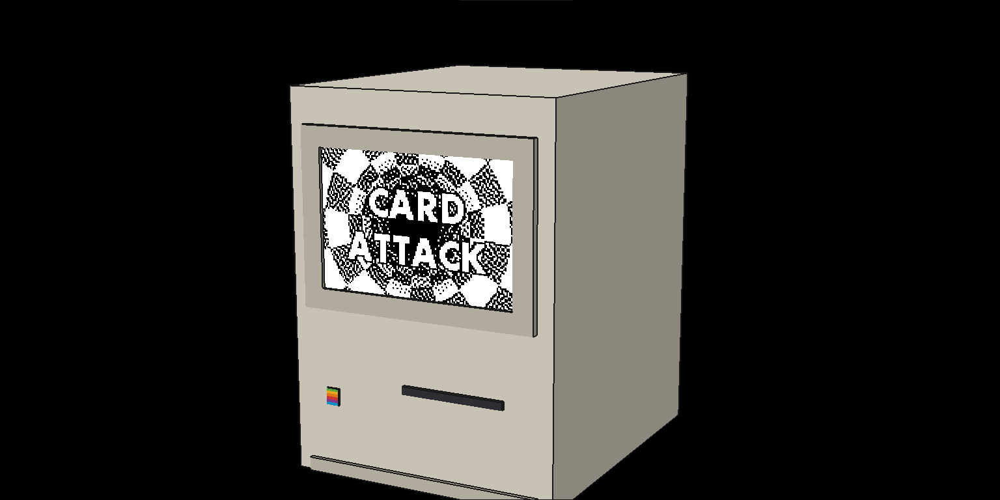

# Swarm

The swarm's arithmetic and edge machines and its printed tables. The swarm itself, a flock of phones and tablets
after the dive, is no longer in the film, but the machines written for it work out the numbers of most of the 3D in
the film, so they are kept here.

## What is here

- **The arithmetic** (27 machines): products by quarter squares, exact long sums, long division rounded down, square
  roots, sines and atans from the printed tables. A number is one card, a long (thousands and the rest) or three cards
  (millions, thousands and the rest). The host's calculator ([`host/src/fx/swarm_calc.rs`](../../host/src/fx/swarm_calc.rs))
  builds each frame's numbers as a graph of these steps and works them out a level at a time, each level one deck per
  machine. The host only deals cards, carries punched cards to the next deck, looks up the tables at the indexes the
  machines punched, and picks between two numbers where a machine's flag says. Alongside each number the calculator
  keeps a bound on how big it can be, worked out on the host from the bounds of its inputs (for a square root, by a
  floating-point square root of the bound), only to choose how many cards the number needs; the bounds are never
  dealt to a machine and never stand in for a value.
- **The edges** (7 machines): `sw_esub` to `sw_epix` walk each polygon edge down the screen's rows and give the
  first pixel right of each crossing, so polygons that share an edge meet exactly.
- **`data/tables.txt`**, the printed tables: 999 sin every thousandth of a turn (a quarter turn, 251 entries), atan
  every 2000th (2,001), 1000 / sqrt(2 w / 1000) (2,001), the highlight's two powers (1,000 each) and the quarter
  squares n^2 / 4 for n = 0..1998. `data/make_data.py` prints them.
- **`hand/`**: five of the arithmetic machines written by hand in CARDIAC assembly for speed (`sw_divd`, `sw_lsum`,
  `sw_mag`, `sw_qis`, `sw_qp`; see `docs/HOT_MACHINES.md`). Where a `hand/NAME.asm` exists the host loads it in
  place of the compiled `NAME`, on the same deck, and `--native` still checks its cards against the Rust machine.

## Where the film uses them

| Segment | What they work out |
|---|---|
| [turn](../turn) | The camera, the morph from the Mac to the PC, the light, every corner on the screen, the screen's grid, and the boxes' edges (all 34 machines but `sw_card`) |
| [mac](../mac) | Boom's camera, rays, walls and floor, the gun's bob, the page's sphere and the flag (16 of the arithmetic machines) |
| [deep](../deep) | The 1536x768 creatures' sums: places, turns, the atans (`host/src/fx/deep_hd.rs`) |
| [accel](../accel) | The jump: the car's path over the crest and the camera following it (`host/src/fx/accel_jump.rs`), and the car itself through the mesh kit |
| [mesh](../mesh) | The mesh kit's turns, corners and edges, used by the accel's car and the deep's orcas |
| [train](../train) and the segments drawn with its operations ([night](../night), [stadium](../stadium), [rooms](../rooms), [sqend](../sqend)) | Products, sums, divisions, sines and square roots inside the train's operations (`host/src/fx/train.rs`) |

The printed tables are read by all of these, and by the native references of the mac, the turn, the deep, the accel's
jump and the stadium.

## Machines

| Machine | Cells | What it does |
|---|---|---|
| `sw_qi` | 80 | The first half of a product by quarter squares: the two places to look up |
| `sw_qis` | 73 | The same for signed products (by hand in `hand/`) |
| `sw_qp` | 72 | A product from the two quarter squares looked up (by hand in `hand/`) |
| `sw_lsum` | 78 | Exact sums of three-card numbers (by hand in `hand/`) |
| `sw_term` | 75 | A number as a term of a sum, negated when its sign is set |
| `sw_add` | 49 | Sums of longs |
| `sw_abs` | 51 | A three-card number as its sign and size, for long division |
| `sw_mag` | 75 | A one- or three-card number as its sign and size (by hand in `hand/`) |
| `sw_sign` | 37 | Whether a three-card number is below 0, and whether it is 0 |
| `sw_divd` | 95 | Long division of a size by a long, a digit at a time (by hand in `hand/`) |
| `sw_join` | 43 | A quotient's digits made a long |
| `sw_floor` | 80 | A negative number's quotient and remainder rounded down |
| `sw_floor3` | 93 | A quotient and remainder rounded down when the number was below 0 |
| `sw_shift` | 28 | A three-card number over 1000, rounded down |
| `sw_short` | 24 | A three-card number that fits a long, as a long |
| `sw_wide2` | 26 | A long as three cards |
| `sw_card` | 28 | A three-card number that fits one card, as that card |
| `sw_hund` | 45 | A number's hundreds and the rest, for square roots |
| `sw_isqrt` | 95 | The square root of the hundreds, by taking away odd numbers |
| `sw_isqrt2` | 63 | The root's last digit |
| `sw_ang` | 95 | An angle as its places in the sine table |
| `sw_sin` | 79 | A sine and cosine between two table entries, by tenths, with the sign |
| `sw_order` | 53 | Two sizes, the smaller first, for an atan |
| `sw_atan1` | 56 | A ratio's place in the atan table |
| `sw_atan2` | 69 | An atan between two table entries, by tenths |
| `sw_quad` | 86 | An atan turned to its point's quarter (atan2) |
| `sw_tall` | 51 | Whether an edge is 1000 pixels tall or more, to be cut at its middle |
| `sw_esub` | 75 | An edge's run and height, its top end first |
| `sw_erows` | 51 | How many rows an edge meets |
| `sw_eclip` | 84 | How many of an edge's rows are above the screen |
| `sw_eend` | 35 | Where an edge's rows leave the bottom of the screen |
| `sw_ewalk` | 84 | The remainders as an edge's crossing steps down the rows |
| `sw_ecross` | 80 | Where an edge crosses each row on the screen |
| `sw_epix` | 64 | The first pixel at or right of each crossing |

Each is one phase; the cells are the compiler's count.

## Files

- `machines/`: the 34 machines in Rust.
- `hand/`: the five hand-written ones.
- `data/tables.txt` and `data/make_data.py`, which prints it.
- Host: [`host/src/fx/swarm_calc.rs`](../../host/src/fx/swarm_calc.rs), the calculator, and the tables' loader
  (`load_tables`).
