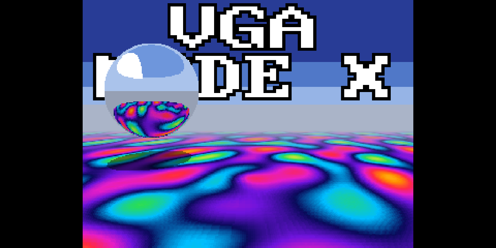

# Titles

This folder no longer holds a segment of its own. The titles it once held (the opening's fizzle-in lines and the
lower-third titles over the shout-outs) are not in the film. What is left is one machine, `tt_role`, which
[Mode X](../modex) uses to outline its sign: the thick black edge round the white **VGA** and **MODE X** behind the
ball.

## What the machine does

`tt_role` runs once per screen row. Its deck is two switches (outline or not, and a shadow's length, 0 for none),
then for each column from the one before the first to the one after the last the mask there, as one card of three
digits (above, here and below, each 1 on a letter), and the run it punched there on the row above. Sliding along the
row it keeps three columns, so it can tell a pixel off the letters with any letter beside it (any of the eight round
it): that pixel is outline. A pixel's run is one more than the run up and to the left (0 on a letter, at most 7), the
steps up the diagonal to the nearest letter, so a pixel within the shadow's length is shadow. That gives a drop
shadow or a long shadow a row at a time, without looking back. For each of its 192 pixels it punches a code (0
nothing, 1-4 fill at x mod 4, 5 outline, 6 shadow) and its run.

## Why it's hard on CARDIAC

- An outline means looking at all eight neighbours of every pixel, and a machine sees one card at a time and holds a
  handful of numbers. Packing the column's three rows into one card's three digits lets it keep three columns, so
  each card is read once.
- The sum of three such cards is above 0 exactly when a letter is near, so one test does the eight neighbours.

## How Mode X uses it

Mode X's sign is a mask of lettered pixels at 320x240 (`modex/data/sign.txt`). Before the first frame the host runs
`tt_role` over it with the outline on and no shadow, three times: each pass's letters and outline become the next
pass's mask, so the outline grows to every pixel within 3 of a letter. A pass is two runs a row (192 columns from 0
and from 128) over the sign's 100 rows: 600 runs in all, 4.9M instructions. The host then files the letters white
and the outline black wherever the ball doesn't cover them, testing each pixel against the row's span of ball pixels
it keeps from the spans `mx_span` punched.

| Machine | Cells | What it does |
|---|---|---|
| `tt_role` | 82 | Per screen row: each pixel's code (fill, outline or shadow) and its run up the diagonal |

## Files

- `machines/tt_role.rs`: the machine.
- Host: [`host/src/fx/modex.rs`](../../host/src/fx/modex.rs), which runs `tt_role`; its reference is
  [`modex/reference.rs`](../modex/reference.rs).
