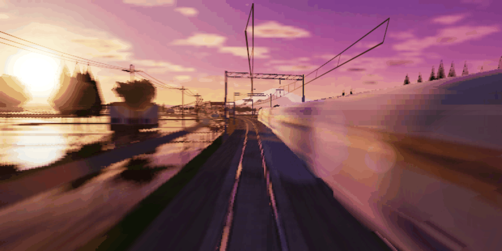

# Train



The bullet train: a cab ride from a standstill in a station to 300 km/h, through a Japanese city, a tunnel and
sunset farmland, with an N700 passing the other way, at 1536x768. The brag (REAL-TIME RAY TRACING / 1536 x 768) and
the `traceRayEXT` shader are laid over its first seconds. Every pixel's colour is worked out on CARDIAC.

## What it shows

256 frames at 12 fps (21.3 s), all of them in the film, straight after the dive's knob
(`seg train train/video_hd.rgb 0 256 1536x768`). First the departure,
84 frames: a second standing at the platform under its canopy (the LED board:
14:03 NOZOMI 37 FOR SHIN-OSAKA), then a steady push for six seconds out of the station and along the viaduct, up to
the ride's speed. Then the ride, 172 frames, the brag and the shader in their place in it: the city on its viaduct (0-260 m), the tunnel with its
lamps (to 500 m), the S-curve through the paddies at sunset with the other train passing (from 550 m), the truss
bridge over the river (920-1040 m), land again. Motion blur, the low sun's glow and its lens ghosts, the paddies and
the river mirroring the sky and what stands above them, shadows (the city's by day, the farmland's at dusk), fog, the
overhead line's wires.

## The world at half resolution

`train/video_hd.rgb` (what the live cut and `cut.txt` play) has the world at half the resolution, 768x384 (the city,
the fields, the river, the bridge, the tunnel, the sky, the paddies and their mirrors, the sun's glow and the lens's
ghosts), made up to 1536x768; at full resolution the departure's board (14:03 NOZOMI 37 FOR SHIN-OSAKA) and the words
over the city (the shader, the brag). [`party.rs`](party.rs), as the night's: the half render keeps the world's own
depth behind the board; the board is drawn again at full resolution and kept where nearer than it, shaded, given its
half pixel's bloom and toned (its blurred half picture mixed in as its blur grows); the world made up from its own
pixels only (no halos). The renderer is the same code at `set_res(2)` (per thread): the lens's twice f halved, the
screen's numbers by the full screen's distances, the blur along the half screen's lines (`data/tables_h.bin`,
`make_tables.py --half`), footprints 4 levels coarser, bloom radii halved; the shading rate's tiles where the blur
smears as before. (The ride has no cab, window frame or interior in view.)

On CARDIAC (exact counts measured on 2026-10-26, the 244 pictures of 256 frames, before some of the hottest
machines were written by hand, below; not measured again since): 398G (the start 9.4G with the half screen's
numbers, the frames 389.0G), 256/256 identical to native Rust. By stage (G): geometry 82.7, blur 27.0, light 39.0,
buildings 36.1, tone 26.1 (with the words), lens 19.0, mirrors 23.1, places 14.7, sky maps 32.7, wires 15.3, paddies
10.6, other 9.4, deck 7.3, sky 4.8, making the world up 25.2, the board at full resolution 1.5.

## Why it's hard on CARDIAC

- **Size.** 1.18 million pixels a frame, 40,000 triangles, a scene 2.6 km deep: nothing of the geometry fits a card,
  and every operation over every pixel costs its machine's few dozen instructions a pixel. The whole ride had to
  come down from about 2,000G (the first version, one machine an operation) to what the film can carry.
- **No multiplication, no division.** A product is two entries of the printed table of quarter squares, fetched by
  the host at the places `tr_qa` punches and subtracted by `tr_qb` (or `tr_qp`, `tr_pctb`); a long division is hundreds of
  instructions. The answer here is logarithms: the printed tables of ln and e make a product or a quotient one
  subtraction on CARDIAC (`tr_ldiff`), for every place along a ray, every slope along an edge or a span, every
  projection, every mean of the blur, the fog's distance, the footprint's level.
- **96 cells.** Every step is its own small machine, run over a whole list at once.
- **Everything is HDR.** Light past 1.0 is kept as a card and its tenths past 999, through the blur and into the tone
  curve.

## How it's done

The renderer is written once, in [`ops.rs`](ops.rs)'s operations, and run two ways: natively (`Native`: the
reference, `refs/train_ref`) and on CARDIAC (`Cardiac` in [`host/src/fx/train.rs`](../../host/src/fx/train.rs)), each
operation a machine (or a few) of [`machines/`](machines) and the host's look-ups. The frame:

- **The camera** ([`render.rs`](render.rs)): the frame's ride time (`ride_t`: the departure's 84 frames before the
  ride's 0, the cab stands still for the first 13 frames, so CARDIAC draws that picture once and the host files it 13 times); departing, the cab at -252 m plus 7 w^2 / 144 cm (w
  tenths of a frame since the push began), its sway growing with the speed; riding, on the line at 7 m a frame, the bend of the S-curve, the sway,
  the lean, from the swarm's sine table.
- **Rays** ([`frame.rs`](frame.rs)): each pixel's at 0.7 of its length, a quarter row at a time by `tr_walkc` (the
  same step every pixel).
- **The ground**: the level deck, the street, the land, the river's water and banks, as planes: their depth by walks
  along the rows, the places by logarithms, the stretch (viaduct, cutting, tunnel, bridge, river) from the host's
  printed table by the place along the line; none where a nearer piece hides it.
- **Which triangles** ([`frame.rs`](frame.rs), `visible`): a frame considers the world's triangles ahead within
  2.6 km, only what is this side of the hill or framed by the tunnel's exit, and small things only within 900 m; it
  takes each tree as its full model within 260 m and as one crown beyond; and it puts each triangle in the near list
  (millimetres) or the far one (centimetres, from 800 m on). At the start the machines work out, from each
  triangle's extents (scene data), the span of the camera's places along (metres) for which a frame considers it, the
  place short of which it is far, and which triangles stand this side of the hill and which the exit frames. Each
  frame the machines put the camera's place in metres (divided by 100 toward zero) and compare it with the bounds,
  one `lt` for all the frame's candidates and one for those that passed, then one for the far list; the host picks
  the candidates by comparing the place with the tunnel's two places and reads the flags. The mirrors keep those of
  the frame's triangles within 450 m by another such bound, and the other train is drawn, near or far, by its nose's
  place less the camera's (on the machines) against its reach.
- **Triangles** ([`render.rs`](render.rs)): the ones facing the camera (by frame tables of the eye's products),
  corners into the camera's space and onto the screen by logarithms, clipped to the near plane and the guard band,
  each edge's crossings of the rows and its values down them by slopes (`edge_rows`, `walk_from`), each span's
  values by its slope (`tr_walka`, `tr_walkc` for normals). The pieces sorted to their pixels by the host; the
  nearest kept (`tr_near`); the trees' leaves cut out by their noise.
- **The sky** ([`sky.rs`](sky.rs)): a map of directions (its constant parts worked out on CARDIAC at the segment's
  start, during the film, the clouds
  where the eye is each frame), looked up at every fourth pixel and made fine by `tr_up4`; at dusk the ridges and the
  sun's core on the same grid, each pixel its own only where a ridge's outline crosses its cell.
- **Shading** ([`materials.rs`](materials.rs)): one pixel a 2x2 block, 4x4 or 8x8 tile where the blur will smear it
  6, 16 or 48 pixels; places by logarithms, each material's pattern from filtered printed tables, the sun (shadow maps
  looked up 16 taps at a time by `tr_lit16`), the sky's and the ground's light by frame tables, the tunnel's lamps
  from maps worked out on CARDIAC at the segment's start (from the printed table of the tunnel's map places and
  normals, `make_tables.py`), the fog by the distance's logarithm. The glass's tint is one of four colours, picked by the host: it divides the material's parameter at
  the pixel by 100 and holds it at 3. The paddies and the river mirror the sky
  and a buffer of what stands above them, flipped, drawn at half the screen's size ([`mirror.rs`](mirror.rs)).
- **Motion blur** ([`blur.rs`](blur.rs)): each moving pixel the mean along its streak, by running sums along lines in
  16 directions (`tr_runsum`), the means by logarithms; in the fastest tiles one pixel a 2x2 block.
- **The wires** ([`wires.rs`](wires.rs)): the overhead line's and the city's, anti-aliased.
- **The lens** ([`lens.rs`](lens.rs)): the glow (bloom) from each 4x4 block's four samples, blurred at a quarter of the
  size and made fine as its square root by `tr_up4`; the sun's ghosts as sprites worked out on CARDIAC at the segment's start and the
  frame's profiles; both as light the tone curve adds.
- **Tone** ([`shade.rs`](shade.rs)): the curve with the vignette in it, by a printed table, and a little more colour
  (`tr_push1`, `tr_push2`); the brag and the shader ([`overlays.rs`](overlays.rs)).

Some of the busiest operations run as machines written by hand in CARDIAC assembly instead of the compiled Rust
([`hand/`](hand), [docs/HOT_MACHINES.md](../../docs/HOT_MACHINES.md)): adding longs is a machine for each of its
three cases (`tr_add1`, `tr_add2p`, `tr_add2m`), and `tr_addc`, `tr_ldiff`, `tr_lt`, `tr_max`, `tr_min`, `tr_mixa`,
`tr_pctb`, `tr_qa`, `tr_qb`, `tr_sum`, `tr_up4` and `tr_walka` each have a hand-written version that the host loads
in place of the compiled one, dealt the same cards (the compiled one's native build runs beside it for the native
checks). The three adders have no Rust, so with `CARD_ATTACK_NATIVE=only` they still run on CARDIAC.

The host deals, sorts, fetches from printed tables (logarithms, squares, the curves) and from tables CARDIAC works
out (for the frame or at the start), and copies computed pixels. It also does arithmetic of its own. The operations
in [`host/src/fx/train.rs`](../../host/src/fx/train.rs) choose which machine runs a sum item by item, by comparing
each value with a card's or a long's limits; no sum is worked out on the host. An item of at most six cards and a
constant card goes to `tr_addc`, which punches every such sum whole, as its thousands and the rest (seven cards add
up to at most 6,993, and CARDIAC's accumulator holds four digits). An item of one or two longs and a constant long,
one of them added, goes to `tr_add1`, `tr_add2p` or `tr_add2m`, picked by the terms' count and signs; these keep the
high's partial sums in the accumulator, never on a card, so only the sum itself has to be a long, which `sum`
promises. Every other item goes to `tr_sum`. `lin` sends a sum of addends to `sum` when each of its values is within
999,000 / w in size (w the count of terms with their multiples), so that every partial sum is a long whatever the
order, and the rest to its three-card pieces; `lin` and `clamp` choose their product and clamp machines by the
values' sizes the same way. The host also splits each long into its thousands and units for the cards and reads the
two cards back as one number. The glass's tint is the host's too.

## Making it

```
python segments/train/data/make_data.py       # scene.bin, from the Blender models
python segments/train/data/make_tables.py     # tables.bin (about 230 MB) and tables_h.bin (--half)
cd segments && cargo cardiac build            # the machines
rustc --edition 2021 -O -o refs/train_ref segments/train/reference.rs   # (refs.sh)
card-attack train refs/train_ref              # the ride on CARDIAC, checked against the reference
```

`scene.bin` (the world's and the other train's models) and `tables.bin` and
`tables_h.bin` (the printed tables) are assets made ahead of time in Python. They are not in git as files: they are packed in
`generated.tar.xz`, which
`build.sh` unpacks.

`TRAIN_FRAMES=a,b,..` renders only those frames; `TRAIN_SETUP_NATIVE=1` works the start out natively (quicker, for
measuring); `TRAIN_STAGES=1` reports the instructions by stage and machine; `TRAIN_BOTH=1 TRAIN_FRAMES=..` runs every
operation both ways and stops at the first that differs (`TRAIN_OPS=N` lists the N costliest calls). The live
player makes the start once (`train:setup`) and the frames in blocks.

## Numbers

- `card-attack train refs/train_ref`: identical to native Rust 256/256. With `CARD_ATTACK_NATIVE=only` it takes
  about 3.5 minutes on one core.
- Live, the player makes the start as one job and the frames in blocks, by the seconds in
  [`segments/cut/costs.txt`](../cut/costs.txt).

## Simplifications

Kept as small as CARDIAC's budget allows; each looks the same at speed:

- **Motion blur**: a box along the nearest of 16 directions (running sums: a streak costs the same however long);
  in the fastest tiles (streaks of 16 pixels or more) one blurred pixel a 2x2 block.
- **Shading rate**: one pixel shaded a 2x2 block, a 4x4 tile or an 8x8 tile where the blur will smear it 6, 16 or 48
  pixels or more. No anti-aliasing of the triangles' edges.
- **Numbers by logarithms**: places along rays, slopes along edges and spans, the projection, the corners' turn into
  the camera's space, normals made units and the shadow maps' places are e of a difference of ten-thousandths of a
  logarithm: right to about one part in 10,000 (a centimetre at 100 m), not exact.
- **The sky**: worked out at every fourth pixel (and the sky map's 5 thousandths of a radian) and made fine between;
  the ridges' outlines and the sun's core sharp where they cross.
- **Glow**: from four samples of each 4x4 block, its near blur twice with a radius of 4 blocks, the wide
  one from that twice with a radius of 14; the glow and the ghosts come
  through the vignette too (they are light added before the tone curve, whose table has the vignette in it).
- **Shadows**: map texels of 25 cm by day and 20 cm at dusk, looked up for each 2x2 block.
- **Mirrors**: what stands above the water drawn at half the screen's size each way.
- **The tunnel's lamps**: their light worked out on maps at the segment's start, only near the tunnel's surfaces.
- **The triangles** are drawn by this segment's own raster ([`render.rs`](render.rs)), not the mesh kit's machines:
  at 40,000 triangles a frame the kit's long divisions an edge cost too much.
- **Normals** in hundredths, their dots over 100 (99 is a unit: about 1% short).
- **The departure board**: the dots placed by whole centimetres (their pitch 29 quarter centimetres), each dot's
  share of a footprint and the glow of a lit one when the footprint is wider than the pitch from printed tables, the
  glow capped at a full dot.
