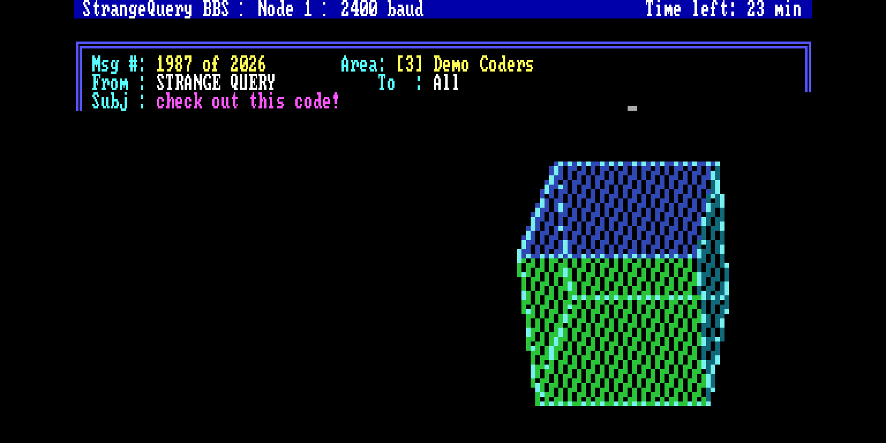

# Tumble

## What it shows

A pale cyan square spins flat and fast. It tilts towards us, and it's a cube. Then it travels in perspective: round
the screen, up and down, toward us until it's two thirds of the screen's height and away until it's small, while its
faces fizzle in, solid and lit. The render goes on to dissolve the [rotozoomer](../roto) in behind the cube and then
dissolve the cube away, but that part isn't in the film. 201 frames at 192x96, on black.

The tumble has no line of its own in the [cut](../cut). The [BBS](../bbs) takes its frames 14 to 147 (134 frames, the
last two of the flat spin, the tilt and the first 117 frames of the travel) and lays the cube over its message page,
each pixel 8 x 8 on the 1536x768 frame. The screenshot is the BBS's frame 25, the tumble's 39.

## Why it's hard on CARDIAC

- Everything the [cube](../cube)'s machines need, at twice the size: the cube's corners, edges and faces as whole
  numbers within ±999.
- Perspective is a multiply and a divide per corner, lens × x / distance, and the product alone runs to tens of
  thousands.
- A face's projected area at twice the size runs past a card (it's four times the area), so the faces can't be
  lit from the cube as it's drawn. Yet which faces show must come from the very corners the edges are drawn from,
  or a nearly edge-on face shows only its edges, or a hidden one is filled over the others.
- Laying one picture over another needs a "no cube here" code.

## How it's done

The frame is four 96x48 tiles, as for the [rotozoomer](../roto). The host deals cards, carries what one machine
punches to the next, and files the pixels. Every number of the frame is a machine's. The sine tables, and the
corner cards for each axis at both sizes (the cube folder's depth of ±12, and ±24), are built by the host when it
starts; each frame takes its axis's.

**Once per frame:**

1. The frame's numbers come from four of the cube folder's machines, each dealt only the frame's number: `tm_turn`
   the angle, `tm_axis` the axis and the tilt, `tm_path` whether the cube travels, the path's three steps and the
   lens, and `tm_levels` the faces' fizzle level, the rotozoomer's dissolve level and frame, and the cube's dissolve
   level.
2. `vtx` (the cube's) turns the cube, dealt a 60-entry sine table scaled to 24 in place of 12 and the corners
   scaled to match: a cube of half-width 24.
3. `path` says where the cube is, from a 120-entry sine table scaled to 48 (S): X = 2 (S(a) - S(a)/4) across,
   Y = 2 (S(b)/6) down and D = 2 (180 + S(c) + S(c)/2) from the eye, 216 to 504. a and c step by 2 a frame, c a
   quarter turn ahead, so the cube goes round a loop; b steps by 4, so it goes up and down once in two and a half
   seconds. It punches the half-size place first, for the faces' light.
4. `project` (the cube's) shifts the corners for the tilt about (X, Y), and `persp` sees each from the eye:
   lens × (X + x + shift) / (D + depth), likewise y. It never forms the product: it adds the size lens times,
   taking the distance away whenever the sum reaches it, so nothing passes distance + size (below 600). The lens
   is 205; the tilt is seen at the path's far end through a lens of 504, and `tm_path` draws the lens back to 205 by
   20 a frame over the travel's first 15 frames.
5. For the faces, the cube's own machines light the cube at its small size (`vtx` on the table scaled to 12,
   `project` and `persp` at half the place and distance, so it's the same view, then `project`, `gather`,
   `fshade`): the same shading, from areas that fit in a card.
6. Which faces show is decided from the big cube's own corners: `gather4` takes each face's two diagonals, and
   `facing` crosses them to twice its projected area, kept as 576s and a rest 0-575 since it runs past a card. A face
   shown keeps the small cube's light, at least 8; a face hidden gets none. Then `palette` colours the faces.

**Once per tile:**

7. `project4` puts the corners in the tile's own pixels. Corners can be well off the screen when the cube is close;
   the edges' spans run on past the tile and the row machines keep only what's in it.
8. `esort` and `raster4` make the edges' spans. A row's span of an edge is the part of the edge within half a pixel
   of the row's centre, its ends rounded to the nearest pixel. Every tile steps each edge from its own ends, so the
   tiles agree. Once the rotozoomer is needed, its `r4_clock` and `rotor4` run too.

**Once per tile row:**

9. `comp` makes the wireframe's codes; with faces, `fspan` and `solid` add them.
10. While the rotozoomer arrives, its `rzrow` and `paint9` make the picture behind and the cut's `dissolve` brings it
    in from black.
11. `cover` lays the cube over the picture: the palette's colour where the cube is, the picture where it isn't.
12. At the end, `dissolve` takes the cube away into the rotozoomer.

## The timeline

| Frames | What happens |
|---|---|
| 0-15 | Flat and fast, 22.5° a frame, centred |
| 16-30 | It tilts, turning about the vertical at 18° a frame, in the centre at the path's far end |
| 31-200 | It travels, turning a full turn about one axis, then the next. The faces fizzle in over the first 16 frames. The rotozoomer dissolves in from frame 151 and the cube dissolves away from frame 185 (neither is in the film) |

The axis changes only after a full turn, so the faces line up where it does.

## Machines

| Machine | Cells | What it does |
|---|---|---|
| `path` | 8 data + 83 / 82 (two phases) | Per frame: where the cube is |
| `persp` | 86 | Per frame, twice: the corners seen from the eye |
| `gather4` | 77 | Per frame: each face's diagonals, from the big cube's corners |
| `facing` | 84 | Per frame: which faces show, from those diagonals, with their light |
| `project4` | 54 | Per tile: the corners in the tile's pixels |
| `raster4` | 88 | Per tile: the edges' spans, row by row |
| `cover` | 94 | Per row: the cube over a picture |
| `tm_turn`, `tm_axis`, `tm_path`, `tm_levels`, `vtx`, `project`, `gather`, `fshade`, `palette`, `esort`, `comp`, `fspan`, `solid` | (the [cube](../cube) folder's) | The frame's numbers, the turn, the light and the rows' codes |
| `r4_clock`, `rotor4`, `rzrow`, `paint9`, `dissolve` | (the rotozoomer's, the shared and the cut's) | The picture behind, and the dissolves |

**Instructions:** 1,303M for 201 frames (6.5M a frame): `comp` 734M, `solid` 281M, `fspan` 113M, `cover` 72M, the
rotozoomer's `rzrow` 43M and `paint9` 22M, `dissolve` 16M, `persp` 13M, the rest 9M.
`card-attack tumble refs/tumble_ref` says identical 201/201.

## How big the numbers get

Every frame's largest, against a card's 999 (worked out from the reference's formulas):

| Number | Largest | Margin |
|---|---|---|
| `path`: the place and distance | 504 | 495 |
| The tilt's shift, tilt × depth | 99 | 900 |
| `project`: a shifted corner (big cube) | 106 | 893 |
| `persp`: its running sum (big cube), below distance + size | 585 | 414 |
| `persp`: a corner seen (big cube) | 77 | 922 |
| A corner in a tile's pixels (off the sides when close) | 164 | 835 |
| `persp`: its running sum (small cube) | 293 | 706 |
| `fshade`: a product, and the area | 672 | 327 |
| `gather4`: a part of a diagonal (big cube) | 64 | 935 |
| `facing`: the rest, carrying 576s (-52 to 638); the 576s, -8 to 9 | 638 | 361 |
| `raster4`: its error term, below twice an edge's height and width | 136 | 863 |

At its closest the cube is 64 pixels from top corner to bottom, two thirds of the screen, and its corners stay
between rows 8 and 95 throughout: it can run off the sides, never the top or bottom.

## Files

- `machines/`: `path`, `persp`, `gather4`, `facing`, `project4`, `raster4` and `cover`.
- `reference.rs`: draws every frame independently in ordinary Rust (with the rotozoomer's `roto_data.rs`).
- Host: [`host/src/fx/tumble.rs`](../../host/src/fx/tumble.rs). It files `video.rgb` (not kept), which the BBS reads.
