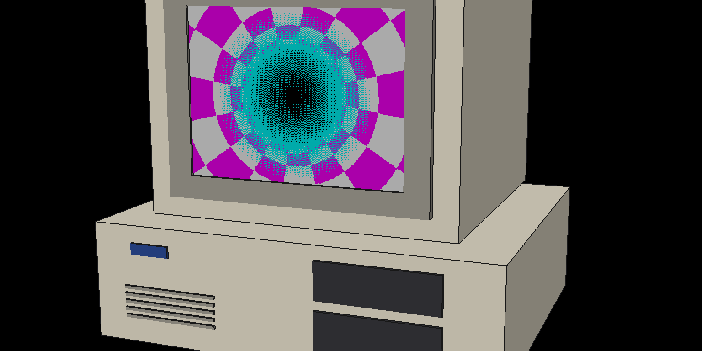

# Turn

The camera pulls back from the Mac, turns it into an IBM PC, and dives into the CGA.

## What it shows

The cold open's turn and the CGA's climb. The camera pulls back from the Mac's screen (its last picture
running on: the cold open's one-bit tunnel with CARD ATTACK over it) to show the whole Mac Classic, outlined and flat-shaded: the platinum case, the screen's bezel, the floppy slot, the rainbow badge. It spins once round, eased,
and while it turns it changes box by box into an IBM PC: the case into the monitor, the bezel into the PC's, the slot
into a drive, the foot into the system unit, the badge's stripes into the second drive and the vents, and the PC's
badge grows out of nothing; half way through, the screen's picture becomes the CGA's. The PC holds half a second, and
the camera dives into its screen until it fills 1024x768 of the frame.

Then the CGA tunnel, at 320x200 shown 4:3: the film's checkerboard twisting down a tunnel in palette colours 2 and 3,
its far end going through colour 1 to black by a 4x4 ordered dither, the palette flicking every second (palette 0 and
1, high and low intensity, mode 5), and half a second in, the brag 320 x 200 / 4 COLORS in the IBM's 8x8 font, doubled,
on a black box in the lower left. It goes out to black by the same ordered dither over a second, then three black
frames.

1536x768, 143 frames (12 s): 24 pulling back, 30 spinning, 6 holding, 20 diving, 48 of the tunnel, 12 fading, 3
black. The film shows all of them, between the [cold open](../mac) and the [BBS](../bbs) (`seg turn
turn/video_hd.rgb 0 143 1536x768` in the cut). Frame 0 is the Mac's bezel the cold open is shown inside: its screen
is 1024 pixels wide at (256, 42), the picture exactly twice its 512x342. The prototype is `prototypes/macpc.py` (and `combo.py`, not in this repository, for the
join and the fade).

## Why it's hard on CARDIAC

- **3D with no multiply, no divide, three digits.** The camera's path is smoothsteps and straight lines through
  unit vectors (square roots), the spin a sine, each box's corners a straight line from the Mac's to the PC's, every
  corner's place on the screen a division by its depth. Places on the screen in hundredths of a pixel reach 128,568;
  a point along the camera's basis 155,660,895.
- **A depth buffer is out.** Which box shows at each of 1.2 million pixels can't be a depth per pixel, and the boxes
  go through each other: the details sit in the case's face, and while it morphs the system unit grows up through the
  Mac's case.
- **The screen is a picture in perspective.** Where each pixel's ray meets the screen's plane is a projective
  division; a division per pixel at this size would be billions of instructions.
- **The tunnel needs an angle and a depth per pixel** (an atan and a square root), and its twist a product of the
  depth and the frame's sine at every pixel, every frame.
- **Cards overflow quietly.** A run of 1002 pixels, a step between grid points, a ratio past a million: each has to
  be kept under 999 a card, or a long, by how it's worked out.

## How it's done

**The scene's numbers** are sums worked out on the swarm's arithmetic machines (`fx/swarm_calc.rs`: quarter-square
products, long sums, long division, square roots, sines and atan from the printed tables), a group of 8 frames at a
time, as the reference's formulas say step for step:

- the camera: the eases (smoothstep, thousandths, 1000 at the end), the target, the distance and the way back to the
  eye along straight lines; the way made a unit (ten-thousandths: 20000 a v / (a^2 + |v|^2) for a the whole square
  root, a Newton step); across (the unit of (-dz, 0, dx)) and up (forward x across); the spin's sine and cosine (none
  when it hasn't turned or has turned once: the machines' flags say), the eye and the basis turned back into the
  boxes' frame;
- the morph: each box's lo and hi on each axis and its colour, a + (b - a) m / 1000;
- the order: every pair of the numbers on each axis (the boxes' and the eye's) compared (their difference's sign):
  the sorter's order of them;
- the light: per face way, 0.62 + 0.38 (n . light) + 0.08 (toward us), held to 0 and up, in ten-thousandths, and each
  piece's colour, its box's times that, held to 255;
- the corners on the screen: each axis's (value less the eye's) times the basis (a product per distinct value), summed
  per corner, across and up in tenths of a unit and depth in units, then 21100 times across over depth (the focal
  length 2110 pixels: 40 degrees across);
- the screen's grid (below), and the polygons' tall edges cut, as the swarm's.

**The pieces.** The hidden-surface work is the host's, done by comparing the ranks the machines' comparisons give
each number on each axis; the host forms no number of its own. From those ranks the host works out each box's faces
that face the eye, and cuts each face where another box is inside it into rectangles (a face's part inside another box
can never be seen: the strip below the other box, the strip above, then the parts left and right), taking the larger
and smaller of ranked ends as it goes. It puts into each piece's edges every corner of another piece that lies on
them (so pieces that meet share their edges exactly and leave no gap of a pixel between them). The pieces then never
cross, and the host decides which of two pieces is in front: the one on the eye's side of an axis's plane that parts
them. There is no depth per pixel and no division.

**The pixels.** The swarm's edge machines walk each piece's edges down the rows (`sw_esub` .. `sw_epix`; a flat edge
that meets one row takes no step, which would pass a long). On each row the host sorts the ends of the pieces' spans
the machines punched, finds at each cut between them the pieces whose spans cover it by comparing their ends, and
picks the one in front of the others by its own front test above. `tn_edge` marks the outline: the row cut where it or
the rows above and below change, each piece's first, middle and last pixels marked when a neighbour (left, right,
above, below, across the frame's edges to the other side, as the prototype's roll does) shows another face's way
(an object's: the outline, grey 24) or an object beside nothing (the rim, 24, 24, 28). The host fills each run with
its colour (computed) or the screen's texels.

**The screen's picture** is placed exactly at a grid of points 20 pixels apart over the screen's box: where the eye's
ray meets the screen's plane (in the boxes' frame the ray's way is X r + Y u + 21100 f; across in thousands, along the
screen's normal in ten-thousands), the ratio of the two in hundred-thousandths (or, for a ray nearly along the
plane, ten-thousandths; held at the edge when it's along it), times the eye's depth from the plane, from the screen's
corner: its place on the picture in thousandths of a texel. Between the points, straight lines: `tn_step` works out a
twentieth of the change between two points (a whole and a rest in twentieths), `tn_walk` steps down each grid column to
the rows the screen is on, then across each row a cell at a time, punching each pixel's texel; the host fetches the
texel by that index (the pictures padded 240 texels round with their edges, so a grid point off the edge keeps its
place). The Mac's picture until the morph is half way, then the CGA tunnel's frame.

**The Mac's picture** is the cold open's (`segments/mac`) running on, as the prototype's `mac_screen` does: its one-bit
tunnel at its frames 108 + f (a picture every third frame, to picture 48), CARD ATTACK over it all the way in, the
screen's rounded corners; made on the cold open's own machines and tables (`mac_offset`, `mac_slope`, `mac_angle`,
`mac_reach` once; `mac_twist`, `mac_trow`, `mac_dither`, `mac_dissolve` each picture) with its sine table run on
(`data/mac.txt`) for `tn_macturn`, the cold open's `mac_turn` taking the longer table. So the cut from the cold open's
last frame to the turn's first is the tunnel's next picture, as in the prototype.

**The CGA tunnel.** Once: each pixel's distance from the middle squared (the rows 1.2 times as tall), against the
dither's two thresholds for its place in the 4x4 Bayer matrix (`data/cga.txt`, a table printed ahead of time in
Python: the prototype's level, 2 ((r - 6) / 110)^1.2, past 1 + t or t): a check, colour 1 or black. For a check, on
the swarm's machines: its depth 1500 over the square root (thousandths), its place along (depth / 3.5, in
fifth-hundredths of a ring, wrapped to two rings), its depth in hundredths, and its angle round (atan, sixteen checks:
fifth-hundredths of a check, two checks); worked out for a quarter of the picture; the other three quarters' angles
are worked out on the swarm's machines from the same atan, turned, and the host mirrors their pixels' places (319 - x,
199 - y). Each frame: the turn round (0.6 sin 0.9 t) and the twist's factor (0.012 sin 0.6 t, as 6 sin) and the travel
(2.2 t) on the swarm's machines; `tn_twist` the turn at every depth (the depth times the factor over 100000, added a
depth at a time, plus the turn); `tn_cga` each row: a check is colour 3 when its places round (turned at its depth)
and along (travelled) are in the same half of their two, else 2; the brag's pixels laid over (its box 0, its ink 3),
and fading, black where the pixel's dither (6 b + 3) is under eight times the step. The host fetches each index's
colour from the second's palette. The brag is the text kit's `CGA_BRAG` page (`ui/pages.rs`, face 10, the IBM CGA 8x8
font, drawn on CARDIAC by the kit), each of its pixels 2x2 on the picture, its box from (8, 143).

**After the dive** the CGA frames show the picture through the last 3D frame's texels: its screen is the same
1024x768 at (256, 0), so the join is seamless.

**The bezel for the cold open:** the turn also files `bezel.rgba`, its frame 0 as a layer for the cut, covering all
but the cold open's screen (1024x684 at 256, 42). In the cut, `over turn/bezel.rgba 1536x768 0 0 0 377` on the cold
open's `seg mac mac/video_hd.rgb 0 377 1536x768` shows the whole cold open in the Mac's bezel, as the prototype's join does,
and the turn follows.

**Live**, the player splits the turn into blocks after a setup job (the CGA pixels, the brag, the last 3D frame's
screen), kept for every block.

| Machine | Cells | What it does |
|---|---|---|
| `tn_edge` | 89 | Per row: each piece's pixels marked by their neighbours (the outline, the rim) |
| `tn_step` | 69 | A twentieth of the change between two grid points |
| `tn_walk` | 92 | Down a grid column or across a cell: each pixel's place, or its texel |
| `tn_twist` | 73 | Per frame: the tunnel's turn at each depth |
| `tn_cga` | 95 | Per row per frame: the tunnel's colours, the brag over, the fade |
| `tn_macturn` | 69 | Per picture of the Mac's tunnel: its turn, twist weight and travel (the cold open's `mac_turn`, its table run on) |
| the cold open's | | `mac_offset`, `mac_slope`, `mac_angle`, `mac_reach`, `mac_twist`, `mac_trow`, `mac_dither`, `mac_dissolve` |
| [the swarm's](../swarm) arithmetic | | `sw_qi`, `sw_qis`, `sw_qp`, `sw_lsum`, `sw_term`, `sw_mag`, `sw_shift`, `sw_sign`, `sw_divd`, `sw_join`, `sw_floor`, `sw_floor3`, `sw_abs`, `sw_short`, `sw_hund`, `sw_isqrt`, `sw_isqrt2`, `sw_ang`, `sw_sin`, `sw_order`, `sw_atan1`, `sw_atan2`, `sw_quad`, `sw_tall`, `sw_wide2`, `sw_add` |
| the swarm's edges | | `sw_esub`, `sw_erows`, `sw_eclip`, `sw_eend`, `sw_ewalk`, `sw_ecross`, `sw_epix` |
| the text kit's | | `ui_page`, `umix` (the brag) |

`card-attack turn refs/turn_ref` says identical 143/143. **Instructions:** 3,193M in 56,812 machine runs: the
screen's walks 1.77G (`tn_walk` 1,341M, `tn_step` 425M), the long divisions 0.45G (`sw_divd` 316M, by hand, and
`sw_join` 133M), the products and sums 0.51G (`sw_lsum`, `sw_qis`, `sw_qp`, `sw_term`, `sw_mag`), the CGA tunnel's
rows 0.24G (`tn_cga`), the edges 0.11G, the Mac's tunnel 0.04G.

## Numbers

| Number | Largest | As | Margin |
|---|---|---|---|
| A point along the camera's basis (units times ten-thousandths) | 155,660,895 | three cards | 844,339,104 |
| A corner across or up (tenths), times 21100 | 31,715; 669,186,500 | three cards | 330,813,499 |
| A depth (units, a divisor) | 15,566 | long | 84,433 (the divisor's limit, 99,999) |
| A place on the screen (hundredths of a pixel) | 128,568 | long | 871,431 |
| A grid ray, before it's cut to thousands or ten-thousands | 216,211,855 | three cards | 783,788,144 |
| A grid point's ratio (hundred- or ten-thousandths) | 987,996 | long | 12,003 |
| A grid point's hit from the screen's corner (hundredths) | 414,625 | long | 585,374 |
| The picture's width times the hit | 136,655,360 | three cards | 863,344,639 |
| A grid point's place on the picture (thousandths of a texel) | 991,999 (held) | long | 8,000 |
| The tunnel's depth times its twist factor | 12,971,016 | three cards | |
| A place round or along (fifth-hundredths), a colour | 999, 255 | card | 0 (by design), 744 |

## Against the prototype

- **The look is the prototype's**, to within a pixel at the boxes' edges (whole numbers: lengths in tenths of a
  millimetre, the rainbow's stripes moved 0.05 mm to whole tenths, directions in ten-thousandths, the spin's sine
  from the 999 table) and the CGA tunnel's checks (fifth-hundredths of a check, the twist's factor in thousandths).
- **The screen's picture** is exact at every 20 pixels and in straight lines between: under a third of a texel from
  the true place where a pixel shows less than two texels, at worst 5 texels where the screen is seen nearly edge on
  (frames 30, 31, 43: there a pixel spans ten texels). The prototype is exact at every pixel.
- **The camera** stands 3709 and 5357 tenths of a millimetre from the screens at the ends (the prototype's framing
  in whole tenths), so each screen is 1024 pixels wide to within a twentieth of a pixel.
- **The CGA frames** take the CGA picture at each pixel's middle (the last 3D frame's texels), where the prototype's
  `cga_full` took it at the pixel's corner: the same picture moved under a pixel, so the dive joins without a jump.
- **Frame 0**, the bezel: the screen's picture is exactly twice the Mac's 512x342, but the bezel's inner edge (in
  front of the screen) covers its top and bottom row and the outline its first and last column, as in the
  prototype's `render(0)`. The cold open is pasted over 1024x684 at (256, 42): at the cut from it to the turn those
  edges appear.

## Files

- `machines/`: the six machines in Rust.
- `reference.rs`: draws every frame independently in ordinary Rust, from the formulas and the data. `TURN_RANGES=1`
  prints the largest of each named number, and how far the screen's picture is from the true place.
- `data/`: `cga.txt` (the dither, its thresholds, the palettes and the flicks) and `mac.txt` (the cold open's sine
  table run on), assets printed ahead of time by `make_data.py`.
- Host: [`host/src/fx/turn.rs`](../../host/src/fx/turn.rs). It files `video_hd.rgb` (143 frames, 1536x768) and
  `bezel.rgba` (the bezel's layer).
