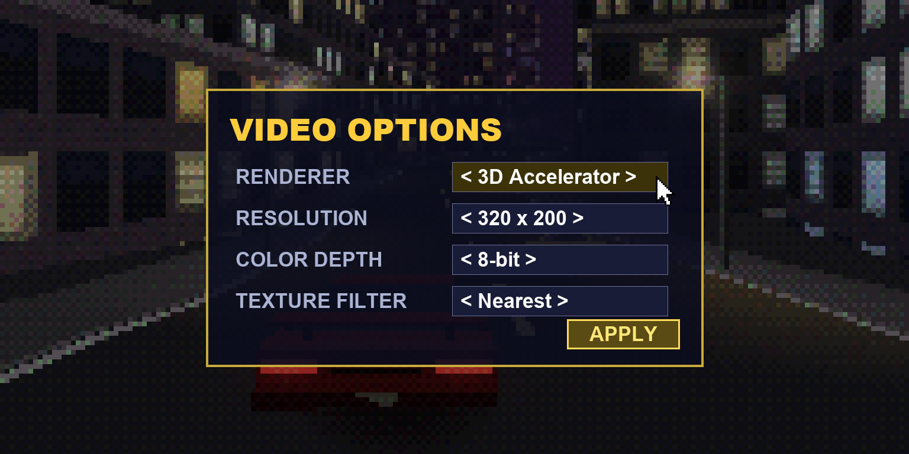

# UI

## What it shows

Crisp computer UI at the full 1536x768, laid over the chunky film: a layer of pixels, each red, green, blue and a
cover (0-32, in 32nds). The kit is not a segment of its own; it paints the layers and the text that other segments
show (the [party chat](../partychat) is laid out with its items too). Its scenes are in [`scenes.rs`](scenes.rs),
both for the [drive](../accel):

- **videoopts** (1197x628 at 339, 140; 47 frames): the drive's VIDEO OPTIONS menu over the dimmed 192x96 drive. The
  pointer glides to each of the four rows in turn and switches it (RENDERER to 3D Accelerator, RESOLUTION to 640 x
  480, COLOR DEPTH to 16-bit, TEXTURE FILTER to Bilinear), then presses APPLY. The cut lays it over the drive's
  frames 66 to 112: `over ui/videoopts.rgba 1197x628 339 140 66 47`.
- **accelbrag** (441x187 at 40, 506; 36 frames, all alike): the accelerated drive's brag, 640 x 480 / 16-BIT
  BILINEAR / 3D ACCELERATED in white Arial Black on a black box. It is seen on the screen of the
  [screening hall](../rooms), which lays it over the drive from the drive's 82nd frame.

**Text pages** ([`pages.rs`](pages.rs)): screens of text in a PC's bitmap font, the IBM CGA's 8x8 or the VGA's 8x16,
drawn at the page's own pixels and shown several times over on the frame. A page is lines of runs, each run its ink
and paper (or none: the picture shows through between the strokes); a line starts at its x or is centred on it; any
number of the characters may have arrived, the cursor after the last. The film's pages are the
[turn](../turn)'s CGA brag, the [BBS](../bbs), the [VGA](../vga)'s CompuServe page and brag, the [degauss](../rotodg)'s
sign, the drive's code and Mode X's sign (whose mask [Mode X](../modex)'s `data/make_data.py` takes from it).

**Lines at one bit** (`fx/text.rs`'s `Text::set` and `lay_bits`, `text.rs`'s `line_start` and `lay_bits`): lines in a
proportional bitmap face, the Mac's Chicago 12, Geneva 9 and Geneva 12 (atlas faces 17-19, from the System 6 BDFs).
`ui_text` places each glyph by its advance and offsets from the pen on the baseline, centred or set right; the host
lays its set pixels on in the line's ink. Used by the [Mac](../mac).

## Why it's hard on CARDIAC

- **It's the full 1536x768.** The menu's layer alone is 750,000 pixels a frame.
- **Antialiasing is fractions.** A glyph's edge pixel is partly covered, and laying it on is a fraction of a colour.
- **Laying one thing over another is a product and a quotient.** A pixel 9/32 covered over one 20/32 covered makes
  20 + 12 9/32 = 23 32nds, and the colour's share is 9 32 / 23: no multiply, no divide.
- **Text is a font.** CARDIAC has no fonts and 96 cells.

## How it's done

**Input data** ([`data/make_atlas.py`](data/make_atlas.py)): the atlas, each pixel of a glyph a cover 0-32. The film
uses Arial Black 52 and 40 and Arial Bold 34 for the drive (faces 20-22, rasterised by PIL), the pointer's arrow
(face 9's sprites 18 and 19), the bitmap faces for text pages (faces 10 and 11: the IBM CGA 8x8 and VGA 8x16 from
VileR's Px437 fonts, each glyph its whole cell, every pixel 0 or 32; code 1 the text cursor), Arial 22 and its bold
for the [party chat](../partychat)'s messages (faces 14 and 15), and the Mac's faces 17-19. The atlas was made for
earlier cuts too, so it also holds faces and sprites the film doesn't show (Helvetica 22-30, faces 0-8; the other
sprites of face 9; Menlo 30, faces 12 and 13; colour emoji, face 16, and the colours of the emoji in faces 14 and
15); it is kept as it was made, since its fonts are not in this repository. `atlas.txt` is the index (each glyph's
advance, place and size), `atlas.bin` the covers. The machines never see a font: they place a glyph by its advance
and offsets and the host fetches its covers by index.

**Each frame** (the host: [`host/src/fx/ui.rs`](../../host/src/fx/ui.rs)):

1. `ui_cube` works out every number that moves, the pointer's glides: an ease out, to - (to - from) w^3 with
   w = (n - j) / n, each product made by adding and taking away.
2. `ui_text` places every glyph and sprite: the advances summed from the anchor, the group's move added.
3. `ui_panel` gives every row of every box: where it starts and ends (its corners are square, radius 0).
4. The items are laid on in order. A box's run of a row is filed in its colour (cover 32: the colour as it is).
   Every glyph's and sprite's pixel goes through `ui_cover` (its cover over the layer's: under + (32 - under) c / 32,
   and its colour's share 32 c / both), then deep's `umix` (the colour moved by that share). `ui_fade` takes an item's
   or a group's covers down (the menu's panel is 27 32nds, a little see-through).

**A text page, a frame** (the host: [`host/src/fx/text.rs`](../../host/src/fx/text.rs)): `ui_page` places every
character that has arrived (the advances summed along a line, the width summed and halved for a centred one, the
line step down the page) and the cursor just after the last; the host fetches each glyph's cell by its code; `umix`
lays each pixel on, from the paper (or the picture under it) toward the ink by its cover. How many characters have
arrived (step j of n) is `ui_ease`'s. A crossfade at 1536x768 mixes two pictures each shown there as a blit of its
own pixels (a 192x96 frame, a page): every pair of their pixels that meets is mixed once on `umix`, at a cover
`ui_ease` works out (32 j / n), and the host files the result wherever the pair meets.

The host deals and fetches (a glyph's covers by its code and row) and files runs of a colour. It also clips, as a
blit does: for each group it works out the rectangle where the layer's bounds and the group's clip overlap (`max`
and `min` of their edges) and compares each pixel's place with it, leaving out the pixels outside.
A scene's items are placed from its middle when they travel more than a card holds (-999..999).

The reference ([`reference.rs`](reference.rs), with [`draw.rs`](draw.rs)) draws the same frames in ordinary Rust from
the formulas: the glides, the text set by its advances, each pixel laid over by the cover formula. `card-attack videoopts refs/ui_ref` and
`card-attack accelbrag refs/ui_ref` say identical 47/47 and 36/36.

**Instructions:** videoopts 19.0M for 47 frames, 0.4M a frame (`umix` 8.1M, `ui_cover` 8.0M, `ui_panel` 2.7M);
accelbrag 5.3M for 36 frames. Pixels laid on alike (the same cover and colour over the same pixel) are worked out
once on the machines and the result copied to each.

## Machines

| Machine | Cells | What it does |
|---|---|---|
| `ui_ease` | 90 | Eased numbers, straight or smooth (u u (3 - 2 u)): a page's steps, a crossfade's covers, the Mac's zooms, the die's moves |
| `ui_cube` | 75 | Every number eased out on a cube (a pointer's glide) |
| `ui_text` | 86 | Every glyph's and sprite's place |
| `ui_panel` | 62 | Every row of every box |
| `ui_cover` | 88 | A pixel's cover over the layer's, and its colour's share |
| `ui_fade` | 58 | An item's or group's covers taken down |
| `ui_page` | 83 | A text page's characters and cursor placed |

and deep's `umix` for the colours. Each is one phase.

## Files

- `scenes.rs`: the scenes, as data (shared by the host and the reference).
- `pages.rs`: the text pages, as data (shared by the host and the references); `text.rs`: a page drawn in ordinary
  Rust, the module the references of the segments that show pages include.
- `draw.rs`: a layer's groups of items drawn in ordinary Rust, the module the reference includes.
- `machines/`: the kit's machines.
- `data/make_atlas.py`: makes `data/atlas.txt` and `data/atlas.bin` (the atlas is kept: input data).
- `reference.rs`: the layers in ordinary Rust.
- Host: [`host/src/fx/ui.rs`](../../host/src/fx/ui.rs). The layers it files: `ui/videoopts.rgba` and
  `ui/accelbrag.rgba` (not kept). Text pages: [`host/src/fx/text.rs`](../../host/src/fx/text.rs).
