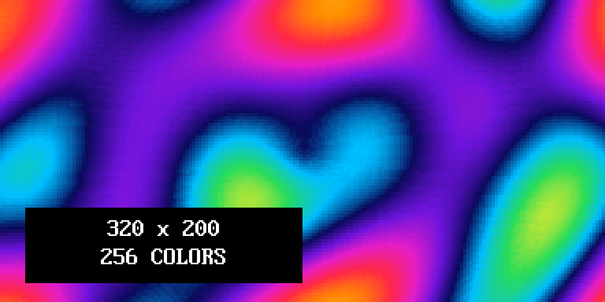

# VGA

## What it shows

The climb from the EGA to the VGA, after the rotozoomer's degauss. The [plasma](../plasma) in sixteen colours, as a
16-colour plasma's palette had them: each pixel's place on the colour ring picks one of the sixteen in their order
(black, blue, green, cyan, red, magenta, brown, light grey, dark grey, then the bright ones), so it comes out
striped and garish, with greys and browns in it. The [degauss](../rotodg) cuts into it half way through its jolt,
and it runs on for 2.5 s in all. It crossfades into CompuServe's page arriving over half a second: a forum message
with the real mode 13h code (`mov ax,13h` / `int 10h` / `mov ax,0A000h` / `mov es,ax`) in the IBM's 40-column
text, the cursor blinking, held 2 s. Then a hard cut back to the plasma, still in sixteen colours, for 8 frames,
and the 256 colours wipe down over it in half a second, 16 rows a frame behind a white line, so the stripes turn
into the smooth rainbow. As it lands, the VGA's brag comes up in the lower left in its own 8x16 font, white on a
black box, 320 x 200 / 256 COLORS, for 3.5 s.

The segment renders three things. `video.rgb` is 44 frames at 192x96: the 16-colour plasma of the plasma's frames
48 to 77, then 90 to 97, then the wipe over 98 to 103. `video_hd.rgb` is 30 frames at 1536x768: six frames of the
crossfade into the page and 24 of the page. `brag.rgba` is the brag's layer, 704x192 pixels of RGB and cover.

In the film the [degauss](../rotodg) shows `video.rgb`'s first 8 frames, and the cut then takes, in order:

    seg vga vga/video.rgb 8 22 192x96
    seg vga vga/video_hd.rgb 0 30 1536x768
    seg vga vga/video.rgb 30 14 192x96
    seg plasma plasma/video.rgb 104 100 192x96
    over vga/brag.rgba 704x192 64 528 0 42

## Why it's hard on CARDIAC

- **Text is a font,** and the page is 1280x768 pixels on the frame.
- **A crossfade is a product a pixel,** a + (b - a) j / 7, at 1536x768.
- **The plasma is the plasma's,** every wave and the ring worked out again for each pixel, and only then turned into
  one of sixteen colours.

## How it's done

**The 16-colour plasma** (per frame, per tile row): the plasma's own machines (`fx/plasma.rs`'s `places`: `pl_row`,
`pl_ring`, `pl_rings`, `pl_wave` twice, `pl_slant`, with `pl_clock` once a frame) work out each pixel's place on the
colour ring (0..511, the paint machines' input). The host fetches its colour's code from `data/ansi.txt`, a table
printed ahead of time that holds a code for every place 0..511 (the place mod 256, by sixteenths), and `paint16`
([shared](../shared)) colours the codes from `data/ega.txt`, the EGA's sixteen colours with colour 6 the brown (170,
85, 0) and not dark yellow. For the wipe, `data/wipe.txt` is a schedule printed ahead of time in Python that gives the
edge's row a frame (16, 32, ... 96). By it the host copies the rows above the edge from the plasma's own frame
(`plasma/video.rgb`), files the edge's row from a row `paint16` painted white (the EGA's colour 15), and leaves the
rest as the 16-colour frame. Each frame's `pl_clock` is dealt the frame and where its count starts among the plasma's
frames (48 for the intro, 60 after the page).

**The page and the crossfade** are the UI kit's text pages ([`ui`](../ui), `pages.rs`'s `COMPUSERVE`,
`fx/text.rs`): `ui_page` places each character that has arrived and the cursor after the last; the host fetches each
glyph's cell from the atlas's IBM CGA 8x8 face by its code (each page pixel 4 x 8 on the frame); deep's `umix` lays
its ink and paper on. How many characters have arrived at step j (252 j / 6) and the crossfade's cover (32 j / 7)
are `ui_ease`'s; the cursor's blink, six frames on and six off from the page's first frame held, is a sum and two
divisions on the train's operations. The crossfade mixes each pair of pixels that meet on the frame once (the
plasma's 8 x 8 blocks against the page's 4 x 8 pixels), on `umix`, and the host files each where it meets.

**The brag** is a page too (`VGA_BRAG`, 176x48 in the VGA 8x16 face, two lines centred), shown four times over on a
black box: a layer with every pixel's cover 32, for the cut's `over` line.

The host deals and fetches (the plasma's pixels, the glyphs' cells by their codes, the pairs of pixels to mix) and
files the colours, the page's pixels and the mixed pairs where they go on the frame.

`card-attack vga refs/vga_ref` says identical 44/44 (192x96), 30/30 (1536x768) and 1/1 (the brag).

**Instructions:** 501M. The 16-colour plasma and the wipe take 351M for 44 frames, 8M a frame (`pl_row` 99M,
`pl_ring` 93M, `pl_wave` 68M, `pl_slant` 38M, `pl_rings` 32M, `paint16` 21M); the 1536x768 frames 150M for 30,
nearly all `umix` (the glyphs' inks and the crossfade); the brag 0.1M.

## Against the prototype

The 16-colour plasma, the page (every frame of it, the cursor's blink included) and the brag are the prototype's to
the pixel. The crossfade steps in 32nds, not 7ths (32 j / 7 rounded down, as the kit's covers), and rounds toward
zero: within 8 of 255 of the prototype's, most within 3. The prototype is not in this repository.

## Numbers

| Number | Largest | Margin |
|---|---|---|
| A place on the colour ring | 511 | 488 |
| A place on a page (`ui_page`) | 424 | 575 |
| A colour | 255 | 744 |

## Machines

| Machine | Cells | What it does |
|---|---|---|
| `paint16` | (shared) | The sixteen colours' codes to colours |
| `pl_clock`, `pl_row`, `pl_ring`, `pl_rings`, `pl_wave`, `pl_slant` | (the plasma's) | Each pixel's place on the colour ring |
| `ui_page`, `ui_ease`, `umix` | (the UI kit's, and deep's `umix`) | The page, the steps and covers, the glyphs' inks and the crossfade |

## Files

- `data/make_data.py`: makes the assets `data/ega.txt` (the EGA's sixteen colours), `data/ansi.txt` (the code for
  each place on the ring) and `data/wipe.txt` (the wipe's edge a frame).
- `reference.rs`: draws every frame in ordinary Rust, the plasma from `plasma/formula.rs`, the page by `ui/text.rs`,
  the crossfade by the formula.
- Host: [`host/src/fx/vga.rs`](../../host/src/fx/vga.rs). It files `video.rgb`, `video_hd.rgb` and `brag.rgba` (not
  kept).
